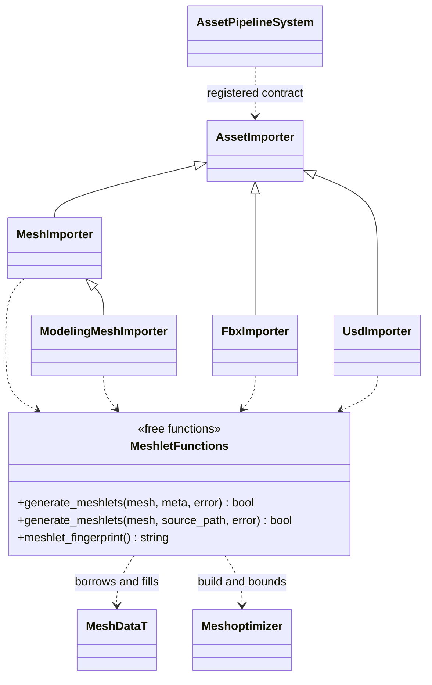

# Meshlet 离线生成

状态：**已实现**。本页定义编辑器职责；
持久模型、运行时开关和 GPU 执行契约见[Meshlet 与 GPU 剔除](../../runtime/class-diagrams/meshlet-culling.md)。

## 导入关系



`MeshletFunctions` 是自由函数集合的图示，不是 C++ 类。
实现放 `src/engine/editor/mesh/meshlets.cpp`，声明放 `include/engine/editor/mesh/meshlets.hpp`，
供已有基础 Mesh 导入器及 asset_import 插件借用；不进入运行时目标。

`AssetPipelineSystem` 继续拥有任务调度、目录、数据库和候选发布；
原有导入器继续持有本类型的识别、meta、依赖与工具指纹。
调用顺序为顶点拆分／切线完成、生成静态 LOD、生成各级 Meshlet、校验并发布候选。
不在运行时临时聚类，不为此增加独立插件或线程池。

## 自由函数与输入

```cpp
[[nodiscard]] bool generate_meshlets(schema::MeshDataT& mesh,
                                     const toml::table& meta,
                                     std::string& error);
[[nodiscard]] bool generate_meshlets(schema::MeshDataT& mesh,
                                     const std::filesystem::path& source_path,
                                     std::string& error);
[[nodiscard]] std::string meshlet_fingerprint();
```

配置沿源资源相邻 `.meta` 保存：

```toml
[meshlets]
enabled = false
```

资源生成只提供一个选择：默认数据（enabled=false）或生成 Meshlet 专用数据（enabled=true）。
后者保留关闭场景功能及不适用通道所需的普通几何，专用数据仍属于同一个 Mesh GUID。
场景只有一个统一使用开关，不再要求对每个 MeshRenderer 分别启用。
首期每个 Meshlet 上限固定为 64 个顶点、124 个三角形；
大小、算法、上游版本与工具修订一起进入指纹，不提前开放一组未经验证的优化参数。
Model 虚拟包中的每个静态 Mesh 子资源应用同源设置，沿已有子资源身份保存结果；
混合源中的蒙皮网格不生成，并报告明确原因。

表参数重载借用生成模型与只读 meta，不操作文件系统、GUID、数据库或 GPU；
源路径重载仅读取相邻 meta，再调用同一生成逻辑，供现有导入器接入。
它在临时候选中生成 LOD0 和各静态 LOD 的数据，全部通过后一次替换；
失败返回 false、给出英文 error，输入资源保持完整旧值。
关闭导入开关时清空候选中的 Meshlet 数据，不改变原拓扑。
蒙皮等不适用类型不产生 Meshlet；空网格仍按已有 Mesh 合法性契约拒绝。实际数量必须读回。

## 生成与校验

1. 各级按实际子网格分别调用所选 meshoptimizer 的 `meshopt_buildMeshletsScan`；
   不在不同材质、不同 LOD 之间混合三角形。顺序扫描保留原三角形顺序，避免等深度表面的覆盖次序变化；
   不为增加分簇紧凑度重排原拓扑，源索引局部性较差时可能增加簇数量。
2. 将上游局部索引展开为同一 Mesh 顶点数组的全局索引，保留每个三角形的顶点顺序及绕序。
   不调用会改变 provoking vertex 的重排模式，也不修改原始索引／碰撞数据。
3. 使用 `meshopt_computeMeshletBounds` 计算局部保守球和法线锥；
   不能可靠形成法线锥时禁用该 Meshlet 的背面测试。
4. 检查索引范围、3 的倍数、材质区间、数量乘法溢出、有限边界及精确三角形覆盖。
   重复三角形按重数验证；不能只比较总数或去重后的集合。
5. 对同一输入、设置和工具版本生成确定结果；meta 改动或上游指纹变化触发现有增量导入。
   不变输入不重写 GUID、源资产或缓存。
6. 缓存／包格式按当前单一版本重新生成；一次失败不能发布半套 LOD 或 Meshlet。

新增数据仍属于一个 Mesh GUID 的负载，不建立 Meshlet 依赖节点。
生成物沿 `cache/gen/<GUID>` 和现有运行目录发布，编辑器源与 SQLite 不进入运行包。

## 关闭导入与发布边界

`[meshlets].enabled=false` 表示下一份成功导入的 Mesh 负载不含 Meshlet 数组，
仍保留原顶点、索引、材质分组和静态 LOD。保存 meta 后按原 GUID 增量生成候选，
完成校验后才发布；不直接删除运行中仍引用的数据。

正在运行的旧版本在安全热重载或重新加载前仍有效。导入失败继续保留完整旧版本并报告失败，
不能把“设置已保存”报告成数据已移除。新目录／包生成并发布后，新加载才使用不含 Meshlet 的负载。
已有导出包、其他设备已安装包不会随本机 meta 修改而改变，需要重新打包和部署。
历史缓存和旧包按原资源管线的回收规则处理，不因关闭功能清空整个 cache。

资源生成选择不改写场景总开关：场景已开启时，无附加数据的网格正常使用普通绘制，
并报告 missing data；重新开启导入时从原美术源生成，保留资源 GUID。
临时停用使用场景的唯一总开关，处理边界见
[运行时生命周期](../../runtime/class-diagrams/meshlet-culling.md#开关与关闭后的数据生命周期)。

## 编辑器与 MCP

扩展现有资源命令登记位置，与静态 LOD 命令同层：

| 命令 | 输入 | 结果与副作用 |
| --- | --- | --- |
| `get_meshlet_import` | `path`：assets 相对源路径 | 保存的 enabled、每个 Mesh GUID 的各 LOD Meshlet／三角形数和未生成原因 |
| `set_meshlet_import` | `path`、`enabled` | 只更新 meta 对应表，保留全部身份及无关字段；变更走既有增量导入，完成导入后返回真实 revision／imported 状态 |

MCP 只适配编辑器命令，不直接调用 meshoptimizer，不写 gen；
命令沿用现有 LOD 导入命令的完成／失败返回，成功后读取已发布目录；不新增一套 Job 或轮询接口。
场景总开关由现有 EnvironmentComponent 的统一属性编辑处理，TS 与场景编解码同步新增字段。
MeshRenderer 不增加该功能的字段、方法或覆盖属性；调试视图经独立编辑器诊断命令临时控制。

公开标准场景的资源、生成方法和项目测试统一维护于
[Showcase 标准场景](../../../projects/showcase/docs/meshlet-culling.md)。
私有真实资源只通过同一通用导入契约本地生成，不增加私有项目专用分支。
