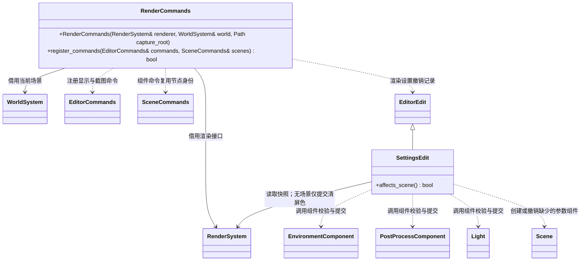

# 渲染编辑命令

[类图索引](../../class-diagrams/index.md)



编辑器决定截图目录并检查相对路径；渲染器只接收明确的文件路径。渲染设置由编辑器直接调用组件提交并负责失败回滚与撤销，RenderSystem 不再提供跨组件写入口；截图是异步请求，回执中的 pending 不代表文件完成，get_frame_capture 返回真实完成状态。

`set_render_stats` 要求唯一的布尔参数 `enabled`，调用渲染系统的统计面板开关并返回保存的状态。该命令跨待机、场景预览及玩法生效，不进入撤销历史，不改变场景保存状态。

`set_render_settings` 有活动场景时编辑 EnvironmentComponent、活动相机节点上的 PostProcessComponent 与方向光参数，修改进入撤销历史并标记场景未保存。环境参数缺少组件时由编辑器创建普通环境节点，相机后处理缺少组件时附加到活动相机；阴影参数要求场景已有方向光。撤销同时移除本次自动创建的节点或组件。设置由场景保存、导入和重载。

无活动场景时只接受 `clearColor`，通过渲染器最小待机清屏接口修改；其他设置明确拒绝。其 edit 可参与批处理失败回滚，用户级撤销、重做仍遵守当前活动场景身份约束。`SettingsEdit::affects_scene()` 返回 false；不创建场景。编辑器不把场景参数写到项目脚本或核心全局覆盖值。

宿主独占 RenderCommands，命令注册和撤销历史释放之后销毁它；渲染系统与世界的有效期覆盖命令对象。

## RVT 实时调试

复用 RenderCommands 与现有 MCP 渲染工具，不新增编辑器专用缓存或另一套 UI。
原生设置、查看器与帧证据只在[RVT 类图](../../runtime/class-diagrams/runtime-virtual-texture.md#mcp-实时贴图查看器)定义。

- 开启：set_render_feature 参数 {"feature":"rvt_viewer","enabled":true}；关闭用同一请求的 false。
  继续路由 set_render_debug_feature，不需要 sceneId/nodeId，不写场景、项目设置或撤销历史。
- 新增 set_rvt_debug_options，只接受 mode、channel、mip 的完整结构，原子调用原生设置接口。
  默认 overview/base_color/-1，无需额外配置便能看到实时虚拟概览、物理图集和页表。
- 新增 get_rvt_debug_options，返回临时 options、debug revision、rvt_viewer 的 feature 状态、
  RvtStatus 和最近实际帧中的 debug revision/visible。协调线程只查询快照，不推进页更新或执行回读。
- get_render_features 的诊断列表增加 rvt_viewer；页面表面诊断仍为 rvt_pages/rvt_residency/rvt_invalidated。
  开关改变不会操作 EnvironmentComponent.rvt.enabled；两种用途必须清晰区分。
- setter 受理不代表面板已经显示。自动化按 debug revision 与实际帧 visible 等待，再用
  capture_frame/get_frame_capture 归档；关闭后同样等待不可见帧，不能截到上一帧面板。

示例参数，工具名由上文指定，均为目标契约：

```json
{"feature":"rvt_viewer","enabled":true}
```

```json
{"mode":"overview","channel":"base_color","mip":-1}
```

界面上任何通道/模式选择都使用相同临时设置接口，MCP 可完成全部切换，不依赖鼠标操作。
测试运行的直接控制入口只在显式测试构建装配，不把编辑器命令类链接进正式运行时。

## 现有场景渲染参数

AO 字段 `aoEnabled`、`aoRadius`、`aoStrength`、`aoPower`、`aoFadeStart`、`aoFadeEnd` 属于后处理域，与曝光共用活动场景相机的 PostProcessComponent、快照和撤销记录。编辑器沿用已有后处理组件准备流程，缺少活动相机时拒绝；运行时核心不创建组件。AO 参数由同一场景保存链落盘，不添加独立编辑器覆盖状态。

`hdrEnabled`、`bloomEnabled`、`bloomThreshold`、`bloomIntensity`、`bloomRadius` 同属后处理域。一次 `set_render_settings` 可原子提交 HDR/Bloom 的两个开关；最终状态必须满足 Bloom 依赖 HDR，不因参数遍历顺序不同产生部分修改，也不自动改变未提交开关。失败回滚本次新建组件，成功进入同一撤销、重做和保存链。

级联阴影使用同一 `set_render_settings` / `get_render_settings`，字段为 `shadowCascades`、`shadowDistance`、`shadowSplitLambda`、`shadowCascadeBlend`。修改归方向灯域，实际变更要求已有启用方向灯，缺少时拒绝而不创建灯；阴影关闭且全部值未变化的空操作沿用原有成功语义。撤销和重做保存整份对应 Light 组件快照。级联数只接受 JSON 整数 1、2、4，其他数值遵循 Light 契约。
