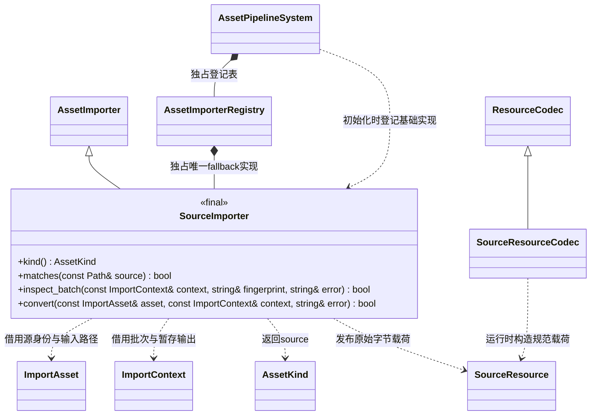

# 通用数据资源导入

[类图索引](../../class-diagrams/index.md) · [导入接口](asset-importers.md) · [资源载荷](../../runtime/class-diagrams/resource.md) · [资源读取脚本接口](../../plugins/runtime/class-diagrams/resources-script-api.md)

通用配置和二进制文件复用已有 `SourceImporter → source / SourceResource`，按原始字节进入标准资源管线。文本与二进制是读取方式，不新增 TextImporter、BinaryImporter 或每种配置格式的资源类。

SourceImporter 属于 `engine::editor::asset_pipeline`，继续留在编辑器基础层现有 `src/engine/editor/asset_pipeline/importers/source_importer.hpp/.cpp`。它不依赖具体编辑器插件；SourceResource 与 SourceResourceCodec 属于运行时核心，完整方法只在各自所属图定义。kind 为 const noexcept，matches/convert 为 const，inspect_batch 为普通重写方法；均 override、nodiscard。

## 选择、载荷与依赖

- 登记表仅在没有具体导入器匹配时选择已登记的 SourceImporter；具体格式导入失败不能回退到 source。显式 meta 的 importer 必须有效，不能因名称未知静默改写。
- `.json`、`.txt`、`.csv` 以及无专用导入器的二进制文件均可按 source 发布；识别不建立配置格式列表。保留原文件名、逻辑路径、扩展名和唯一邻接 meta GUID，生成物仍为 `cache/gen/<完整GUID>`。
- convert 原样复制字节，允许空文件，不校验 JSON/TOML/CSV 语法，不判断 UTF-8，也不转换换行、BOM 或字符串内容。体积边界与运行时 SourceResourceCodec 一致，超过上限在发布前失败；完整实体仍由管线封装并校验。
- SourceImporter 不解释内容中的路径或 GUID，不自动创建资源依赖。显式精简包由项目清单列出配置及实际使用的资源入口，管线继续收集标准资源的真实依赖。
- GUID、meta、增量指纹、SQLite、依赖调度和整批原子发布仍由管线负责；导入器只提供自己的指纹与字节转换。失败保留已有发布版本。
- 通用数据导入在关闭 `editor/asset_import` 插件时仍可使用。该插件继续承担 FBX、USD、字体、UI 等确实需要格式解释的导入。

## 目录与版本

目录 schema_version 为 3，资源实体使用 ERS2 前缀与 format_version=2。类型表不含配置格式专用种类；所有生成结果、宿主登记和工具校验使用当前类型表。旧目录或实体明确失败，需重新生成缓存与运行包，不在运行时转换旧数据。源资源 meta 使用 importer=source，保留已有 GUID；未知 importer 不静默改写。

脚本先获取资源句柄，再调用通用读取接口；JSON.parse、其他格式解析、字段校验和配置版本由项目负责。资源层保证字节有效与生命周期，不保证业务配置可用。其他模块因其协议或格式而使用 JSON 的职责保持。
