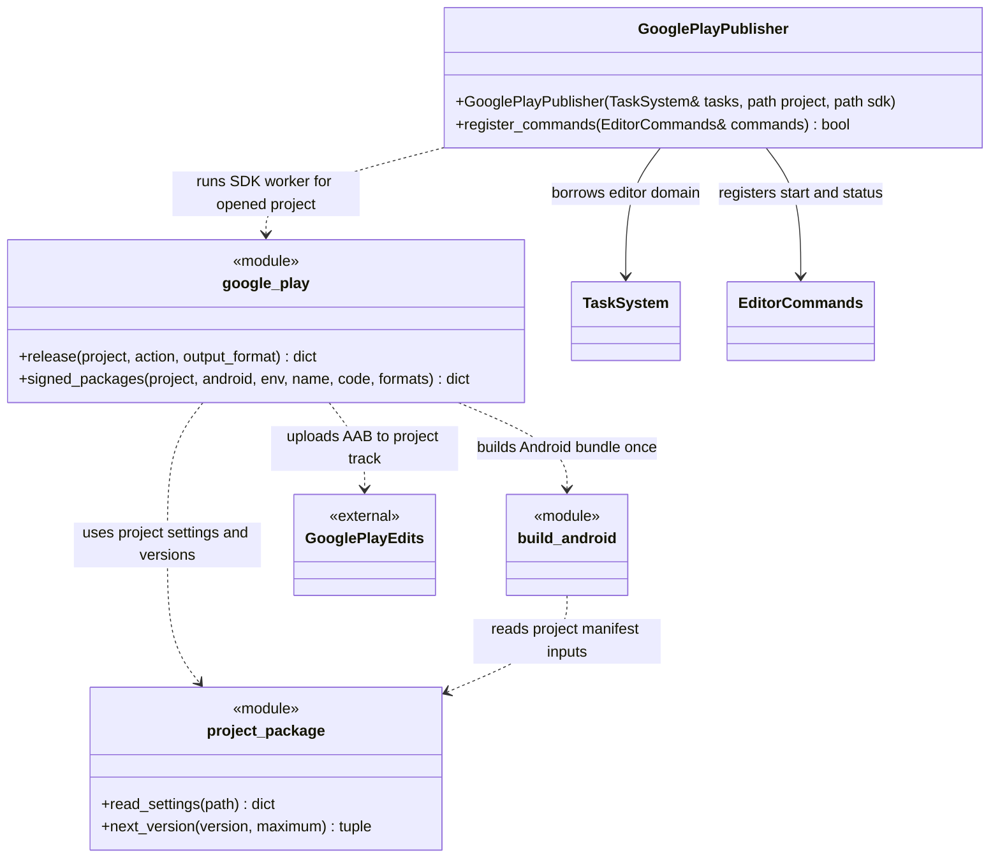

# Android 出包与 Google Play 发布

编辑器宿主借用任务域，向当前项目提供 APK、AAB 构建和发布命令。`project_package.read_settings` 将项目填写的应用身份、版本和可选覆盖与引擎的 Android 默认设置合并。`build_android`、签名包校验和编辑器预检使用相同的有效设置。编译 SDK 由框架选取，默认成品为 APK 和 AAB。签名构建读取 `[android.signing]`，从上传密钥库导出的证书用于验证两种成品。发布时 `google_play` 从独立的 `[google_play]` 读取帐号和轨道。[项目配置字段](../google-play.md)

