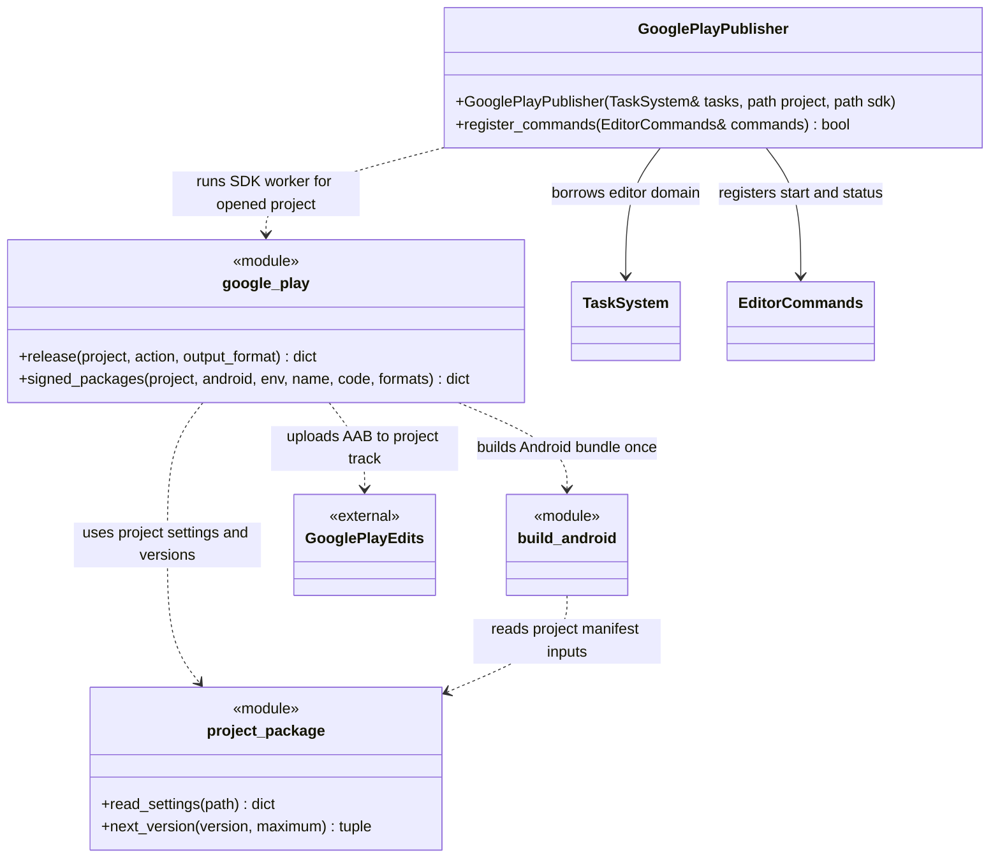

# Android 出包与 Google Play 发布

编辑器宿主借用任务域，向当前项目提供 APK、AAB 构建和发布命令。项目在 `settings/editor-android.toml` 的单一 `[android]` 表中配置应用清单、版本策略、输出格式、签名引用和商店轨道，密钥及成功回执留在同一项目的私有目录。框架按项目配置构建一次 Android 资源和原生库，从同一签名包导出所选格式。发布仅将 AAB 交给对应商店轨道。

