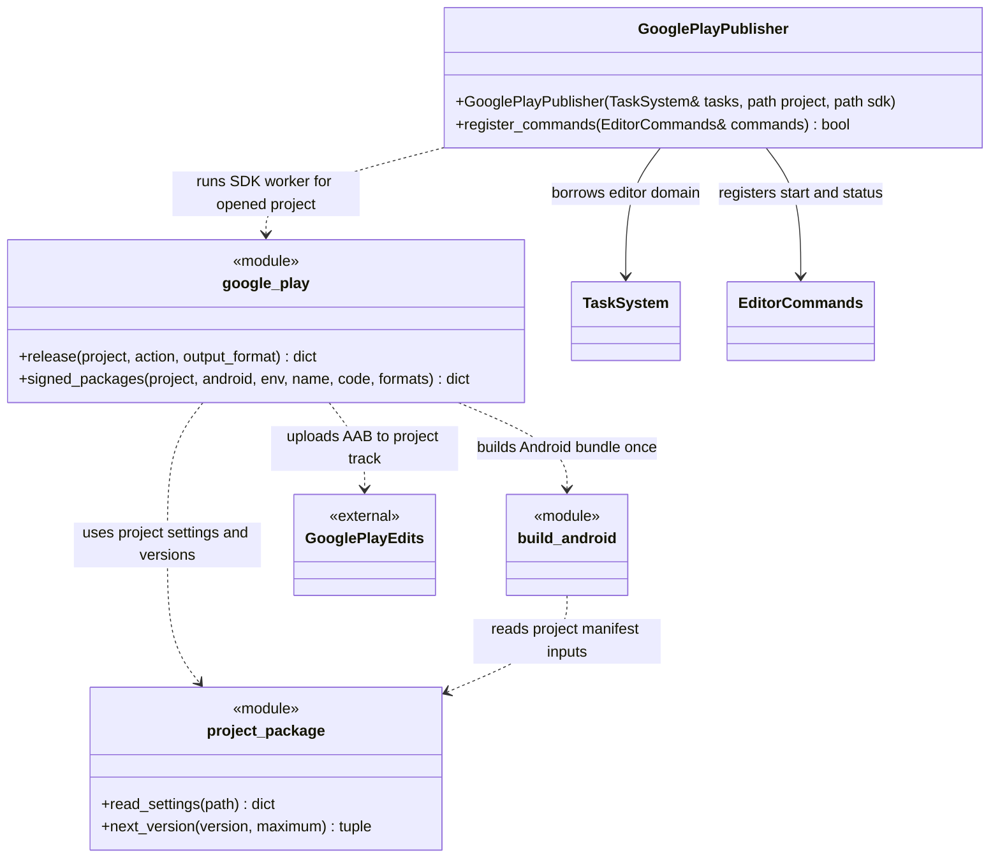

# Android 出包与 Google Play 发布

编辑器宿主借用任务域，向当前项目提供 APK、AAB 构建和发布命令。`project_package.read_settings` 从项目的 `settings/editor-android.toml` 读取分组配置。`build_android` 使用 `[android]` 和 `[android.version]` 生成应用清单，签名构建同时使用 `[android.signing]`，发布时由 `google_play` 使用独立的 `[google_play]` 表选择帐号和轨道。签名口令直接从配置读取，密钥库与服务帐号文件按配置路径定位。框架从同一次 Android 构建导出所选格式。[项目配置字段](../google-play.md)

