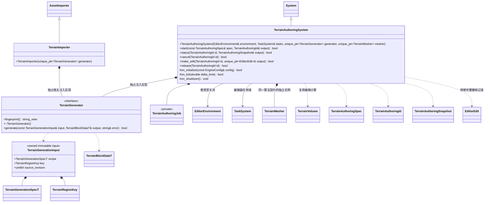
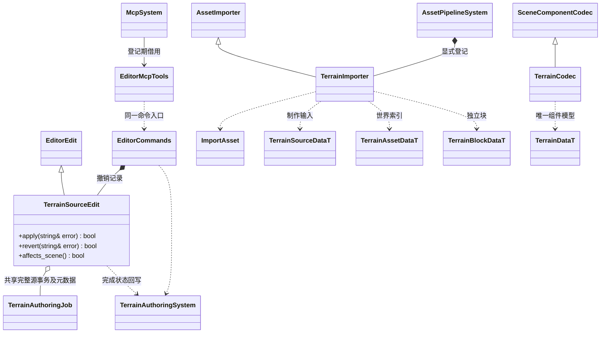

# 地形制作、资源发布与 MCP

[总入口](../../runtime/terrain-world-design.md)。
编辑器使用同一体积/网格算法，拥有制作源、撤销和作业；不保留只改预览内存却丢失源修改的旧制作流程。

## 制作算法与作业

生成器只做输入到体积块的纯计算，具体噪声库不出现在公共类型中；
默认实现可组合 FastNoise2、heightmap、stamp 和道路控制折线，固定种子/坐标/输入指纹。
fingerprint() 是实例生命周期内稳定、非空的实现/算法版本标识；generate 为可并发调用的 const 纯计算。
宿主分别向 TerrainImporter 和 TerrainAuthoringSystem 转移所选生成器的独立实例，导入器不创建默认实现。
导入指纹、局部块缓存、作业恢复记录均包含该指纹；算法变更时源 GUID 不变，旧算法结果不得复用。
编辑器和运行时算法对象分别拥有 scratch，不能并发借用不安全的全局实例。
新增依赖只进所属制作目标，不将噪声图编辑器或 Godot 运行时引入正式核心。

TerrainGenerationSpecT 是 editor Schema：bounds、origin、采样尺度、种子、噪声图、内嵌高度样本、
材质层、印章和道路。TerrainSourceDataT 在 recipe 外保存 revision 和有序 edits。
道路控制点、宽度、falloff 和层权重形成同一体积，不另存高度场碰撞。

TerrainAuthoringSpec 只含 path、expected_source_revision 和完整 source，不再为每个配方步骤包装一个 System。
所有制作改动都有持久配方；运行修改使用独立分块 checkpoint。树/石/建筑继续使用普通实例和分区场景，
专用 scatter 配方与二进制制作源块 delta 尚未实现；不将其列入 get_terrain_capabilities。

AuthoringId 含编辑器会话与单调序号。Snapshot 返回阶段、进度、source revision、
输出路径/GUID/hash、可取消/可发布状态、error_code/error。
queued → preparing → ready_to_publish → published，另有 failed/cancelled；
published 表示源事务完成，不能代替资源导入、运行就绪或截图完成。

## 源文件、导入和撤销

TerrainImporter、TerrainCodec 保留既有 AssetImporter/SceneComponentCodec 的统一方法签名，
只替换内容模型；不增加专用管线/资源数据库。Importer 负责识别、meta、依赖和指纹，
管线负责任务、数据库和原子目录发布。

- .terrain 为 TOML 制作描述，包含 recipe 与有序 edits；相邻 meta 保存唯一身份。
  当前不读写 .terrain-region 制作文件，不包含 GPU/Jolt 数据或本机路径。
- 运行索引及块采用既有虚拟子资源发现机制，子资源 key 用稳定整数块坐标/LOD，
  GUID 登记于所属源 meta，重建不换身份；复制资源生成新身份。
  删除块引用后按目录闭包处理，不在运行时根据旧 GUID 猜新块。
- 输出只在 cache/gen/<完整GUID>，目录/SQLite 留在 cache 根。runtime 只读当前二进制，
  不解析 .terrain/TOML/源噪声图。块走 stream_dependencies，合成 surface 材质及数组为实际驻留依赖；源层材质仅为构建依赖。
- source meta 的生成精度、边界规则、层纹理导入设置及算法指纹影响增量；
  生成缓存根据块坐标和局部 recipe 命中；相同块不重复计算。普通资源管线仍统一建立目录和原子发布。
- 作业准备在 cache/terrain-authoring/transactions/<source hash>/，不修改正式源。ready 后 make_edit 交出完整候选；
  EditorCommands 执行 TerrainSourceEdit，先校验源 revision、路径和输出 GUID 冲突，
  在项目资源锁内发布文件/meta，最后发布源清单，失败恢复旧清单。
- 同一 job 只能成功发布一次；重复查询不创建文件。中断恢复按作业 journal/哈希判断，
  不能盲目重发 generate 或覆盖已有源。旧源/数据保留至撤销历史释放。
- undo/redo 交换完整源描述及稳定 meta，不在 apply/revert 中全体积计算或等待 GPU。
  退出项目先释放命令历史再销毁 authoring，避免撤销记录借用失效。
- 源发布后沿用普通导入/目录更新/热重载。预览继续复用 TerrainSystem 准备新内容，
  未完成时保留旧有效预览；导入失败应报告 source_published/import_failed 并可重试，
  不能声称原文件没写，也不能把 ready_to_publish 当作场景已经可用。
- 文件修改的 affects_scene=false，场景组件/道路节点修改走各自现有可撤销命令；
  整套制作的 checkpoint 明确记录各项结果，不能声称不同文件和物理副作用天然全局可撤销。

## MCP 全流程

新命令属于编辑器地形插件，工具 schema 由命令登记共享。下表列出当前入口。

| 操作 | 目标入口 | 完成条件 |
| --- | --- | --- |
| 查询能力/配置 | get_terrain_capabilities、get_terrain_source | 当前实现、支持操作、限制、设置与源版本 |
| 创建/生成/雕刻/画层/道路 | start_terrain_authoring，完整 TOML 配方与预期版本 | 返回 job ID，不阻塞等待 |
| 观察/取消/释放 | get_terrain_authoring、cancel_terrain_authoring、release_terrain_authoring | 可恢复的终态与输出 |
| 可撤销发布 | publish_terrain_authoring | EditorCommands 实际写源成功 |
| 设置场景地形 | set_terrain、get_terrain | 统一 TerrainDataT 读写，不加平行场景开关 |
| RVT 与诊断 | 环境组件设置、set_render_feature(rvt_viewer)、set/get_rvt_debug_options | 视口实时显示虚拟概览、物理图集和页表；开关/通道可自动控制，实际帧版本可观察 |
| 资源导入/构建/运行 | 既有资源与项目命令 | 导入完成、版本发布、SceneLoad active |
| 运行修改/状态 | terrain_request_*、terrain_operation_status、terrain_cancel_operation、terrain_query_regions | 复用 TerrainComponent 请求和查询 |
| 存档/重载/截图 | 原生保存请求、现有场景命令、capture_frame/get_frame_capture | 存档与实际帧身份对应 |

常规编辑操作仍可用 UI；UI 和 MCP 同时使用 EditorCommands，没有 AI 专用算法实现。
运行 terrain_request 用类型化 kind/spec 路由具体方法，不开放任意原生调用。
批次准备作业不塞进同步 execute_batch 假装可撤销；只有 ready 后的源发布记录进入撤销历史。
爆炸、模拟推进、临时脚本错误不提供自动回滚承诺。

MCP 回执表示命令受理/执行事实，job/operation 表示领域状态；以 session/request ID 查询已执行回执，
断线不重复创建世界或重复爆炸。编辑器重启后以相同 path/expected revision/source 重新提交，借助 source journal 恢复可发布作业，
临时运行 ID 则明确 session_expired，重新读取真实源/存档，不假装旧 Run 仍存活。

纯制作无需人工交互：路径、数值、种子、预制体、镜头、测试动作全部是结构化参数。
正常流程不打开文件选择器、不依赖窗口焦点/手工按钮；错误返回具体 code、对象和失败阶段，
AI 可查询、调整参数、重试尚未发布部分。需要真实图形设备的运行/截图不会伪造 headless 成功。

## 无人参与验收链

创建 8×8 公里源和层 → 批量印章/洞穴/道路 → 生成并发布 →
标准导入与场景保存 → 设置初始需求与 RVT → 构建并运行 →
等待加载与目标区域版本 → 固定镜头截图 →
跨区移动/挖地/建筑失去支撑 → 保存共同 checkpoint →
卸载重载 → 核对修改、碎块和碰撞 → RVT 开/关与诊断截图归档。

每一步保存输入、种子、源 hash、作业/请求回执、目录 revision 和截图帧证据；
失败归档最后真实状态，不靠固定 sleep 猜准备完成。
正式包剔除 MCP 运行端点/临时脚本，普通组件、加载、状态和截图能力仍可由业务使用；
运行测试端点只在显式 ENGINE_ENABLE_TEST_SUPPORT 构建装配。
