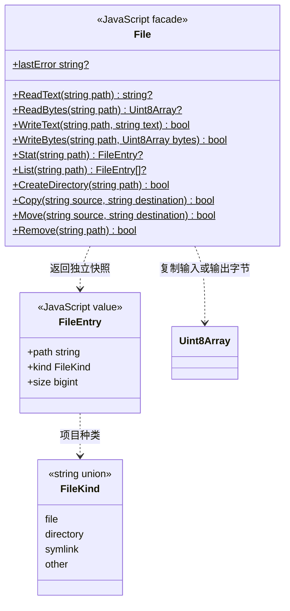
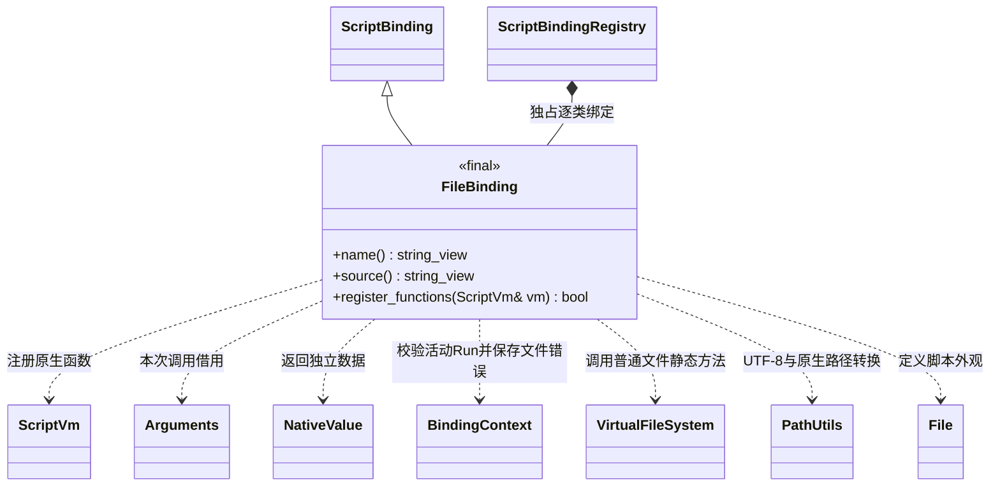

# 文件与目录脚本接口

[类图索引](../../../class-diagrams/index.md) · [核心文件类](../../../runtime/class-diagrams/virtual-file-system.md#普通文件与目录) · [资源读取](resources-script-api.md) · [绑定注册](script-bindings.md) · [VM 数据桥](script-vm.md#文本与二进制数据桥)

`File` 提供实际文件与目录操作；资源目录中的逻辑路径和 GUID 继续由 `Resources` 处理。本图方法均同步完成，适用于小文件和单层目录操作；不把它们描述为后台扫描或非阻塞接口。既有原生 `FileRead` 异步契约保持，脚本异步文件请求、分页扫描与文件监听不在本次接口范围内。

## 脚本外观

- `File` 不可构造，静态方法和只读属性冻结；只在活动 Run 的 Gameplay / UI 回调内可调用。候选预检、模块顶层及已停止 Run 返回 false/null，不执行磁盘操作，`lastError` 为 null。
- 路径为 UTF-8 表达的绝对原生路径，调用方可从 `App.persistentDataPath`、`App.cachePath` 或桌面 `App.assetsPath` 组合得到；不依赖进程工作目录，不自动补项目名，不接收资源 GUID 或 `builtin://` 逻辑路径。`apk:/assets/...` 只支持平台已实现的读取能力。Web 路径只对应浏览器虚拟文件系统；本接口不授予任意宿主文件访问，也不提供系统文件选择器。
- 文本与二进制的编码、大小及复制规则统一见 [VM 数据桥](script-vm.md#文本与二进制数据桥)。Read 返回独立字符串／Uint8Array；Write 在调用期间复制或借用输入完成写入，不持有 VM 内存。文件扩展名不决定读写方式，格式与字段由调用方解析。
- `Stat` 不跟随末端符号链接，返回该项快照；`List` 只列出直接子项，不含 `.` / `..`，不递归、不跟随子项符号链接。结果包含完整路径，按名称的 UTF-8 字节序排序。size 仅对普通文件有意义，其他项为 0n；以 bigint 保留 uint64 精度。
- Write、CreateDirectory、Copy、Move、Remove 的覆盖、失败及平台边界只在[原生文件契约](../../../runtime/class-diagrams/virtual-file-system.md#普通文件与目录)维护。脚本方法一一转发；不隐式创建父目录、递归删除、更新资源 catalog 或触发导入。
- 空文件返回 `""` 或长度为零的 Uint8Array，空目录返回空数组；缺失路径、非法编码、参数错误及 I/O 失败返回 null/false。`lastError` 保存本 Run 最近一次文件操作的错误，成功清空；只读错误查询不清空状态。Stat 对缺失路径返回 null 并报告原因。
- 本接口不新增线程池、System、全局文件缓存或 `FileSystemManager`。耗时操作的异步绑定需要单独明确任务注入、结果身份与 Run 收尾；不能直接在 worker 调用脚本 VM 或 UI。

## 绑定与所有权

`FileBinding` 位于 `engine::plugins::script::bindings`，三个方法为 const、override、nodiscard，name/source 为 noexcept。统一注册表 `add<FileBinding>()` 登记，QuickJS/V8 共用实现；声明统一进入 `include/engine.d.ts`。不新增原生 File 包装类，也不借用 ResourceSystem 内部的 VFS 或资源挂载。

BindingContext 只保存本 Run 的文件错误字符串，不拥有文件服务、目录索引或文件句柄；方法定义见[绑定上下文](script-bindings.md)。操作同步完成，停止／重载没有文件请求需要迁移；已返回的 JS 值随所属 VM 回收。
