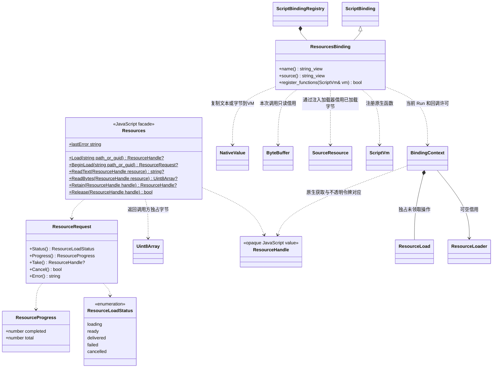

# 资源脚本接口

[类图索引](../../../class-diagrams/index.md) · [资源加载契约](../../../runtime/class-diagrams/resource-loader.md) · [业务接入](../../../runtime/class-diagrams/resource-consumers.md)

脚本接口直接使用宿主注入的 ResourceLoader。Run 持有每次获取和异步操作，不依赖默认资源插件；实现替换不改变业务流程。

通用数据由资源模块提供文本和字节读取，项目 TS 自行解析；配套导入契约见[通用数据资源](../../../editor/class-diagrams/source-importer.md)。

句柄是不可伪造的不透明对象。JavaScript 变量赋值不加引用计数，只有 Load、Retain 和成功 Take 创建独立获取；Release 撤销相应获取。句柄不能跨 Run 使用。

Status、Progress、Error 只查询；资源核心与插件由宿主 tick 推进。Take 仅成功一次，Cancel 不等待任务；Run 关闭取消操作并释放所有尚未交还的获取。新目录不使旧的已就绪获取失效，未完成请求按加载器契约终结。

场景先完成资源加载，再调用 Scene.Load 或 Scene.BeginLoad 返回的 SceneLoadRequest；影片把已加载句柄传给 Movie.Play。使用方会为自身的持续使用独立保活，业务可以在绑定成功后释放原始获取。

## 通用文本与二进制读取

- 两个方法只接收当前 Run 的有效、已加载 ResourceHandle，并通过注入的 ResourceLoader 查询规范 SourceResource。它们不接收路径，不打开文件，不重新加载资源，不访问 ResourceSystem 的底层实体工具，也不依赖具体 resource_graph 插件。
- 源载荷统一为 ByteBuffer。ReadBytes 返回逐字节相同的 Uint8Array；ReadText 严格解码 UTF-8，保留 BOM、换行和有效的 NUL 字符，不按扩展名解析 JSON、TOML、CSV，也不把非法编码替换成字符后报告成功。编码与字节桥唯一契约见[VM 数据桥](script-vm.md#文本与二进制数据桥)。
- 当前接口只消费 kind=source 的通用数据。Scene、Mesh、Texture、Shader、script 等仍使用各自类型契约；即使某种载荷也是 ByteBuffer，也不能通过强转或重新序列化冒充 source。
- 返回字符串和 Uint8Array 都是调用方独立快照，不借用原生资源内存。修改返回数组不影响共享资源；Release 后返回数据继续有效。每次读取产生一次新的内容副本，不缓存项目解析对象，不添加共享引用；同步复制及文本解码耗时由调用方承担。
- 空载荷返回 `""` / 空 Uint8Array；失效句柄、其他 Run 的句柄、类型不符、非法文本编码或超过 VM 输出上限返回 null，并更新本 Run 的 Resources.lastError。成功清空错误；纯错误查询不清空。活动回调之外不读取，返回 null，lastError 为 null。
- 加载可继续通过 BeginLoad 异步完成，读取操作本身不承担 I/O。业务完成读取后可立即 Release，随后在 TS 中 JSON.parse 或交给项目解析器。合法 JSON null 与读取失败不再混在同一个返回值中；配置语法及字段错误由项目处理。

ResourcesBinding 的三个重写方法均 const、override、nodiscard，name/source 为 noexcept。复用 BindingContext 的资源句柄校验及错误通道，不增加文本 System、二进制 Manager、JSON 值模型或原生解析结果缓存。

脚本声明统一维护于 `include/engine.d.ts`；数据格式和导入契约见[通用数据导入](../../../editor/class-diagrams/source-importer.md#目录与版本)。
