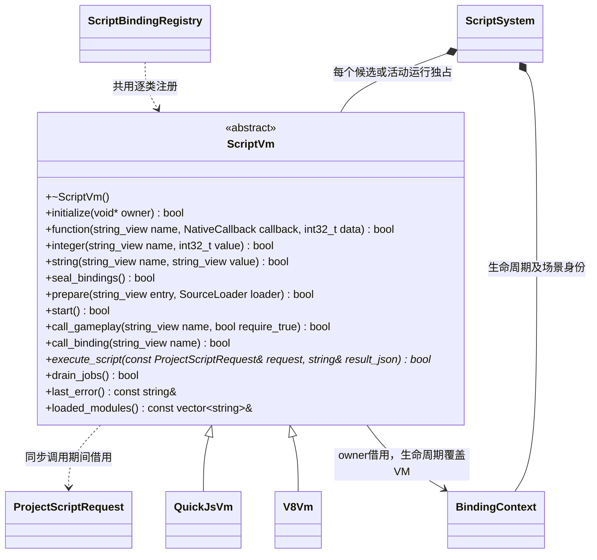
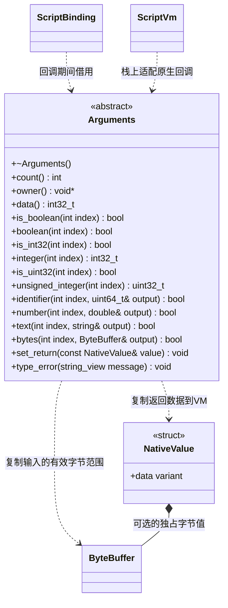

# 脚本虚拟机中间层

[脚本系统](script-system.md) · [逐类绑定](script-bindings.md)

`ScriptVm`、`Arguments` 与 `NativeValue` 位于 `engine::plugins::script::vm`，只属于脚本插件内部；核心 `ScriptRuntime` 仍位于 `engine`。中间层不改变核心的执行职责。参考 PuerTS 的
[PESAPI](https://github.com/Tencent/puerts/tree/master/unity/native/pesapi) 将原生调用与虚拟机隔离的思路，
只实现当前绑定需要的参数读取、标量及对象返回、模块预检和同步生命周期调用。

File 与 Resources 共用下述数据桥，不在逐类绑定内直接操作 QuickJS/V8 句柄。

每次构建只选择一个后端。CMake 的 `ENGINE_SCRIPT_BACKEND` 默认 `quickjs`，生成互斥的
`ENGINE_SCRIPT_BACKEND_QUICKJS` / `ENGINE_SCRIPT_BACKEND_V8` 宏，只加入选中后端的源码和依赖。
不提供运行时切换，也不同时部署两套虚拟机。QuickJS 使用固定版本 quickjs-ng；默认产物不含 V8/ICU。

`ScriptVm` 和 `Arguments` 均有公共虚析构，且析构为 `noexcept`。两者的查询返回值均不可忽略；
`ScriptVm::last_error/loaded_modules` 为 `const noexcept`，`Arguments` 的全部方法为 `const`，
其中 `count/owner/data` 额外标注 `noexcept`。`function` 的标签 `data` 默认 0。
`NativeCallback` 是 `void(const Arguments&)` 函数指针，`SourceLoader` 是返回 `bool`、
接收模块路径和字符串输出参数的函数；注册与读取不把 VM 句柄传入业务模块。

- `NativeValue` 用于返回临时标量、字符串、数组、命名对象及ByteBuffer；uint64 保持 BigInt，
  不把任意 JavaScript 对象或 GC 句柄交给业务绑定。读取严格检查类型，失败清空输出。
- 每个 Run 独占模块环境、Gameplay 和任务队列。候选只编译和链接静态 import 图，
  不运行用户代码；导入不存在的命名导出和传递依赖的顶层 await 在预检阶段失败，旧玩法继续运行。
  入口默认导出是否为 Gameplay 派生类在启动时验证，失败停止本次运行。
- 后端负责 GC、句柄、异常文本和模块执行；ScriptSystem 负责资源清单、生命周期顺序、
  场景调用权限和重载策略。JavaScript 异常变为 bool 与错误文本，C++ 不使用异常。
- 停止先调用 OnShutdown、清理 UI 订阅，再释放 VM 和本 Run 的场景；异步任务不能跨 Run。
  两后端共享 engine 模块的 JS 外观，保留 UI MVC 和 V8 热重载。

## 文本与二进制数据桥

文件与通用数据读取共用下述转换契约。ByteBuffer 沿用核心 vector<byte> 别名；NativeValue 的 variant 增加这一独占值，不新增 Binary 对象层、JSON 值模型或跨 VM 句柄。

- `Arguments::bytes(index, output)` 为 const、nodiscard 的虚方法，只接收 Uint8Array。按其 byteOffset / byteLength 复制实际视图范围，允许空视图；拒绝其他 TypedArray、普通 number[]、裸 ArrayBuffer、已 detached 的缓冲和共享内存视图，失败清空 output。后端实现保持一致。
- `NativeValue` 携带 ByteBuffer 时，所选 VM 创建独立 ArrayBuffer 和 Uint8Array 并复制字节。JS 可修改自己的副本；GC 生命周期不依赖原生资源或文件，不能将指向可释放 ByteBuffer 的内存直接交给 VM。
- 单次文本沿用 4 MiB UTF-8 字节上限，二进制桥为 64 MiB；在复制或分配前检查大小与范围，超限返回明确失败。输入字节缓冲按实际视图长度检查，不按底层缓冲全部容量计算。原生 SourceResource 大小规则见[类型处理器](../../../runtime/class-diagrams/resource-codecs.md)。
- 原生字节读取为文本时，先严格验证 UTF-8；有效文本保留 BOM、NUL 和换行，不做 JSON 语法校验或宽松替换。JS 写文本时拒绝不能无损编码为 UTF-8 的未配对代理项；正常字符串按 UTF-8 输出。路径额外拒绝 NUL，由文件边界负责。
- `Arguments::set_return` 保持现有 void 契约；参数、编码和大小错误先由绑定返回 null/false。VM 返回值构造失败继续通过已有 JavaScript 异常与外层调用失败机制报告，不保证内存耗尽后还能返回普通业务错误；不抛 C++ 异常、不触发业务解析。业务绑定不包含具体 VM 类型。
