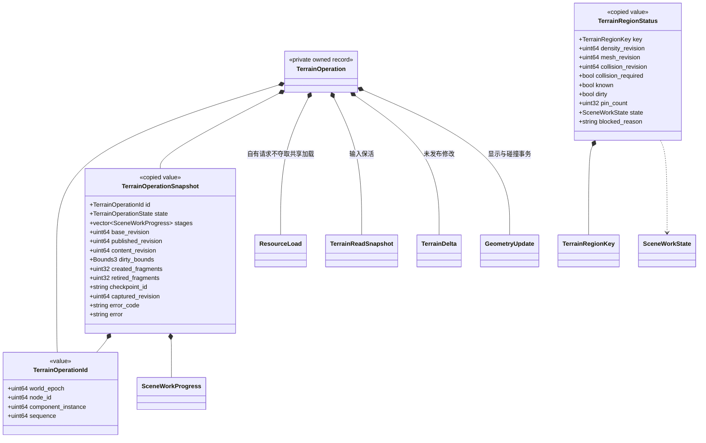
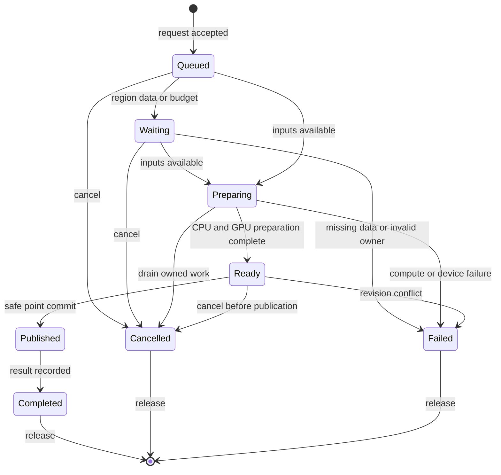

# 地形请求、状态与发布

[组件方法](terrain.md) · [区域算法](terrain-regions.md)

## 身份与状态值

ID 在组件生命周期内不复用，0 表示空身份；原生 uint64、TS bigint、JSON 十进制字符串。
操作记录有上限，终态显式 release 前不静默淘汰；销毁组件后原 ID 明确失效。
查询不推进计算、不扫描全场景、不触发文件读取或 GPU 操作；错误归请求，不能被别的请求覆盖。

SceneWorkProgress 复用现有状态/计数：residency、editing、meshing、collision、upload、
publication、persistence，单位分别明确为块、样本、块、形状、字节、批、字节。
total 未确定时 total_known=false；等待依赖有 blocked_reason，不能伪造百分比。

## 具体输入

| 值类型 | 必需字段与约束 |
| --- | --- |
| TerrainRegionQuery | world-space bounds、所需 LOD/质量、分页 cursor/limit；查询只观察，不隐含加载 |
| TerrainEditSpec | 可选 expected_revision、vector<TerrainBrushDataT> brushes；一次有界批次，支持 dig/fill/flatten/smooth/paint，形状与操作分离 |
| TerrainBrushDataT | world-space center/extent、strength、shape、operation、material_layer/weights；按 schema 判别，不做每种笔刷的平行接口 |
| TerrainCollapseSpec | bounds、可选 expected_revision、min_samples、fragment_cells、max_fragments、density、connectivity_block_limit |
| TerrainResetSpec | bounds、可选 expected_revision；恢复完整指定块并删除从这些块提取的碎块；跨界碎块来源不完整时拒绝并返回所需范围，不隐式扩大修改 |
| TerrainRetireSpec | max_count、max_age_seconds、可选 expected_revision；年龄按模拟时间，0 年龄不按寿命筛选 |
| TerrainSaveSpec | slot、checkpoint_id、expected_revision；安全持久槽，无任意绝对路径 |
| TerrainLoadSpec | slot、checkpoint_id、expected_base_hash；不跨基础资源偷偷转换 |

输入具体结构由所属 schema 或临时 struct 唯一定义，禁止原生、TS、MCP 各维护一份业务模型。
brush 批次有数量/影响块数上限；超限拒绝并报告限制，不拆成悄悄部分成功的多次编辑。
同 owner 的内容操作按接受顺序准备和发布，一次操作内部的块计算以及不同 owner 可以并行。
若提供 expected_revision，开始执行时不匹配即失败；省略则明确基于轮到本请求时的当前版本，
实际基线记录在快照 base_revision。发布前仍重验邻域，不能静默覆盖外部修改或偷偷重放请求。
LOD/视域变更不是内容修改，仍需匹配块和邻接依赖版本。

区域快照只在[当前需求与已发布区域](terrain-regions.md#当前需求与已发布区域)定义；
查询同时返回当前需求状态、目标与已发布身份、组件整体 revision 和片段数量，AI/编辑器可据此判断就绪或提交乐观校验。
分页 cursor 绑定本次 revision；版本变更使旧 cursor 明确失效，重新查询，不混合两版区域列表。

## 受理与终态

TerrainOperationState 使用 queued/waiting/preparing/ready/published/completed/cancelled/failed；
图内英文大写标签只为可读性。save 不改变场景，ready 后原子发布文件并完成；load/reset/edit/collapse
发布世界内容。published 是不可取消边界，不表示截图完成。

request 返回 bool 仅表示受理；拒绝输出空 ID 和明确错误。取消仅在发布前接受，
不撤销已发生的爆炸；取消过程中继续保活 worker/GPU 回读，完成清理才到 cancelled。
设备暂不可用可等待并记录原因，真实设备代次失效要丢弃/重建 GPU 候选，不能假报 ready。
暂停期间不发布玩法修改；取消和只读查询仍可执行。

初始场景的领域准备复用相同私有作业，但其候选附属于 SceneScopeId，不自行发布；
由 GameplaySession 的原始场景流程切入。活动场景修改才使用 GeometryUpdate。

## 同版本提交与预算

1. 捕获身份、基础哈希、内容与邻域 revision，pin 完整影响集合。
2. 共享任务域并行读取/计算修改块、LOD 过渡和碰撞描述；所有输出独占，旧状态继续可用。
3. GeometryUpdate 按帧准备 GPU 与 Jolt 候选，旧版本与候选共同计入预算。
4. 安全点重验身份、源版本、邻域、变换及几何候选；任一不符，整批失败/取消。
5. 成功切换几何后在同一不可重入安全点无失败交换 TerrainDelta，递增发布 revision，
   再允许物理查询、模拟和渲染；向调用方返回变化范围、稳定支撑身份与 content_revision。
6. 调用方决定建筑支撑/应力、导航失效和效果；渲染器根据新几何与材质使 RVT 页失效。

提交路径不进行 IO、网格提取、Jolt Shape 构建或等待 GPU fence。
每帧限制上传字节和发布批数，单次事务也必须有上限；不能用“每帧一次”掩盖一次全世界重建。
跨区事务超预算时明确拒绝，或由调用方显式拆成可接受的批次。
性能只按上述阶段接入现有 Profiler，不新建地形专用统计框架。

completed 证明所请求的发布完成。实际画面仍用现有帧/截图接口匹配世界代次、场景、
content_revision、device_generation 和 submission_id；RVT 额外证据见[其类图](../../../runtime/class-diagrams/runtime-virtual-texture.md)。
