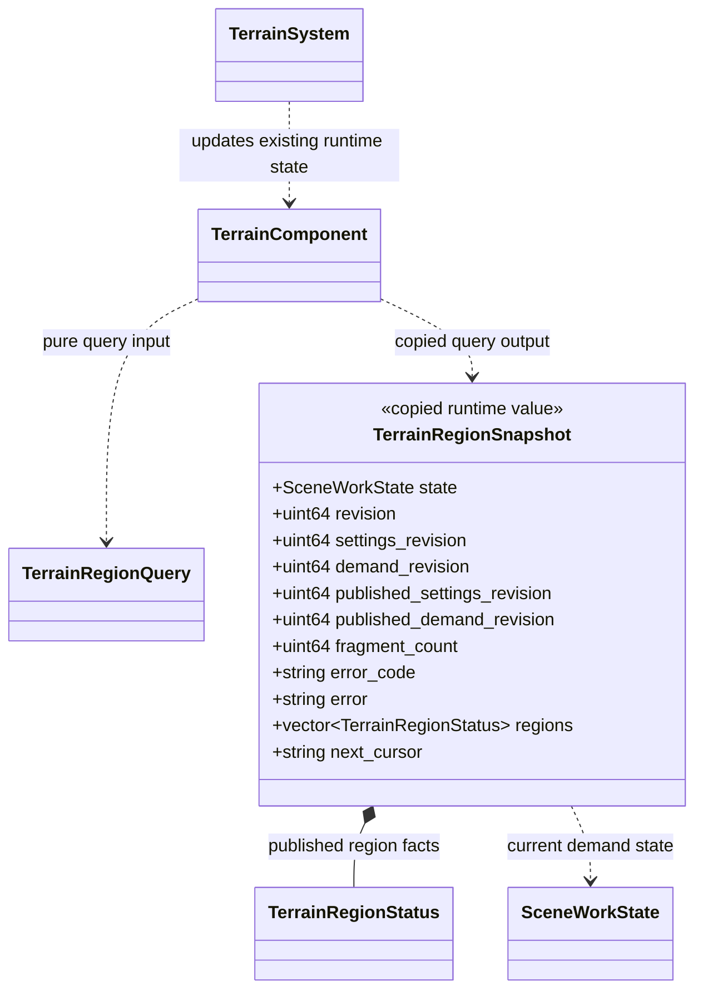
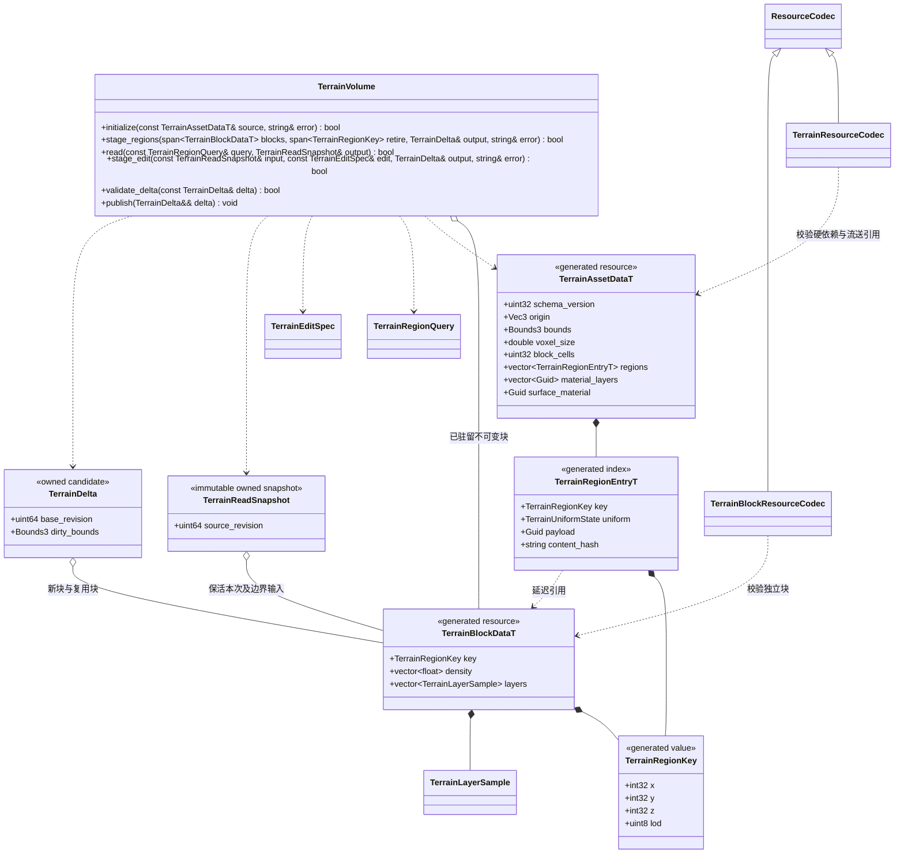
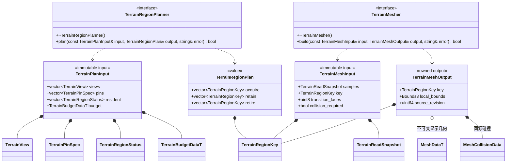

# 地形区域、流送规划与算法

[设计入口](../terrain-world-design.md) · [操作状态](terrain-operations.md)

## 当前需求与已发布区域

`TerrainComponent::query_regions(const TerrainRegionQuery&, TerrainRegionSnapshot&) const` 继续是唯一查询；
业务、脚本 GetRegions 与 MCP 使用同一快照，不增加第二套流送管理器或推进型查询。
state/error_code/error 描述当前设置和需求；revision、regions 描述仍可使用的已发布数据。
settings_revision/demand_revision 是当前目标，published_settings_revision/published_demand_revision 是最后成功发布的目标。
ready 只在两组身份匹配且没有失败时成立。准备中返回 working，失败返回 failed 并保留旧几何；
无效句柄或非法查询返回 false；有效但禁用的组件或节点不参与准备，状态为 not_required。修改设置/视域清除旧失败并建立新需求，查询本身不推进工作。
源尚未加载或当前变换失败时，合法的无游标查询仍返回状态与空区域列表，避免错误入口本身不可查询。

## 权威数据

Schema 是唯一持久模型。Bounds3 表示 double 的最小/最大世界或局部边界，使用处明确空间。
TerrainLayerSample 为稳定层 ID 和规范化权重；层 ID 不随编辑器列表排序变化。
RegionKey 有符号、相对地形原点，LOD=0 为权威精度，逐级采样间距加倍。
范围采用半开整数区间及 floor 除法，负坐标不能向零截断；块/世界大小在分配前检查溢出。

密度负实体、正空气，只保证有符号标量场，不假定布尔编辑后仍为精确距离场。
uniform=solid/air 无需密集载荷，mixed 必须有合法 GUID/hash；缺项、未加载和坏块是 unknown/error，
不能解释为空气。真实世界外边界由资源声明，流送窗口边界不能作为空气或固定锚点。

边界采样只有一个逻辑拥有者；halo 为派生只读副本，面、边、角归属一致。
跨块修改收齐拥有者及梯度/LOD 邻域，在一份 delta 内更新；邻域版本冲突取消或重算，不能发布半条接缝。
粗 LOD 是可重建数据，不用粗层覆盖细层编辑。

TerrainVolume 不读文件、不操作场景/GPU/物理。read 只读完整已驻留快照；
缺块由 TerrainSystem 经 ResourceLoader 获取，再通过 stage_regions 校验坐标、样本、层与
源索引身份并形成驻留候选；退出块也通过同一候选完成，不隐藏文件读取或另设加载器。
调用方负责加载器的 GUID/hash 校验、脏块及 pin 的退出限制。
publish 是内部安全点的无分配交换：
必须同安全点先验证版本，并与 GeometryUpdate 发布一起完成；不能由 worker 调用。

## 算法替换点

默认规划使用视域/距离与滞回，只输出计划，不加载资源或启动线程。实现必须满足预算、pin、
邻接 LOD 与公平调度约束。默认网格沿用固定 Transvoxel 并补齐 transition cells；
相邻差最多一级，过渡面归属唯一，粗细候选成组切换，准备完前保留旧覆盖。
不能以裙边遮住裂缝代替正确地下拓扑。

显示和碰撞使用同一修改版本；远景可仅粗 LOD，可交互范围必须具备细碰撞和约定精度的显示。
同版本不意味着两者细分数量必须相同。一个逻辑碰撞分区继续使用稳定 Collider/Jolt 分段复用，
不按每个 4³ 叶创建 Body。跨物理分区需无重复面、边界采样一致，并验证角色连续通过；
分区尺寸是实现策略，不污染资源语义。

后台只持有不可变输入与独占输出，不借用 ECS/VM/GPU/Jolt。输入包括全部必要版本和邻域；
同描述/种子/上游版本可复现，不要求不同后端逐位相同。算法实现无共享可变 scratch，
并发安全；取消通过所属任务的停止标记检查，不自行开线程。

宿主在所选实现目标内调用普通工厂 create_terrain_region_planner / create_terrain_mesher，
返回对应 unique_ptr 并输出错误字符串；创建失败为空。业务只依赖上述契约，不调用默认工厂、
向下转型或创建第三方对象。编辑器的 create_terrain_generator 同理。
工厂由构建选择的实现提供，不建立字符串服务定位器或运行时后端切换器。

## 视域与卸载

TerrainView：world-space center、visual_radius、collision_radius、lod_bias、priority。
按三维空间工作，地下不被地表高度裁掉。TerrainBudgetDataT 分别限制请求数、并发任务、
CPU 字节、GPU 字节、碰撞字节、每帧上传字节和发布批数；硬上限必须包含候选与旧版本重叠。

TerrainPinSpec：区域集合、所需质量、reason、owner_key。TerrainPinId 为组件 owner 与单调序号。
正在修改、保存、跨区连接检查或作为活动物理支撑的块必须 pin；错 owner 不能释放。
CPU、GPU、碰撞、RVT 分别记账，GPU 可先退出，未保存 CPU 修改仍需驻留或持久化。

有 dirty 未保存数据、在途事务或 pin 的区域不得退出；超限报告 blocked/budget_exceeded，
不能丢数据。已有持久修改可卸载，下次加载必须叠加，不恢复成初始地形。

Gameplay 在物理前按扫掠范围预取和 pin。目的碰撞未就绪时，明确延迟传送/移动或暂缓该对象模拟；
内核不偷偷传送或冻结玩家。建筑/道具场景由同一 GameplaySession 组织，地形规划器不认识项目场景。
