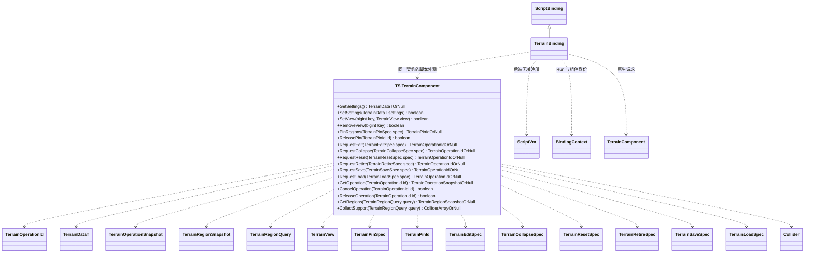

# 地形脚本与运行自动化

[原生组件](terrain.md) · [操作值类型](terrain-operations.md)。
删除 DigSphere/FillSphere、独立 *Async 回调、同步 Save/Load 等旧门面，不保留转发别名。

组件设置使用 GetSettings/SetSettings，直接读写生成的 TerrainDataT，与现有角色配置绑定一致；
不新增全局地形设置，不保留旧字段的平行属性入口。
组件继续通过 Node.AddComponent/GetComponent 取得。TerrainBinding 保留现有
ScriptBinding 的 name/source/register_functions 方法，不把 VM 句柄暴露到核心。

- 数值坐标用 Number/double；ID/revision 用 bigint；MCP JSON 转为十进制字符串。
- GetRegions 返回[当前需求与已发布区域](terrain-regions.md#当前需求与已发布区域)的同一快照。
  先判断顶层 state/errorCode/error；准备或失败时 regions 可以保留旧的 ready 数据。
  settingsRevision/demandRevision 表示当前目标，publishedSettingsRevision/publishedDemandRevision
  表示已发布目标，不将旧区域状态当作新需求完成。无源时仍可查询状态，regions 为空。
  无效句柄/不属当前 Run 的操作返回 null/false，不能读取另一会话。
- Request* 只返回受理身份；Update 或临时测试脚本通过 GetOperation 观察，不阻塞 VM，
  不自动返回 Promise，不继续保留 bool completion 机制。
- 查询结果是独立快照。状态模型、错误与取消语义唯一来自原生契约，TS 不再实现队列或几何逻辑。
- SetView/PinRegions 登记当前 Run 的拥有关系，停止时配对清理，不释放其他调用方的需求。
  ReleaseOperation 只释放终态记录，不卸载已发布区域；取消发布前操作不等于回滚世界。
- 存档 slot 仅允许安全 ASCII 名称、校验相对路径和符号链接边界；根由 App 决定，
  不通过脚本传任意本机路径。保存全部已修改区域和土石，结果含 captured revision。
- CollectSupport 成功的空数组与失败 null 区别明确；只有前者代表已知无地基。
  建筑 RefreshSupport 同步更新为 Collider[] 输入，不留单 Collider 脚本重载。
- 临时脚本在当前真实 Run 内调用这些方法；MCP 测试模块仅在显式测试构建出现，
  不增独立 TerrainTestRuntime。标准 Release 验收用相同场景、区域、状态和截图接口。
