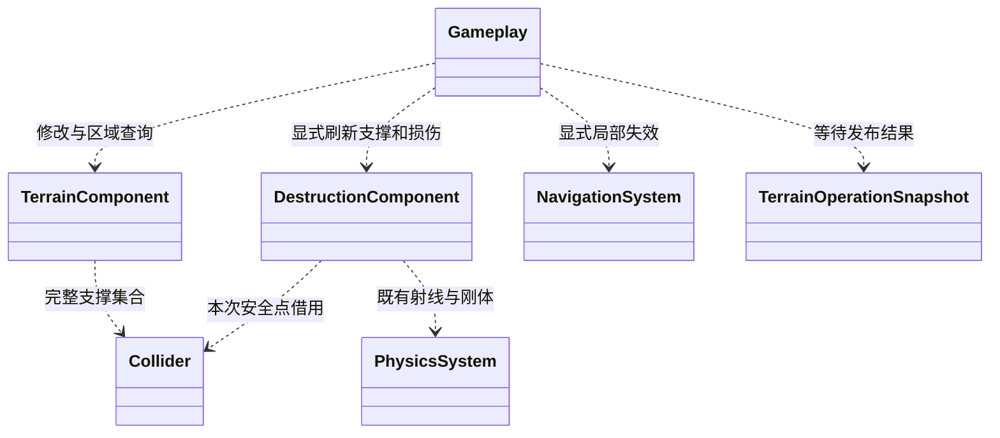
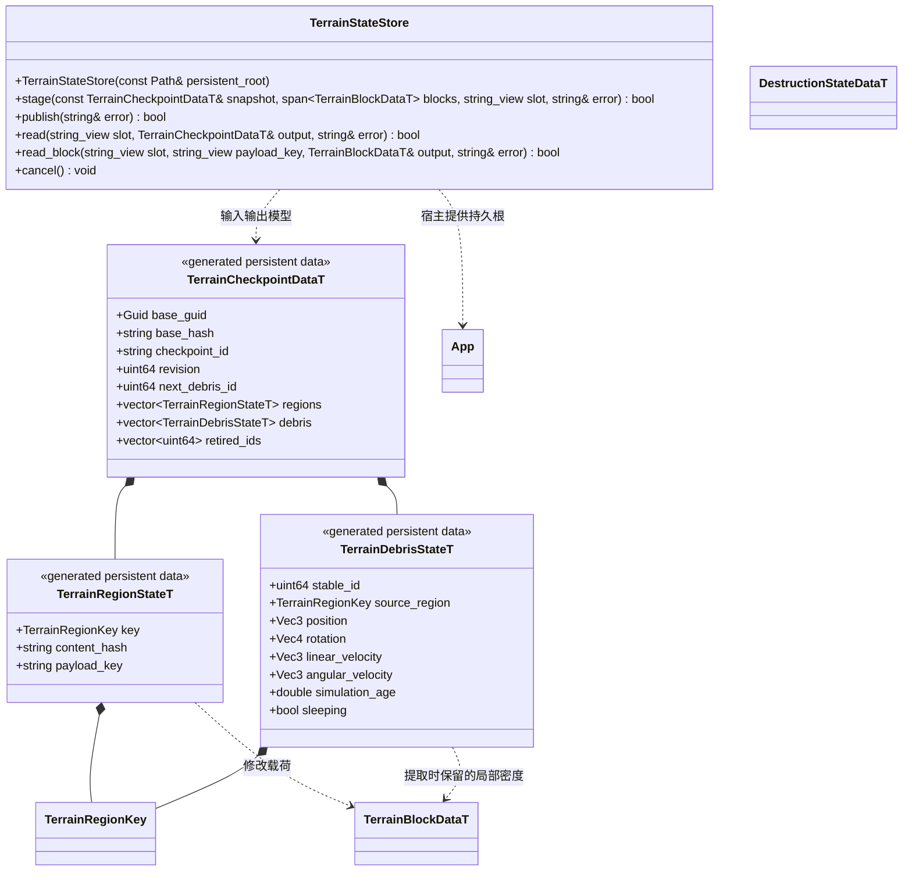

# 跨区地基、土石与保存

[地形操作](terrain-operations.md) · [现有破坏模块](destruction.md)

## 地形与建筑的调用边界

地形/破坏插件不相互 include 或链接。DestructionComponent 的目标方法及系统转发定义在
[破坏类图](destruction.md)：refresh_support(span<const Collider>, max_gap, min_coverage)。
只保留集合签名，删除旧单 Collider 重载；集合元素使用同一世界的完整组件身份。

调用方先等待地形修改 published，再 collect_support 确认覆盖区域及边界完全就绪，最后刷新支撑。
collect_support 失败表示未知/尚未就绪，不能传空集合继续坍塌；
成功的空集合表示已知没有地面，可用于解除锚定。

支撑集合只接收合法静态、非 trigger、非本建筑碎块的 Collider。合并命中覆盖并去重，
不能把同一面积算多次。成员在查询期间失效或版本变化则整次失败，不发布部分断键。
现有底面覆盖近似和 Blast 重力应力保持各自语义，不宣称完整建筑力学或任意模型预破碎已经完成。

## 跨区连通与物理占用

- 土石连通搜索从修改区扩展，读取并 pin 所需邻接块；没有加载的邻居是 unknown。
  搜索不能把窗口边界当作锚点或空气。只有确认整个连通体与真实支撑断开后才提取。
- 超过 connectivity_block_limit 时报告 connectivity_incomplete 并保留旧实体，不能截断成假孤岛。
  确认连到真实锚点可提前结束该连通体检查；真实边界规则来自基础资源。
- 动态土石生成、静态密度移除和相应碰撞切换是同一发布批。
  全部凸包/质量/姿态/速度准备失败时保留原地形，不先挖掉再补碎块。
- 建筑跨区和移动碎块按扫掠范围保留实际支撑区域；owner 是稳定建筑/土石身份，
  不以瞬态 Node ID 作为存档身份。目标区域未就绪时由业务暂缓运动或保留更大窗口，
  不因摄像机离开就销毁脚下地形。
- 睡眠碎块可保存后退出；活动物体不得直接卸载。数量/寿命回收是显式 request_retire，
  更新 retired 身份，不填回地形、不在重新加载后复活。角色碰撞边界属于共同验收。
- 导航按成功变化范围更新，失败使受影响的旧瓦片失效；动态碎块不自动变成永久可行走面。
  特效、声音只消费成功发布事件，不成为地形计算依赖。

## 区域状态与文件事务

TerrainDebrisStateT 同时引用提取时的局部体积/材料数据及 hash，不只保存姿态；
网格和凸包从这些数据按当前算法重建。源块已移除土石，不能再从修改后地形猜出碎块。
GPU atlas、Mesh、Jolt/Blast 内存镜像、临时操作 ID、物理 BodyID 都不保存。
基础 hash 或格式不符明确失败，不进行旧存档兼容。

StateStore 是文件事务，不是另一个资源加载器/世界。stage/read 的 IO 由 TerrainSystem
通过共享任务域组织，协调线程不等待。采用不可变块文件加最后原子替换的清单，
先完整校验并落盘所有新块和哈希，再发布 manifest；失败保留旧清单。
stage 的 blocks 只包含本次新增的不可变载荷，其他清单引用必须已存在且通过校验；
read 只返回清单，read_block 由调用方按视域或重建需要明确请求，不在读取清单时加载全世界。
载荷键为内容摘要，只允许存档槽内的文件名，不能传入任意路径。
未发布临时文件清理，已发布但尚被旧 checkpoint 引用的数据不能提前删除。

保存涵盖整个已修改世界，包括已卸载区域的持久记录和当前驻留 delta，不是只保存镜头附近。
保存采样于一致 revision，后台持有不可变快照；同时继续产生的新修改保持 dirty，
不能在旧 snapshot 完成时一并标记已保存。发布记录包含 captured revision/checkpoint_id。

加载先验证全清单和基础身份，再按当前视域准备所需块；其余状态保持磁盘索引。
当前活动区域、土石、显示和碰撞完整准备后一次切换，失败保持旧活动世界。
Reset 必须明示范围及碎块策略；不能用旧静态快照限制拒绝所有已塌方地形的保存。

## 游戏整体 checkpoint

地形组件仅保存本领域；建筑通过现有 DestructionStateDataT 保存连接/姿态/速度/retired IDs。
项目负责稳定对象 ID 与基础资产对应，以及地形、建筑、玩家等快照的共同 checkpoint_id，
不把私有业务写入引擎。

整体保存时项目暂停物理和修改输入，等待/取消未发布事务，在同一安全点获取不可变快照，
再恢复运行并后台写入。各模块文件成功后才原子发布项目 checkpoint 清单；
恢复时不混用不同 checkpoint。基础资源不符或任一模块失败不得标记恢复成功。
目标加载在候选场景完成，所有领域就绪后才由 GameplaySession 切入，失败不拆毁旧场景。
