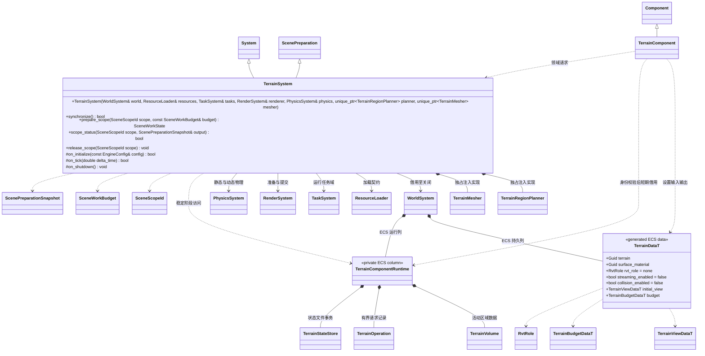
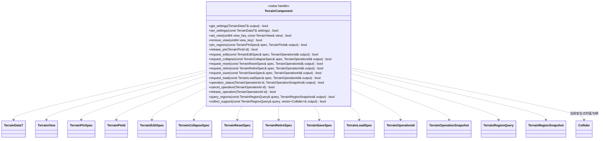

# 大世界体积地形：组件与系统

[设计入口](../terrain-world-design.md)。
区域/算法、请求值类型和存档分别在所属图定义，不保留旧有限体积或同步笔刷接口。

## 设置与所有权

TerrainDataT 来自 runtime Schema；GUID 使用既有资源身份，不引入手写持久模型。
材质层是地形资源的真实依赖，surface_material 是普通材质引用；颜色和粗糙度由材质参数配置，
不继续保留地表/洞壁颜色特例字段。Schema 的视域设置与运行 TerrainView 使用同一字段语义，
前者保存初始需求，后者是临时值；不建立第二份持久设置。

rvt_role 只声明生成网格的来源/接收用途，默认 none，并复制到普通 MeshRendererDataT；
它不打开 RVT，唯一运行开关仍在 EnvironmentComponent。材质/Shader 是否支持相应通道另行验证。

- 组件是标准值句柄；字段和 Runtime 唯一存于 Flecs。任何访问重验世界、实体和组件实例；worker 不保存 ECS/VM/System 裸借用。
- 流送和碰撞由项目显式开启。初始需求有界，不隐式加载全世界；编辑器可在候选阶段明确提供预览需求。
- 系统仍在物理之前更新。必要任务域、加载器或算法缺失时初始化失败，不回退主线程重建。
- 初始区域通过同一算法准备，在原候选场景创建普通瞬态节点；封存与领域准备见[核心契约](../../../runtime/class-diagrams/scene-domain-preparation.md)。
- 块数据、GPU 和碰撞分别计账；数据加载成功不是区域可进入。普通对象分区仍由 GameplaySession 管理。
- 地形节点要求根节点、平移和正等比缩放。更换基础资源或采样尺度使旧候选失效；设置切换成功重建后才替换活动数据。坐标转换先用 double。

## 组件公开契约

构造、登记、恢复沿用统一 Component 契约。查询 const、输出独立值，失败输出安全空值；
可能失败的方法均 nodiscard。设置只校验和受理，重建通过区域状态观察，不等待 GPU。

view_key 在当前组件生命周期内唯一；键 0 为场景初始需求，业务键非零。更新同键替换该需求，
不同视域取并集。Run 停止只清除它登记的视域和 pins；原生调用者同样配对释放。
临时视域不写回场景。

collect_support 只有在所问范围及必要邻域的碰撞完整且匹配密度版本时成功，返回相交静态
Collider。已知空气可成功返回空集合；未知、未加载、在提交或加载失败必须失败，不能视为地基缺失。

## 生命周期

请求记录归组件 Runtime，终态保留到 release_operation 或组件销毁。组件销毁后的查询返回 owner_invalid，
不伪造 cancelled 记录；MCP 回执仍可报告目标已失效。源更新、禁用、卸载使旧候选失效，
不能写到同名新组件。

关闭先停止调用及领域准备回调，再取消未发布工作；worker 仅拥有输入/候选，模块代码在任务回收前保持存活。
GPU fence 结束后释放旧缓冲，清理本插件生成的节点、碰撞和共享资源引用。
先清 GPU 拥有者、再关闭世界插件，最后关任务域；支持部分初始化和重复清理。
未保存的修改不因视域移出而静默丢失，遵守[区域卸载](terrain-regions.md#视域与卸载)。
