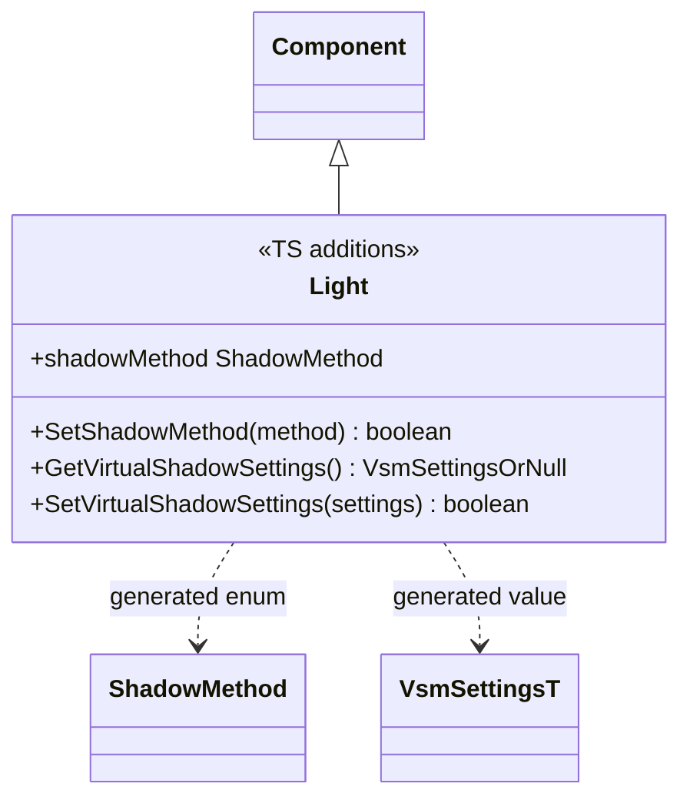

# VSM 脚本入口增量

**状态：当前实现契约。** 唯一生产模型、原生接口及生命周期见
[方向光 VSM](../../../runtime/class-diagrams/virtual-shadow-maps.md)。
本页只定义现有 Light 的脚本外观，不添加脚本阴影管理器。

VsmSettingsOrNull 在图中表示 `ControlData.VsmSettingsT | null`，不是新增包装类型。
ShadowMethod 与 VsmSettingsT 都由当前 FlatBuffers schema 生成到 ControlData。

| TS 签名 | 契约 |
| --- | --- |
| `readonly shadowMethod: ControlData.ShadowMethod` | 读取同一 Light 组件的生产模式 |
| `SetShadowMethod(method: ControlData.ShadowMethod): boolean` | 修改模式，保留 cast_shadows、VSM 参数与 CSM 底图参数；点光/聚光拒绝 virtual_shadow_map |
| `GetVirtualShadowSettings(): ControlData.VsmSettingsT | null` | 返回副本，失效句柄返回 null |
| `SetVirtualShadowSettings(settings: ControlData.VsmSettingsT): boolean` | 整体验证后提交参数，不隐式开启阴影或切换模式；失败保持原值 |

`ControlData.ShadowMethod` 的值为 0（shadow_map）或 1（virtual_shadow_map）。

原有 SetShadows 仍负责该灯投影总开关；SetShadowCascades 维护普通模式及 VSM 的 CSM 底图。
切换 Light 类型时，目标组件状态必须合法；不默默清除或重解释 shadow_method。
跨场景、删除重建和资源重载遵守既有值句柄/实例身份契约。

实现落入现有逐类 LightBinding；原生设置复用 Light::set_settings。
`include/engine.d.ts` 与绑定保持一致；项目源缓存按当前格式重新生成，不保留旧数据读取分支。
诊断开关与状态走渲染器和 MCP，业务脚本不创建 GPU 页、atlas 或调试 UI。
