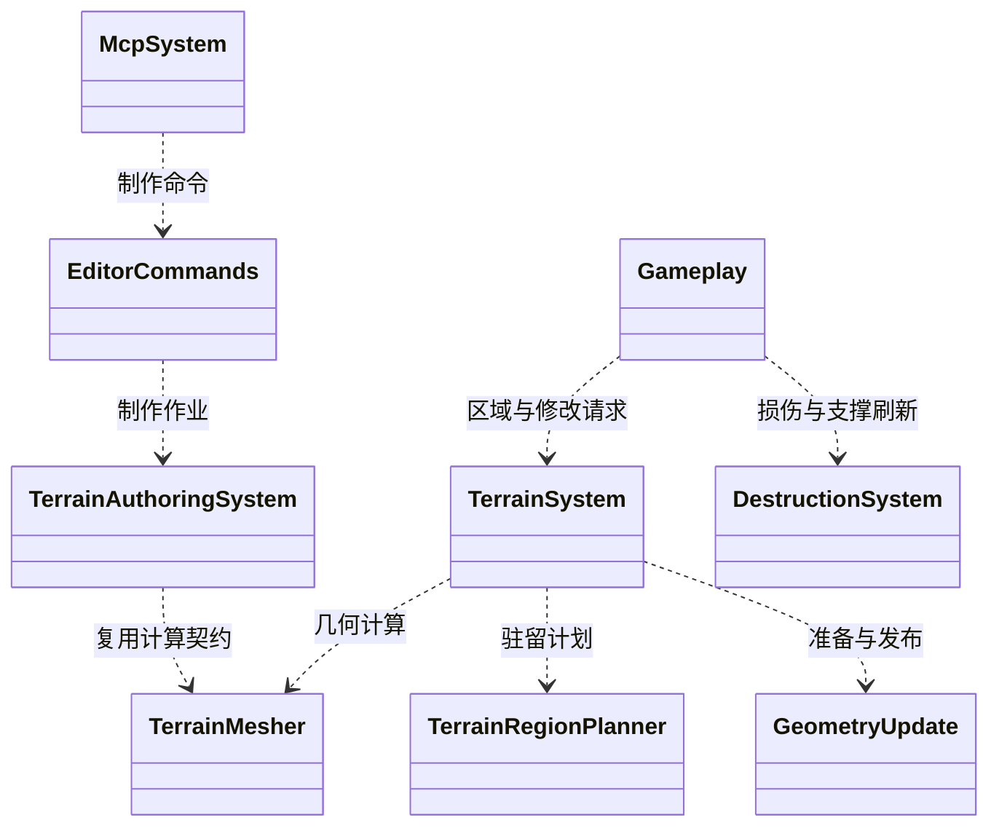

# 大世界地形、RVT 与破坏

当前实现采用这组类图定义的运行时边界：稀疏分区、异步操作、领域准备、原子几何发布、RVT 和运行存档。
只维护当前格式与接口；旧源/缓存需重新生成。制作端已支持持久配方与局部块缓存；专用散布规则、
二进制制作源块 delta 仍属未完成范围。平台与测试结果见[测试文档](../../testing.md#大世界地形与-rvt)。

[类图总索引](../../class-diagrams/index.md) · [现有实现范围](terrain-destruction.md)

## 范围与评审入口

- 地表与地下、洞穴与悬垂、运行时挖填、建筑地基破坏；首个标准验收世界为 8 × 8 公里，垂直范围由项目显式配置。
- 高度图、噪声、印章、道路和笔刷最终写入同一份分块体积与材质层。高度图只是制作输入，不保留另一套高度场显示或碰撞。
- 稀疏三维分块、LOD 和区域流送；不分配覆盖整个世界的稠密数组。LOD 不改变物理附近的权威密度。
- 标准 PBR 为基础；RVT 默认关闭，只缓存地表材质，不承担洞穴拓扑或物理。洞壁使用普通三向投射 PBR。
- 模块与流程隔离，复用 TaskSystem、ResourceLoader、GameplaySession、Jolt、Blast 和渲染管线。
- MCP 覆盖从空项目创建、编辑、生成、保存、运行、破坏、卸载重载到截图的完整流程，不要求人工选择文件、移动镜头或点击发布。
- MCP 开启 RVT 查看器后，视口逐帧展示真实虚拟贴图、物理图集、页表与页面状态；显示与生产开关分离，截图可归档当前面板。

| 评审内容 | 唯一类图与契约 |
| --- | --- |
| 组件、系统、生命周期和模块装配 | [运行时地形](class-diagrams/terrain.md) |
| 稀疏区域、流送规划、网格与 LOD | [区域与算法](class-diagrams/terrain-regions.md) |
| 请求身份、状态、取消、预算与发布 | [地形操作](class-diagrams/terrain-operations.md) |
| 插件参与现有场景准备 | [领域准备](../../runtime/class-diagrams/scene-domain-preparation.md) |
| 同版本显示与碰撞的原子切换 | [几何更新](../../runtime/class-diagrams/geometry-update.md) |
| 大坐标的精度与消费者边界 | [大世界坐标](../../runtime/class-diagrams/world-coordinates.md) |
| 随包导出、按需读取的区域资源 | [流送资源引用](../../runtime/class-diagrams/streamed-resources.md) |
| RVT、开关、页缓存与诊断 | [RVT](../../runtime/class-diagrams/runtime-virtual-texture.md) |
| 地基、跨区碎块与存档 | [破坏与保存](class-diagrams/terrain-world-state.md) |
| 制作、撤销、资源发布和 MCP | [地形编辑器](../editor/class-diagrams/terrain-editor.md) |
| 项目脚本与运行测试入口 | [脚本契约](class-diagrams/terrain-script-api.md) |

## 模块与依赖

下图只画职责关系，不重复定义方法；箭头表示调用/使用，非所有权。

- 核心只扩展通用几何发布、领域准备、资源引用、坐标和渲染；不得 include 或链接具体地形、破坏或编辑器插件。
- 地形插件拥有数据、请求和区域生命周期。算法由宿主注入，不读取 ECS、GPU、Jolt、项目路径或 MCP。
- RVT 位于现有 runtime/render，使用普通渲染组件及材质，不依赖地形插件，不另建渲染器。
- 地形与破坏插件不互相依赖；Gameplay 根据已发布结果调用建筑支撑、导航、特效。
- 编辑器插件拥有制作与撤销；脚本逐类绑定；MCP 转发现有命令和原生能力。
- 建筑、道具及植被分区场景由调用方通过 GameplaySession 追加、按所属节点组卸载，按相同整数分区坐标关联。地形流送不接管业务场景、UI 或整体游戏存档，不新增通用 WorldManager。

## 类的必要性与替换范围

| 类/契约 | 存在理由 | 实现替换时保持什么 |
| --- | --- | --- |
| TerrainVolume | 唯一体积、不可变块、修改候选 | 坐标、密度符号、边界、层数据、revision |
| TerrainRegionPlanner | 隔离视域、LOD 和驻留算法 | 需求、现状输入及加载/保留/退出计划 |
| TerrainMesher | 隔离几何和过渡缝生成 | 输入版本、边界归属、局部坐标、几何输出 |
| TerrainSystem | 沿用领域生命周期和协调职责 | 组件、状态、请求、错误；不暴露默认算法 |
| GeometryUpdate | 一次有界显示/碰撞事务 | 准备失败保留旧状态，发布不做重型计算 |
| TerrainGenerator | 编辑器生成算法入口 | 固定输入和种子输出规范体积块 |
| TerrainAuthoringSystem | 多帧制作作业与源文件事务 | 身份、进度、取消、可撤销发布 |
| VirtualTextureCache / RvtPass | 分离页面驻留与内容生成 | 页面键、编码、失效、帧序和生命周期 |

不为每个步骤创建 System 或第三方包装类；记录用 struct，私有计算用函数。
有明确替换需求的规划、网格、生成入口采用抽象契约，其余按公开行为替换实现。
替换按构建与宿主装配发生，不承诺动态库 ABI、运行时热插拔或不同算法间自动迁移。

## 当前数据边界

运行模型由 FlatBuffers 定义：TerrainAssetData 保存稀疏索引，TerrainBlockData 保存密度与层，
TerrainCheckpointData 保存修改和碎块。编辑器 TerrainSourceData 保存 recipe 和有序 edits，
源 GUID 与虚拟子资源身份保持稳定。没有旧数组/存档读取器、同步地形兼容入口或 float 世界矩阵重载。

## 参考与验收边界

参考 [Terrain3D](https://github.com/TokisanGames/Terrain3D) 的区域/编辑流程、
[Voxel Tools](https://github.com/Zylann/godot_voxel) 的体积与流送、
[FastNoise2](https://github.com/Auburn/FastNoise2) 的生成，以及
[UE RVT](https://dev.epicgames.com/documentation/en-us/unreal-engine/runtime-virtual-texturing-in-unreal-engine)
的页面与材质职责；这些参考不代表引擎已经实现其能力。

现有 Transvoxel/Jolt/Blast 沿用已固定版本；新增依赖在实现时固定版本、许可并实际构建。
已购工具只参考公开功能与制作体验，购买清单、付费和私有源码不进入 Git。
公开验收用自制标准素材，真实资源测试留在忽略的私有项目。
验收矩阵统一见[测试文档](../../testing.md#大世界地形与-rvt)。
