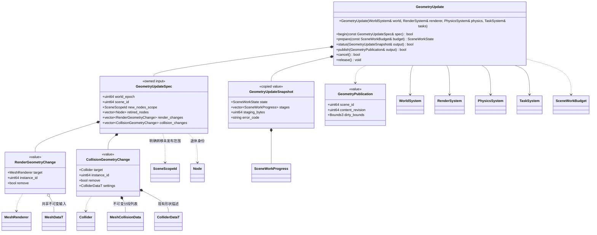

# 通用几何候选与同版本发布

解决活动地形分块修改的显示/碰撞一致性；
继续使用现有 ECS、RenderSystem 的资源准备和 PhysicsSystem 的分段碰撞实现。
初始场景仍走[场景准备](scene-domain-preparation.md)，不另建几何运行时。

一个 GeometryUpdate 对象就是一次有界操作，不是 System/Manager。
构造借用覆盖整个操作，析构兜底释放；活动请求由调用模块独占。
输入复制身份和描述、共享 const 网格，不借用调用栈或跨任务保存组件运行列。
公开接口为 nodiscard，status 为 const；失败输出空值并保留原发布版本。

## 准备与原子性

- begin 校验同世界/同场景、组件实例、形状/运动类型约束、变换和操作规模，捕获各目标配置/几何版本；
  不用整个场景每帧变化作无谓冲突条件。TerrainDelta 的源 revision 由地形模块另行校验。
- prepare 复用渲染的增量解码/上传和物理的不可变 MeshShape/CompoundShape 缓存。
  重型 CPU 工作走同一 TaskSystem，GPU 只在既有渲染线程按帧提交。不得复制另一套上传或碰撞算法。
- GPU 缓冲、完整 Shape、节点结构变更和旧资源退休记录全部在 ready 前准备。
  只有设备代次有效且写入对后续绘制已可用，才 ready；上传命令受理不等于完成。
- publish 只在物理步进、查询、脚本与渲染收集之外的同一协调安全点执行。先完整预检所有目标；
  失败整批不动。通过后只交换已分配的 ECS 几何引用、GPU 绑定、Jolt 形状及生效标记，
  无 IO/分配/回调/第三方构建，提交区间不对外重入。
- publish 返回成功前，显示和碰撞必须共同指向候选版本；任何正常可报告失败都发生在交换前。
  不是“先改碰撞，后改网格，失败再尝试重建旧网格”的非可靠回滚。
- 调用方在同一安全点已预验自己的 TerrainDelta，成功后执行无失败的数据交换，再返回主循环。
  几何层不识别 Terrain 类型；地形数据不能先发布再等待几何。
- content_revision 由 WorldSystem 的既有内容版本推进一次；旧 GPU 对象按已有 fence 退休。
  正常设备丢失遵守原渲染失败/恢复规则，不能把不可用 GPU 声称为有效旧画面。

稳定 Collider/Renderer 的更新不替换组件身份。首次增加的区域节点由调用方先在明确的未发布 scope
创建，包含变换、材质和普通组件；new_nodes_scope 在 begin 成功时交由操作负责，失败仍由调用方清理。
没有新节点时 scope 为空。删除节点预先加入 retired_nodes；提交一起切换 Published 与碰撞注册。
此 scope 复用 WorldSystem 范围和安全点，不开启第二份 Flecs world；
新节点、替换、退出的支持都必须在实现中覆盖，不能先发布空节点再补网格。

静态分段三角网格使用 MeshCollisionData；动态土石使用现有 ColliderDataT 的凸包/compound 描述，
其 RigidBody、质量、姿态和初速度放在 new_nodes_scope 的普通组件中，由同一 PhysicsSystem 准备。
禁止动态三角网格；不是新增平行碰撞模型。土石提取的静态删除、动态节点进入以及碰撞注册
必须由同一 GeometryUpdate 发布，不能把动态刚体创建推迟到静态地形已被挖掉之后。

私有接入位于三个已有系统的实现侧，只对 GeometryUpdate 提供必要友元/内部准备访问；
不向项目暴露 bgfx、Jolt 对象或底层候选句柄，不为测试放开接口。

取消仅在发布前接受，等待自有 CPU/GPU 工作安全释放后终结；已发布的操作只能释放记录，
不能撤销其他业务。暂停中不发布玩法几何修改。多次 release 和部分初始化均安全。

## 使用范围

分区更新只包含脏块及过渡/碰撞邻域，维持单次事务上限。创建整个 8 公里世界应分批流送，
不提交全世界 GeometryUpdate。原有普通 Mesh/Collider 配置接口仍服务其自身业务，
不是地形旧同步接口的兼容入口；地形不再绕过本事务逐个公开修改。
