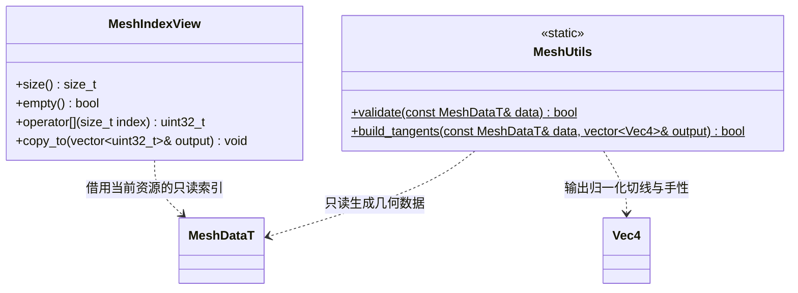

# 网格工具

[类图索引](../../class-diagrams/index.md) · [节点组件](component.md)

- 公共静态方法只校验或转换几何，不访问 GPU、项目设置或文件；数据均由 FlatBuffers 生成。资源层另外校验路径身份，动态网格允许空路径。
- 顶点位置与非零法线必须有限，三角索引合法。UV、切线、颜色可省略，存在时长度必须等于顶点数。切线 xyz 非零、w 为正负 1；颜色在 0..1。
- 子网格可省略，省略表示完整索引与材质槽 0；存在时按顺序完整覆盖索引，范围为三角形倍数，槽号小于 16。
- 切线构建采用 bgfx examples/common/bgfx_utils.cpp 的 calcTangents 思路：三角 UV 梯度累计、Gram–Schmidt 正交化及手性。实现使用 double 中间值和 uint32 索引；退化 UV 或没有 UV 时建立稳定正交基，不产生 NaN。已有切线保持其方向并归一化。失败输出为空。

方法返回值标记 [[nodiscard]]；validate 为 noexcept。

## 运行时网格的紧凑存储

网格资源的 `optimize_storage` 由[模型导入参数](../../plugins/editor/model-import.md#网格无损优化)决定。关闭时解码为完整宽数组。默认开启时，资源解码将每个网格及各级 LOD 的索引按实际最大值存为 16 或 32 位。Meshlet 索引与所属级别的普通索引长度、顺序和值均相同时，通过共享标志引用父级序列。独立 Meshlet 索引保留自身顺序和位宽。主 UV、光照 UV 和切线各自独立选择精度；仅当整条属性流的每个分量都能从单精度逐位还原成原双精度时才收窄。

调用方通过 `mesh_storage::indices`、`meshlet_indices` 和属性读取函数访问逻辑值。索引视图借用当前资源数据，不跨数组修改或资源释放保存。调用 `copy_to` 时，目标使用独立数组或与源完全相同的数组。需就地编辑宽数组或传给只接受连续宽数组的外部工具时，在调用方的独立快照上使用 `expand`。同一流同时提供宽、窄数组，或声明共享仍提供独立索引，均视为无效编码。动态生成网格也可按原始精度直接提交。
