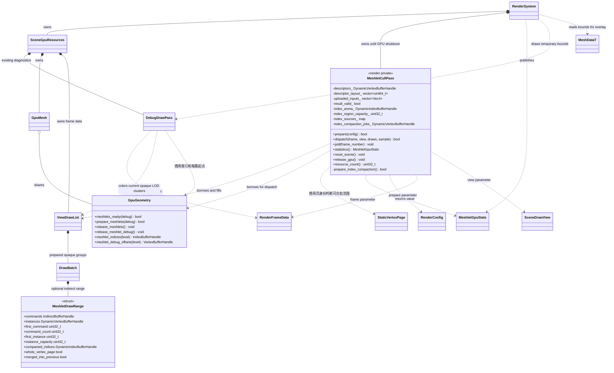
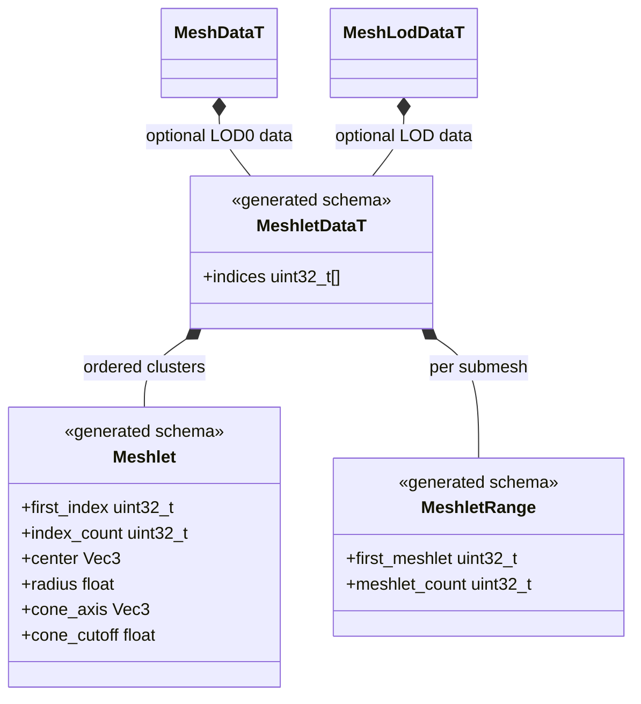
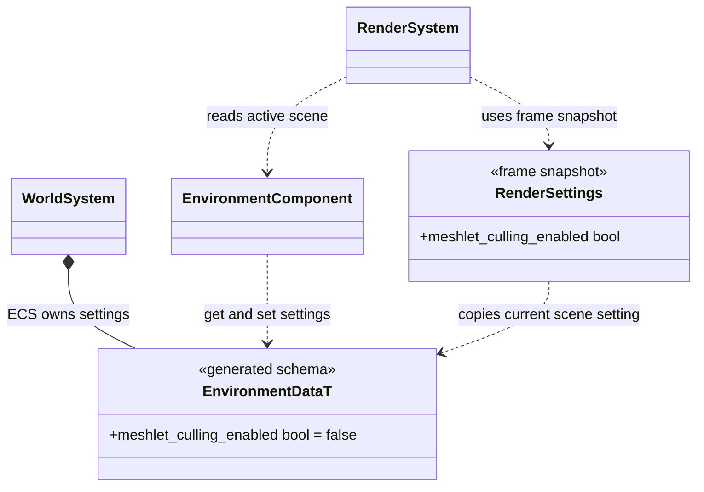
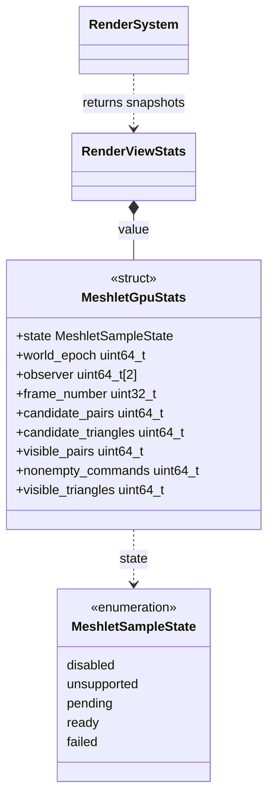

# Meshlet 与 GPU 剔除

状态：**已实现**。本页定义当前运行时契约；实际验证平台与结果见[测试文档](../../testing.md#meshlet-与-gpu-剔除)。
首期目标是在现有前向管线中，对静态不透明网格执行 GPU Meshlet 视锥／背面剔除和索引间接绘制。

[类图索引](../../class-diagrams/index.md) · [现有提交链](render-submission.md) ·
[离线生成](../../editor/class-diagrams/meshlet-import.md) ·
[公开标准场景与验证](../../../projects/showcase/docs/meshlet-culling.md)

## 范围与渲染模式

- 复用现有 CPU 对象剔除、静态 LOD、材质绑定和实例化；GPU 继续细分到 Meshlet。
- 首期覆盖主观察者的 depth、surface、opaque 通道；它们共用一次剔除结果。
  阴影、反射、烘焙捕获、透明、蒙皮、运行时变形和顶点位移继续使用当前普通路径，各自保持正确视角。
- GPU 索引源复制、计数清零、剔除与索引合并分别使用视图 75–78，排在主观察者通道之前。平面反射及其阴影占用 3–73。
- 首期不做 Hi-Z 遮挡剔除、虚拟几何分页或原生 Mesh Shader。不能宣称墙后物体已被遮挡剔除。
- Meshlet 的输出是几何索引区间、可见实例及间接命令，不依赖光照模型或颜色附件。
  当前前向通道消费这些结果；将来的延迟 G-buffer 可在相同观察者、拓扑及顶点位置契约下消费。
  双渲染模式并非本功能前提，本轮不新增 Pipeline 抽象、模式枚举或未实现开关。
  后续延迟模式仍需单独评审 G-buffer 布局、材质、透明前向通道、MSAA 和后处理。

## 所有权与执行类



`MeshletCullPass` 属于 `engine::render_detail`，由 RenderSystem 调度。`StaticVertexPage` 是 GpuGeometry 的共享存储，由现有场景资源准备流程分配。页的所有权和释放见[渲染主图](render-system.md#私有实现边界)。

图中简写方法的完整签名如下。对象引用均为主线程当前调用内借用，不保存 ECS 列或 Scene 指针。

| 方法 | 契约 |
| --- | --- |
| `bool prepare(const RenderConfig& config)` | 按能力与预算准备 Compute 程序、命令和工作缓冲；由现有准备流程调用，同配置复用；失败清理候选资源 |
| `bool dispatch(const RenderFrameData& frame, const SceneDrawView& view, ViewDrawList& draws, bool sample)` | 读取已筛选、选层和分批的数据，提交 Compute 并填充批次间接区间；无适用批次是正常空操作；实际提交错误返回 false |
| `void poll(uint32_t frame_number)` | 推进已发起的诊断回读；不等待 GPU，不创建新采样 |
| `MeshletGpuStats statistics() const` | 按值返回当前观察者的采样状态及最近完成结果 |
| `void reset_scene()` | 使旧观察者结果失效，释放场景工作缓冲；未完成回读的 CPU 存储保留至完成 |
| `void release_gpu()` | 幂等销毁 GPU 资源，支持部分初始化；回读目标内存仍由对象持有 |
| `uint32_t resource_count() const` | 计入现有 GPU 资源统计，不建立另一套统计服务 |

所有可能失败及返回状态的方法标注 `[[nodiscard]]`。输出区间先清空，失败不得留下可提交的半成品。
`RenderFrameData`、`SceneDrawView`、`ViewDrawList`、`DrawBatch` 的原有字段与职责仍见提交类图。

`RenderSystem` 直接独占该 Pass，原因是诊断回读可跨越场景释放；
`SceneGpuResources` 被释放时不能同时释放 bgfx 仍可能写入的 CPU 地址。
切场景只调用 `reset_scene()`，正常帧与空闲呈现继续 poll。
设备退出顺序为停止新提交、`release_gpu()`、`bgfx::shutdown()` 完成、销毁 Pass 与其回读存储。
不为清理诊断在切场景时同步等待 GPU，也不因短暂切场景无限积累回读对象。

### 合并剔除调度

`MeshletCullPass` 将本观察者的簇描述与输入／输出偏移组织到同一个 GPU 工作数组。单实例命令区间每组并行处理最多四条，分别由 8 个线程独立判定和写入。多实例保留一组一簇，由线程并行判定实例。超过单次 65535 组时分段。按批次消费命令，各批次内部保留原几何索引顺序和材质边界。

描述数组由 Pass 拥有，完整布局键包含资源获取身份、LOD／子网格、批次与输入／输出范围；相同布局跨帧复用。单实例上传 FP32 模型矩阵和局部相机。同模型矩阵位模式、同锥体剔除条件的批次共用这份输入。多实例另上传法线矩阵，仅为多实例候选保留压紧输出。输入字节完全一致时复用上次上传，视锥仍随当前视图提交。缓存保存值，按实际需求扩容并随场景或设备释放。

单实例批次在同一材质子网格内按连续索引顺序，每至多 8 个簇划分一个命令区间。命令描述记录第一个簇、簇数和输入实例区间。GPU 工作组并行判定各簇，汇总首尾保留簇并提交一个索引区间。区间内的间隙随命令保守提交，全拒绝写零实例。多实例按簇压紧可见实例。两种工作组共用描述缓冲与剔除分派，三个主通道共享结果及原索引缓冲。诊断统计实际提交的簇和三角形，含保留区间内的间隙。

同一观察视图的批次布局、剔除输入字节、视锥、剔除标志及索引作业完全一致时，后续帧直接复用已生成的间接命令、实例及压紧索引区间。缓冲区重建、输入变化及诊断采样会重新分派。三个主通道在复用时仍按各自原有覆盖和顺序提交。

有序合批的首项将 `whole_vertex_page` 置为真，提交时绑定该页并消费合并的间接命令。`merged_into_previous` 标记已纳入首项的后续批次。这些批次仍保留各自的可见项与剔除范围，三个主通道通过同一批次标记提交。

带 Meshlet 的小型静态几何可以在同一 16 位顶点页存放位置和材质属性。两条顶点流各按页容量分配，实心深度只绑定位置。几何持有各自区间，页由场景资源弱引用。主视图中连续的单实例不透明批次在页、完整材质和覆盖状态、光照与模型／法线矩阵相同时，可按原序汇合剔除后的索引。索引在复制时加上页内顶点偏移，深度、材质表面和颜色通道借用同一间接命令。源和临时区根据候选的索引需求在预算内增长，按单位索引可消除的命令数安排作业。保留每个网格原有剔除范围，越过页、命令或索引容量时沿用单批绘制。 [The Forge 索引过滤](https://github.com/ConfettiFX/The-Forge/blob/master/Examples_3/Visibility_Buffer/src/Shaders/FSL/TriangleFiltering.comp.fsl) · [AnKi 共享几何](https://anki3d.org/gpu-driven-rendering-in-anki-a-high-level-overview/)

对缺少原生可变间接绘制数的设备，内置材质使用 16 位索引的多命令单实例批次可使用共享索引缓冲。静态源区域按资源版本、LOD 和索引区间缓存，由 GPU 从已有索引缓冲复制。剔除后区间连续时，最终命令直接引用源区域。区间分散时，组内并行复制保留区间到临时区域，保留命令和三角形顺序。三种主通道借用同一缓冲与间接命令，诊断按合并后的实际非空命令计数，并沿用剔除输出的三角形计数。源区域与临时区域分别限额，超出时对应批次使用原间接区间。[GeometryFX 的 GPU 索引过滤](https://gpuopen.com/archived/geometryfx/)

## 同一 Mesh 内的生成数据



以上类型由 `include/schemas/runtime/mesh.fbs` 唯一生成，命名空间为 `engine::schema`。
`MeshDataT.meshlets` 与 `MeshLodDataT.meshlets` 为可空的独占生成对象；
`MeshletDataT` 保存 `indices`、`meshlets` 和 `submeshes` 三个数组。

- Meshlet 在单一 LOD 的单一材质子网格内生成；不跨材质边界。
  `submeshes` 是与该级原子网格顺序对应的 `MeshletRange`；无显式子网格时归一为槽 0 的一个范围。
- `indices` 是按 Meshlet 排列的全局顶点索引。它引用原 Mesh 的顶点、UV、法线、切线等，
  不复制顶点，不作为独立资源，也不改变碰撞、原索引拓扑或 LOD 身份。
- `first_index/index_count` 定位新增索引数组；`center/radius` 为模型局部空间保守球；
  `cone_axis/cone_cutoff` 为上游法线锥。无可靠法线锥时明确标为不可执行背面剔除。
- 生成结果必须验证索引、范围、材质归属、有限边界和三角形覆盖。
  损坏或越界数据是加载失败，不能以“未生成”掩盖。
- 单一版本迁移：Mesh 为 `EMS2`／版本 2，Shader 为 `ESH2`／版本 2，Scene／Prefab 为版本 4；重新生成缓存与运行包；
  不保留旧格式读取。当前格式中未启用 Meshlet 生成而为空，是合法资源状态。
- 生成的索引和元数据计入 CPU 资源统计。GPU 统计按实际上传的字节和缓冲所有权计量。

`GpuGeometry` 共享同一资源发布版本。每个 LOD 的普通索引与 Meshlet 索引逐项相等时，两种提交借用同一 GPU 缓冲；不同序列各存一份，由各自的索引范围读取。能完整表达的序列使用 16 位索引，保留索引顺序，末尾按 32 位原始读取对齐。Meshlet 色块和线框读取相同索引并按实际宽度解包。通过生成资源取得子网格 Meshlet 范围，各级专用负载完整有效后才可使用。`GpuMesh` 不按实例复制这些缓冲。
准备仍走 `prepare_scope` 及现有上传字节、工作项和时间预算；单项几何原子创建，空步骤允许一个超过字节预算的几何推进，后续项延后；热重载创建候选资源，安全发布后再替换，旧帧借用不得提前失效。

`GpuGeometry::prepare_meshlets(debug)` 按需准备已生成层级的索引。常规剔除读取 `MeshletCullPass` 组装的共享工作数组。色块有独立的可选 GPU 缓冲，每簇仅存一个 32 位索引起点。准备按现有队列与 `meshlet_upload_bytes(debug)` 的预算推进，失败释放本次批次，已有可用索引继续有效。`meshlets_ready(debug)` 检查本次需求的完整性。`release_meshlet_debug()` 释放色块缓冲，`release_meshlets()` 释放全部专有缓冲。生命周期方法在主线程准备或提交安全点调用。

两个新增只读访问器为
`bgfx::IndexBufferHandle meshlet_indices(size_t level) const` 和
`bgfx::VertexBufferHandle meshlet_debug_offsets(size_t level) const`，缺少该级数据返回无效 handle。
它们只在渲染私有头声明；返回值不转移所有权，有效期不能超过当前几何版本。
子网格范围读取当前 `RenderFrameData` 已借用的生成数据，不再复制一份手写持久模型。

## 场景统一控制

资源生成与运行使用分别控制：导入决定是否生成专用数据，运行时只有一个场景总开关。
该开关扩展现有 `EnvironmentDataT.meshlet_culling_enabled`，默认 false，
随场景的 `EnvironmentComponent` 保存；不增加逐 MeshRenderer、材质或 Camera 的 Meshlet 使用开关。
项目运行代码通过 `Node.GetComponent(EnvironmentComponent)` 取得该组件，
公开的只读状态和启停方法见[场景组件脚本类图](../../plugins/runtime/class-diagrams/render-script-api.md#meshlet-场景总开关)。
下图引用原生组件，原生设置方法仍由[环境组件类图](environment-components.md)维护。



复用当前场景环境选择规则：活动场景最多一个启用环境，缺失／禁用时为 false。
`RenderSystem` 将其解析进本帧 `RenderSettings`，统一本次主视图中所有已发布网格，
包括参与绘制的常驻／附加内容；不按每个节点的来源场景选择不同策略。
切换活动场景重新读取新场景的值，不继承上一场景状态。
`RenderSettings` 仅为派生帧快照，不是另一份可写或持久配置。

开启后所有满足资源与材质条件的静态网格自动参与；未生成专用数据的网格、
透明、变形或不支持的 Shader 仍正常绘制，并报告未应用原因。
同一份场景支持普通和 Meshlet 两条几何提交路径，开启时允许按适用性混合绘制。
每个子网格在每个通道只选择其中一条，不重复提交两份几何；关闭后当前场景全部对象恢复普通绘制。
这种自动选择不引入对象开关，也不需要另一份场景资源；着色仍使用现有前向管线。
现有实例化、LOD 和 Camera 视锥属性维持各自原有职责。

编辑器场景设置复用 `set_render_settings` 的 `meshletCullingEnabled` 字段；
统一 MCP `set_render_feature` 的 `meshlet_culling` 分支携带场景与环境节点身份，
只编辑该场景唯一 EnvironmentComponent，沿用属性校验、保存和撤销流程。
MeshRenderer、材质及 Camera 不接受该属性，调试接口也不能代写这个运行开关。

## 最小公开契约增量

| 归属 | 公开字段／接口 | 含义 |
| --- | --- | --- |
| `EnvironmentDataT` | `meshlet_culling_enabled: bool = false` | 当前场景唯一运行总开关，随环境组件保存 |
| `EnvironmentComponent` | 复用 `get_settings / set_settings` | 读改生成数据，核心不新增专用方法 |
| TS `EnvironmentComponent` | [公开属性与方法](../../plugins/runtime/class-diagrams/render-script-api.md#meshlet-场景总开关) | 项目通过场景组件读取／切换总开关；绑定与 `engine.d.ts` 保持一致 |
| `ShaderData`／源 `.shader` | `meshlet_culling_compatible: bool = false` | Shader 作者声明位置、实例变体和通道语义满足下述契约 |
| `RenderConfig` | `maximum_meshlet_candidates: uint32_t = 65536` | 同帧工作区的 Meshlet × 实例槽预算；须大于 0，尺寸乘法先做溢出检查 |
| `RenderFeature` | `meshlet_culling` | 查询当前场景总开关和实际生效状态；写入走环境属性编辑 |
| `RenderFeature` | `meshlet_bounds` | 编辑器 MCP 临时开关分簇包围范围视图；复用 `set_debug_feature` |
| `RenderFeature` | `meshlet_colors` | 编辑器 MCP 临时开关模型表面分簇色块；复用 `set_debug_feature` |
| `RenderFeature` | `meshlet_statistics` | 通过既有 `set_debug_feature` 临时启停诊断采样；默认关闭，不保存场景 |
| `RenderFeatureReason` | `capacity_limited` | 调试视图因已有线绘制预算仅显示部分候选，不将部分显示报告为完整 |
| `RenderViewStats` | 见下节的直接／间接计数和 `MeshletGpuStats` | 沿现有 `submission_stats` 与 MCP 返回，不另建统计系统 |

Meshlet Shader 声明要求：顶点位置仅由输入顶点和实例仿射变换决定；普通与实例变体位置一致；
depth／surface／opaque 使用相同位置与裁切语义；不依赖原始三角形顺序、Primitive ID 或独立顶点位移。
仅有 `instanced_vertex_code` 不足以自动判定符合要求。内置标准 PBR 显式声明，
项目 Shader 可按同一契约声明，不硬编码路径白名单。

没有生成数据、Shader 未声明、变形或通道不支持的对象仍正确绘制，统计说明未应用的原因。
无效资源／设备提交故障继续走现有失败返回，不将故障包装成能力不足。
`Camera.frustum_culling_enabled` 仍决定是否执行视锥测试；背面测试只在实际材质允许剔除背面时启用。

## 开关与关闭后的数据生命周期

产品使用只保留“资源生成选择”和“场景总开关”两层，默认都是普通路径。
以下为运行契约；诊断视图与采样是编辑器临时工具，见下一节。

| 层级 | 选择 | 结果 |
| --- | --- | --- |
| 资源生成 | `[meshlets].enabled=false` | 生成默认网格数据，不带 Meshlet 专用数组 |
| 资源生成 | `[meshlets].enabled=true` | 生成 Meshlet 专用索引／描述，同时保留普通绘制所需基础几何，支持场景关闭和不适用通道 |
| 场景统一使用 | `EnvironmentComponent.SetMeshletCulling(true / false)` | 整个当前场景开启／关闭；编辑器显示一个 Meshlet 选项，所有网格自动遵循 |

场景开关不生成资源，也不覆盖导入选择。即使场景开启，默认数据的网格仍走普通路径。
同一 Mesh 的基础几何只有一个资源身份，不因生成专用数据另建资产 GUID。

开启总开关后，渲染器将全部适用网格的专用 GPU 数据加入现有准备队列；
准备中的网格继续普通绘制，就绪后在帧边界同时切换 depth／surface／opaque。
`requested` 读取唯一场景开关，`effective` 只反映真实提交；实际准备失败仍明确报告。
再次开启上传已有生成数据，不在运行时重新聚类。

关闭总开关在下一次场景提交安全点生效，当前场景全部对象停止 Meshlet Compute，
清除间接范围并正常使用原索引／材质。
同时撤销该场景尚未完成的 Meshlet 准备需求，迟到候选只回收，不重新激活已关闭的场景。
现有候选场景准备若仍有独立有效需求，可以保留共享资源，但不改变当前场景的关闭状态。

| 数据 | 关闭场景总开关后 |
| --- | --- |
| 原模型、材质、静态 LOD | 保留，用于全场景普通绘制 |
| 磁盘生成数据、已有运行包 | 保留，不因运行开关改写文件或重打包 |
| CPU `MeshletDataT` | 仍属于不可变 Mesh 负载，最后资源引用释放时清理 |
| 附加索引与色块索引起点 | 无其他使用需求时释放专有索引；色块缓冲随诊断关闭单独释放 |
| Pass 的间接命令／实例压缩工作区 | 无有效 Meshlet 使用／准备范围时执行 `release_gpu()` |
| 在途 GPU 命令与回读 | 沿 bgfx 有序销毁安全收尾；回读目标内存保留至完成或设备关闭 |

Compute 工作区需求按已发布场景的总开关和有效候选准备范围管理；几何上传另计色块诊断需求，
在范围内自动收集适用几何；
不维护逐对象开关，也不引入新的引用管理器。
对象暂时离开视锥不触发专用缓冲释放／上传；范围取消、卸载或总开关变化才重算需求。
主线程提交安全销毁，不等待 GPU 空闲，也不声称 setter 返回时驱动显存已立即归零。
Pass 的轻量 CPU 对象可保留处理在途回读；内置 Shader 定义维持原有缓存生命周期。

需要让新运行包及其 CPU 负载也不含附加数据时，选择默认资源生成并完成导入／打包／部署，
见[离线导入开关](../../editor/class-diagrams/meshlet-import.md#关闭导入与发布边界)。
场景总开关只改变运行使用；资源是否包含专用数据始终由导入选择决定。

## 编辑器 MCP 调试视图

提供两个独立的临时视图：`meshlet_colors` 在模型表面按实际 Meshlet 显示稳定的实心色块，
`meshlet_bounds` 使用线框显示各 Meshlet 的包围球；两者可分别开启，也可叠加。
开关属于编辑器诊断会话，默认关闭，不保存到场景、预制体、meta 或运行设置。
它不改变场景的 `meshlet_culling_enabled`，也不隐式开启 GPU 统计。

复用现有三层入口，不增加同义工具或新的控制系统：

| 层级 | 调用 |
| --- | --- |
| 编辑器 MCP | `set_render_feature`，`feature="meshlet_colors" / "meshlet_bounds"`，`enabled=true / false` |
| 编辑器命令 | `set_render_debug_feature`，同样的 feature／enabled |
| 核心运行能力 | `RenderSystem::set_debug_feature(RenderFeature::meshlet_colors / meshlet_bounds, enabled)` |

MCP 参数（两个方向使用同一入口，不需要节点或材质身份）：

```json
{"feature": "meshlet_colors", "enabled": true}
```

`enabled=false` 在下一次提交取消该视图。`get_render_features` 返回其
`requested/supported/effective/reason`；命令成功只表示已接受请求，不冒充已显示。

`RenderSystem::draw_debug_overlay` 从当帧 `RenderFrameData / ViewDrawList` 借用当前 LOD
的 Meshlet 边界与实例变换，交现有 `DebugDrawPass` 绘制，不新增 Pass 或独立窗口。
`DebugDrawPass::draw` 额外借用 `const RenderFrameData&` 和 `const ViewDrawList&`，
不保存跨帧引用；`supports_meshlet_colors()` 查询 Compute 读取、至少四个 buffer binding 及四个实例数据槽。
存储缓冲使用槽 1–3，槽 0 留给实例顶点流，避免 Metal 的顶点绑定重叠。
色块 Shader 读取已有顶点、Meshlet 索引和每簇的索引起点，按真实索引区间确定簇身份；
每个对象的材质范围一次绘制，不逐簇增加提交，不逐帧 CPU 展开三角形。
主 opaque 提交将实际是否使用实例变换记录在当前 `ViewDrawList::Item::instanced_transform`；
诊断顶点沿用该事实选择相同矩阵计算顺序，深度相等测试只覆盖真实表面，不用深度偏移掩盖误差。
该字段是帧内提交结果，不是逐对象配置；瞬态实例缓冲不足时也记录实际普通回退。
实例变体沿用相同的实例属性输入，普通变体沿用 MVP uniform；不能只改运算顺序而替换输入来源。
`DebugDrawPass` 独占一份按当前帧对象数增长并复用的动态矩阵缓冲，仅色块中的实例绘制使用，
关闭色块时释放；容量先检查 32 位字节范围，创建失败明确返回，不静默漏画。
颜色由资源路径、当前 LOD 与簇索引确定；同一簇的三角形颜色一致，实例共享分簇颜色。
只处理主视图已有不透明、静态且位置语义适用的几何；不适用对象保持正式材质。
色块使用现有场景深度，在独立 view 129 绘制，位于场景颜色复制之后、透明通道之前；
包围线仍位于 view 134。色块不写深度、不修改正式材质，也不传播到阴影或反射视图。
色块开启时通过既有准备预算取得 Meshlet 索引并上传索引起点；剔除工作区按场景剔除需求创建。
关闭色块且无场景剔除需求时释放附加几何缓冲；关闭诊断后正常 PBR 画面恢复。
使用正常主视图的调试叠加位置，离开当前帧即丢弃几何借用。
按已有调试线容量限制构造数据，超过容量只显示确定顺序的有界子集并返回 `capacity_limited`；
不会为显示全部边界阻塞一帧，也不会把部分显示报告成完整覆盖。

该视图表示 CPU 候选分簇的范围，不代表 GPU 最终保留了哪些簇。
场景总开关关闭时，只要资源生成过专用数据，仍可查看范围；
此时不创建 Meshlet Compute／间接绘制工作区；包围线只使用既有诊断线缓冲，色块按需使用共享几何缓冲。
缺少专用数据时报告无适用数据，不临时生成资源，不偷偷改场景总开关。
GPU 实际剔除数继续由独立 `meshlet_statistics` 采样说明。

该诊断项独立于通用 `debug_draw` 开关，行为与既有 `mesh_bounds/camera_frusta` 一致。
关闭后清除其待提交诊断几何，保留其他诊断功能仍在使用的共享缓冲；
换场景清理旧几何并重新读取新场景，结束编辑会话清理临时请求。
Meshlet 调试视图和临时 GPU 采样的控制项只登记到编辑器 MCP，
本功能不在运行端 MCP 增加诊断控制，也不在业务 TS 或场景组件暴露调试视图开关。
测试通过编辑器 MCP 控制正在运行的 Gameplay 实例，继续使用同一运行时渲染和截图能力。

## 一帧内的批次与同步

1. 复用 `RenderFrameData` 的一次场景收集；CPU 完成有效激活、手动隐藏、对象视锥和已有 LOD 选择。
2. 在 `ViewDrawList` 准备主视图不透明 `DrawBatch`，沿用完整几何版本、LOD、子网格、
   材质有效值、纹理、光照、镜像方向及渲染状态键；深度和表面通道复用该分组，
   仅选择各自的 Shader／状态，不另造不一致的可见列表。
3. 单实例命令区间每四条合用一个 Compute 工作组，多实例每个 Meshlet 对应一组。
   两类工作组共用描述数组和一次剔除分派，超过单次工作组上限时分段。
   多实例批次按簇将可见实例的模型和法线变换紧密写入预留区间，复用 7 × vec4 实例布局。
   命令的 `instanceCount` 是实际保留数，全不可见时为 0。
   各工作组拥有独立的输出区间，诊断计数通过前置分派清零。
4. `static_instancing_enabled=true` 的兼容实例可共享批次；关闭时只建立单实例批次。
   多实例批次消费 GPU 压缩后的实例缓冲；单实例的间接范围保留普通 Shader 与 MVP 运算次序，
   避免仅因开启 Meshlet 改变单物体的顶点浮点结果。这样保留真正的实例化绘制，
   不把所有实例无条件拆成逐 Meshlet × 实例的小 draw。
5. `DrawBatch` 新增可空 `MeshletDrawRange` 值，含间接缓冲、实例缓冲和可选压紧索引缓冲的借用 handle，
   `first_command/command_count` 与实例区间。所有字段仅当前提交帧有效；
   GPU 缓冲由 Pass 独占，清空列表不销毁缓冲。普通批次该字段为空。
6. 每个材质批次提交一个或少量受后端限制的间接范围。CPU 不逐 Meshlet 提交 draw，
   不读回可见集决定当帧绘制。首次实现仅要求固定命令范围，零实例命令表示剔除；
   不要求 `DRAW_INDIRECT_COUNT`。
7. 索引复制和剔除先于压紧，压紧先于主视图 depth／surface／opaque 消费者。
   视图号集中在现有 `render_constants.hpp` 分配并核对阴影、反射、UI、捕获通道范围。
   通过 bgfx buffer access 和 view 顺序建立写入到间接读取／顶点读取的同步；
   不凭 C++ 调用顺序假定 GPU 已完成。
8. 三个主通道读取同一命令和实例区间，最后一个消费者之后才允许在 GPU 队列上复用区间。
   复用上游 Compute／间接绘制的有序缓冲模型，核对 write → indirect／vertex read →
   下一次 write 的同步。CPU 输入通过 bgfx 拷贝／更新接口交付，不跨帧借用临时数组，
   不用固定等待 N 帧猜测 GPU 完成，也不引入逐帧回读围栏。

`maximum_meshlet_candidates` 约束可见实例压缩缓冲的最坏容量，也约束命令与临时数据的派生容量。
项目在 `settings/runtime-parallel.toml` 的 `[common.rendering]` 或平台覆盖中配置；运行包消费汇总 JSON，同其他渲染预算一起校验，允许范围为 1 到 33,554,431。
分配前用实际候选数 × 实例步长及后端上限检查，不能只限制命令数而遗漏实例乘积。
超过候选预算时，按稳定批次顺序让整批走原有普通／静态实例路径，不截断物体。
工作缓冲在预算内按需几何增长并复用，不随每帧候选数收缩或重新分配；关闭或切场景统一释放。
普通路径是同一当前格式的必要绘制路径，不属于旧版本兼容。

## 保守正确性与平台

视锥平面变换到网格局部空间，再用未归一平面法线长度测试局部包围球；
不能用最大轴缩放近似所有带剪切的父子仿射变换。
边界相切、近面穿越、无效数值或退化矩阵都保守保留。

首期法线锥测试只用于可证明安全的单面、无变形、正向均匀缩放变换。
双面、负缩放、非均匀缩放／剪切保留 Meshlet，只跳过法线锥；仍可执行保守视锥测试。
透视与正交按上游各自公式处理；不能把世界空间视线直接与局部法线锥点乘。

通过实际 `COMPUTE`、`DRAW_INDIRECT` 及 `maxInstanceData >= 7`、至少 5 个 Compute 绑定槽检查支持情况。
不按操作系统名字假定设备支持；macOS / iOS 保持 Metal，Windows 保持 DX12，Android / Linux 保持 Vulkan，
Web 导出也独立核对 bgfx WebGPU 当前能力。首个实际验证平台为 macOS Metal，其他平台未验证前明确标注。

## 观察、错误与异步统计

`RenderFeatureState` 沿用 `requested/supported/effective/reason`：
请求来自当前活动场景环境的唯一总开关，支持由设备／实现决定，
有效只在当帧实际提交了适用批次后成立。总开关开启不保证全部资源都适用，
逐视图原因计数区分未生成数据、材质不适用和预算不足；不再汇总逐 MeshRenderer 请求。

`RenderViewStats` 的对象级候选／剔除／可见计数维持原义；它们仍是 CPU MeshRenderer 级信息。
以下字段区分直接提交、间接候选与异步 GPU 结果；所有调用方使用当前命名，不保留旧别名：

| 字段 | 精确定义 |
| --- | --- |
| `draw_calls` | 本视图 CPU 实际提交调用数；包含间接范围提交，不等于 GPU 内部 draw 数 |
| `direct_instance_batches`、`direct_instances`、`direct_triangles` | 只统计普通提交中的已知数量 |
| `indirect_batches`、`indirect_commands` | 已提交间接范围数及命令槽数，命令可能有 0 个实例 |
| `meshlet_instanced_batches` | 输入包含多实例、且允许静态实例化的间接批次数，属于提交事实 |
| `meshlet_candidate_pairs`、`meshlet_candidate_triangles` | 实际送入 Compute 的候选上限；Meshlet × 实例以及对应三角形数 |
| `meshlet_missing_data`、`meshlet_incompatible_draws`、`meshlet_budget_fallbacks` | 请求启用但按这三类原因走普通路径的绘制项数；一个项只归一个原因 |
| `meshlet_gpu` | 下述独立采样快照；只由主 opaque 统计行发布，不在三个通道重复累计 |

新增普通值类型 `MeshletGpuStats`，状态枚举 `MeshletSampleState`：
`disabled/unsupported/pending/ready/failed`。包含：



- `state`；`world_epoch: uint64_t`；`observer: uint64_t[2]`；
  `frame_number: uint32_t`（被采样的提交帧，不是当前查询帧）。
- `candidate_pairs/candidate_triangles: uint64_t`：发起该采样时同步保存的 CPU 候选值。
- `visible_pairs/nonempty_commands/visible_triangles: uint64_t`：
  GPU 回读完成后才有意义。首期按每 Meshlet 最多 124 个三角形，
  配置校验要求候选槽预算 × 124 不超过 uint32_t 上限，GPU 计数可使用 32 位原子，
  完成后转为公开 64 位值；不要求平台支持 64 位原子，也不能静默溢出。
- 失败状态没有有效数值。诊断错误沿现有错误通道报告。
  `visible_pairs`、`visible_triangles` 统计间接命令实际保留的簇实例和三角形，
  包括单实例连续区间内部的间隙，计数发生在光栅化与深度遮挡前。

默认不采样；开启 `meshlet_statistics` 且场景实际提交 Meshlet 后低频采样，至多每 250 ms 一次且在途数量有界。
场景总开关关闭后停止新采样并失效旧结果，统计请求不反向开启场景功能。
只读查询不会隐式发起 GPU 回读。每次结果与世界、观察者和采样帧绑定；
换世界、观察者、资源版本或功能开关使旧结果失效，迟到回读只回收内存、不污染新状态。
有新采样在途时可继续返回最近完整结果及其原帧号；首个结果之前返回 pending，不能以 0 表示成功。
缓冲槽忙时跳过诊断采样，不阻塞绘制。

回读遵循所选 bgfx API 的完成帧；目标内存必须稳定到完成或设备关闭。
该 API 明确提示回读可能造成 GPU stall，因此诊断采样与性能计时分开，性能采样时关闭它。
测试连接编辑器 MCP，使用现有 `get_render_features`、`set_render_feature` 诊断入口及
`get_render_submission_stats` 读取同一运行实例的状态；不新增运行端诊断控制入口。
场景就绪、首帧、截图继续走现有范围状态和截图接口。

## 文件归属与上游

- 新私有 Pass：`src/engine/runtime/render/passes/meshlet_cull_pass.{hpp,cpp}`；
  Compute Shader 放现有 `src/engine/runtime/render/shaders/`。
- 生成数据：现有 `include/schemas/runtime/mesh.fbs`、Shader／组件所属 Schema；
  GPU 数据继续在 `resources/gpu_geometry` 与已有准备链。
- 公开组件、功能查询、Script 绑定、组件编解码、资源命令只扩展各自所属模块；
  平台专用差异留在平台目录及目标配置，Shader 按现有工具链编译。
- 上游复用现有 meshoptimizer 1.3 和固定 bgfx API 167；不新增第三方库。
  参考 [meshoptimizer clusterization](https://github.com/zeux/meshoptimizer/tree/v1.3#clusterization)、
  [bgfx 48-drawindirect](https://github.com/bkaradzic/bgfx/tree/b2513038f4b753ebeced40821c193978daa0492f/examples/48-drawindirect)
  与 [固定版 buffer read／indirect API](https://github.com/bkaradzic/bgfx/blob/b2513038f4b753ebeced40821c193978daa0492f/include/bgfx/bgfx.h)。
  上游移植保留来源和版权，不引用私有参考源码。

标准场景操作见项目文档，实际结果和平台限制统一见测试文档；不以功能通过代替性能收益。
