# 性能观测接入

[类图索引](../../class-diagrams/index.md) · [性能采样](../performance.md)

运行宿主初始化 Tracy 主线程名称，各模块在实现内通过 `runtime/performance/profiling.hpp` 提交阶段、帧与曲线。内存追踪复用这条时间线，领域系统保留资源与持有关系的所有权。

```mermaid
classDiagram
    class RuntimeHost
    class WebRuntime
    class MacosHeapHooks
    class FunctionProfileScope
    class Allocation {
        +track(pool, address, capacity)
        +reset()
    }
    class HeapAllocations {
        +allocated(address, requestedBytes)
        +freed(address)
        +reallocate(address, requestedBytes, allocator)
        +attribute(address)
        +unattribute(address, allocationId)
        +snapshot()
    }
    class HeapSnapshot
    class BackingAllocation {
        +allocate_block(pool, capacity, zeroed)
        +allocate_aligned_block(pool, capacity, alignment)
        +reallocate_block(pool, address, capacity, alignment)
        +free_block(pool, address)
    }
    class MemorySnapshot {
        +sequence
        +timestamp_ns
        +connection_id
        +mode
        +pools
        +general_heap
        +capture_gaps
    }
    class ResourceSystem
    class ResourceGraph
    class RenderSystem
    class GpuMemoryTracker
    class GpuMemorySnapshot
    class GpuMemoryAllocation
    class BgfxCpuAllocator
    class PhysicsSystem
    class WorldSystem
    class PreparedTexture
    class GpuTexture
    class FrameOutput
    class Capture
    class ScriptVm
    class QuickJsVm
    class EditorPerformanceTools
    class RuntimeTestTools
    class Tracy {
        <<external>>
    }
    RuntimeHost ..> Tracy : 可选初始化线程名称
    FunctionProfileScope ..> Tracy : 宿主适配层转交来源位置和运行区间
    RuntimeHost ..> MemorySnapshot : 发布内存曲线
    WebRuntime ..> MemorySnapshot : 从帧线程读取并返回 Web 快照
    WebRuntime ..> HeapAllocations : 可选接入链接到 libc 的分配入口
    RuntimeHost ..> MacosHeapHooks : 在初始化呈现前启用诊断观测
    MacosHeapHooks ..> HeapAllocations : 将平台分配事件交给同一份存活记录
    HeapAllocations ..> HeapSnapshot : 发布存活量、归属和最近释放记录
    HeapAllocations ..> Tracy : 为已连接的详细会话提交通用堆逐笔事件
    Allocation ..> HeapAllocations : 同一底层分配转入或转出命名池
    ResourceSystem *-- Allocation : 读取与解码缓冲
    RenderSystem ..> BgfxCpuAllocator : 注册设备使用的 CPU 分配器
    BgfxCpuAllocator ..> BackingAllocation : bgfx CPU 内存块
    PhysicsSystem ..> BackingAllocation : 引擎负责注册时的 Jolt 内存回调
    WorldSystem ..> BackingAllocation : 首个 ECS world 前登记 Flecs 内存回调
    PreparedTexture *-- Allocation : 持有 CPU 像素容量
    GpuTexture ..> BackingAllocation : 上传副本随 bgfx 释放回调归还
    FrameOutput *-- Allocation : 截图回读缓冲容量
    Capture *-- Allocation : 截图编码任务持有的像素副本
    ScriptVm <|-- QuickJsVm
    QuickJsVm ..> BackingAllocation : QuickJS arena 与大块分配
    Allocation ..> Tracy : 提交命名池的分配与释放
    Allocation ..> MemorySnapshot : 更新 CPU 池计数
    BackingAllocation ..> Tracy : 复用相同分配记录
    BackingAllocation ..> MemorySnapshot : 更新 CPU 池计数
    ResourceGraph ..> ResourceMemorySnapshot : 资源 GUID、实际引用和 CPU 记录状态
    RenderSystem *-- GpuMemoryTracker : 单个图形设备的渲染观测
    GpuTexture *-- GpuMemoryAllocation : 跟随实际纹理所有权
    FrameOutput *-- GpuMemoryAllocation : 跟随呈现和截图目标
    GpuMemoryAllocation --> GpuMemoryTracker : API 线程借用
    GpuMemoryTracker ..> GpuMemorySnapshot : 复制容量和生命周期时点
    GpuMemoryTracker ..> Tracy : 提交逻辑容量、共享容量和退役曲线
    WebRuntime ..> GpuMemorySnapshot : 复用网页内存查询
    EditorPerformanceTools ..> GpuMemorySnapshot : 与资源图一并读取
    RuntimeTestTools ..> GpuMemorySnapshot : 测试宿主的只读查询
    ScriptVm ..> MemorySnapshot : 计划提供 VM 堆观测
    EditorPerformanceTools ..> MemorySnapshot : 计划只读查询
    RuntimeTestTools ..> MemorySnapshot : 计划只读查询
```

`ENGINE_ENABLE_TRACY` 默认 OFF，开启时明确由实现目标私有链接客户端。`ENGINE_TRACY_MEMORY_MODE` 控制内存开关，`off` 关闭采集，`totals` 记录当前量、峰值和数量，`detailed` 同时记录所覆盖池的逐笔分配与释放。Engine/System 框架保持独立，bgfx Stats 叠加继续由 RenderSystem 控制。

头文件内联、模板和基础框架使用同一个标准库函数探针。目标通过核心库的编译用法继承同一开关，跨目标看到相同的内联定义。运行宿主注册实际采集端，公开头只传函数来源和作用域。常量求值保持原行为，运行期调用可采集。

CPU 分配记录由实际缓冲拥有者持有。记录使用已分配地址和容量，所有权交接可跨线程，替换内存前先关闭旧记录。当前量和峰值在采集器离线期间继续更新。逐笔事件依赖同一 Tracy 连接，开始采集前存活的分配通过快照计入。启动阶段采集由宿主选择等待连接，并设置等待上限。

分配器回调的记录与内存块一同存活，重分配失败继续保留旧块和计数。QuickJS 记录交给宿主的 arena 和大块，arena 内部的对象共享这笔容量。纹理解码缓存和提交给 bgfx 的上传副本各由自己的实际拥有者记账。bgfx 完成读取后释放副本，GPU 资源的生命周期由渲染模块单独提供。

诊断构建将 bgfx 的 `AllocatorI` 接到 `Engine.BgfxCpu`。注册覆盖设备初始化到关闭期间交给该入口的 CPU 块，回调允许渲染线程释放。引擎首次注册 Jolt 且其分配接口为空时，安装 `Engine.Jolt` 回调。Flecs 由首个 WorldSystem 在 OS 内存接口尚未配置时安装 `Engine.Flecs`，覆盖 ECS 的底层堆块和 arena，arena 中的 ECS 对象共享这笔容量。宿主已经配置的 Flecs 和 Jolt 内存接口继续拥有自己的分配。GPU 对象和驱动分配使用各自的观测入口。

普通截图的 CPU 回读缓冲由 FrameOutput 保留供下次截图复用。Capture 独占编码用像素副本，编码工作释放最后一次持有后归还。两笔真实缓冲在重叠期间各有分配记录。

Web 诊断构建的查询从页面发往帧线程，帧线程读取统一池计数并附上浏览器平台的 Wasm 线性容量和 libc 分配器总量。同一帧前的并发查询共享结果，运行关闭时撤销等待。由项目继续决定场景和玩法，查询只读。

目标覆盖全部可观测内存入口。CPU 通用分配入口与第三方分配器共同提供覆盖，各领域为分配加归属，同一笔底层内存只计一次。第三方内部堆和浏览器、驱动内存以它们公开的分配或统计接口为边界。覆盖状态区分逐笔、模块总量、估算和不可用。

Web 的可选通用堆观测保留 SDK 使用的 dlmalloc，从宿主进入 `main` 开始记录经过链接包装的 libc 分配入口。固定容量表保存存活分配和有限的释放历史，释放与调整大小按分配身份排序。独立命名池的底层申请绕过通用观测，已经存在的标准容器缓冲在 `Allocation::track` 时转入命名归属，解除归属后仍由通用堆跟踪到实际释放。命名池与归属在一次快照中一致。快照显式报告容量丢失、未命中释放和归属异常。

macOS 的诊断宿主通过同进程动态库接入 Darwin 分配入口，原调用继续由系统分配器执行。动态库借用宿主安装的回调，不持有统计或 Tracy 客户端。宿主从呈现初始化前开始记录，进程退出时撤销回调。通用堆事件在当前 Tracy 详细会话内带调用栈，接入命名池时结束通用堆事件，解除归属时续记通用堆。总量快照持续记录已知存活量，连接前和跨连接结束的逐笔缺口分别累计。

ResourceGraph 通过协调线程快照提供已测载荷、GUID 和消费者持有边。编辑器走编辑工具入口，运行时 MCP 查询仅由显式启用的测试宿主装配。渲染内存快照的覆盖和回收语义见[渲染内存快照](render-system.md#渲染内存快照)。
