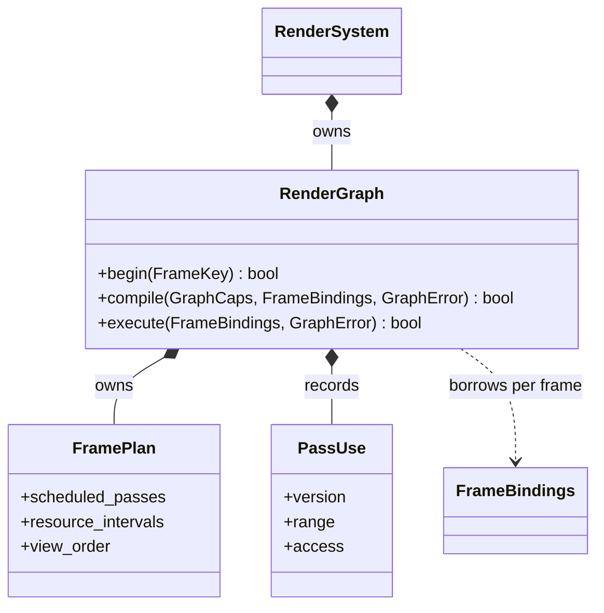
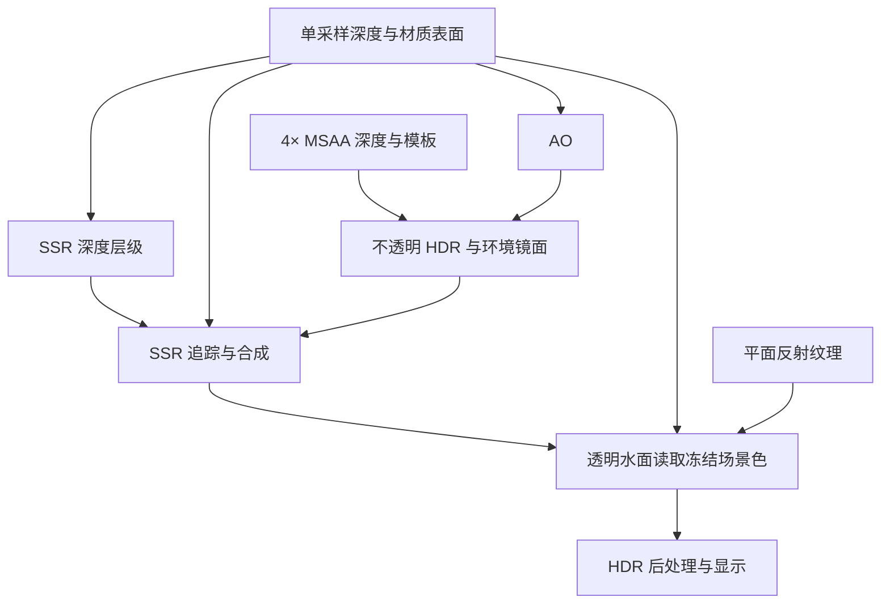

# 跨平台渲染图架构提案

## 决策与边界

**本方案待评审。** 建议在运行时 `RenderSystem` 内增加一层 Render Graph。各效果声明它们读取和写入的资源版本，编译器从显示、回读和必须发布的结果反推活跃通道，生成可直接交给 bgfx 执行的顺序。现有前向着色、材质、资源插件和平台宿主继续承担各自职责。本文定义目标契约；实现从下文 M0 开始。

**第一项交付**是同一帧的可检查执行计划。**第一项性能实验**是从后处理链找出一份可省的中间目标或一次可省的读写。图负责通道间的资源；`MaterialBinding` 和绘制批次负责通道内的绑定组合。两项优化各自做 A/B，才能把帧耗变化归到正确的位置。

Render Lab 上次 Android Vulkan 模拟器实测为固定 15.76 FPS、移动 13.54 FPS，实际显示间隔 P95 分别为 67.78 和 84.06 ms。庭院材质纹理绑定减少 12.9% 后，描述符集仍为 360 个/帧，其中不透明 PBR 228 个、SSR 材质表面 105 个。**Android 真机全效果 30 FPS 是第一档目标，33.33 ms 是预算，60 FPS 是后续目标。** 模拟器的 CPU 采样与 Metal 的 GPU 阶段时间分别保留，跨设备数据不作加减。

架构边界在每帧已准备的场景输入与 bgfx Views 之间。运行时图使用内部值类型，编辑器通过现有性能/诊断入口读取只读快照。场景持久属性仍由相机、环境和灯组件提供。GUID、catalog、资源插件、Shader 离线构建与 ECS 的所有权沿用原有契约。[现有渲染类图](render-system.md) · [提交与合批](render-submission.md) · [渲染扩展](render-extension.md)

## 类与所有权

运行时新增一个具有行为的私有类型 `engine::render_detail::RenderGraph`，由 `RenderSystem` 独占。图中其余新增项均为值记录。既有 Pass 拥有着色程序、持久目标和执行方法。通用编译部分只处理逻辑记录，执行部分在 runtime/render 内把记录落实为 bgfx 操作，首版共用一个执行实现。下表是拟议的模块内签名，输出参数用引用，带状态的操作均为 `[[nodiscard]]`。

| 阶段 | 最小调用契约 | 所有权与失败状态 |
| --- | --- | --- |
| 开帧 | `begin(const FrameKey&) -> bool` | 在准备成功后开始声明，生成非零图代次。清场景、正常绘制、影片各有自己的输出根。候选声明属本帧。 |
| 描述资源 | `create(const ResourceDesc&, ResourceId&) -> bool`、`import(const ResourceDesc&, ExternalSlot, ResourceVersion&) -> bool` | 临时资源起初未定义；导入把外部槽映射到已有版本。调用方持有物理对象，实际句柄和内容有效性由本帧绑定表给出。 |
| 登记通道 | `add_pass(const PassDesc&, PassId&) -> bool`、`read(PassId, ResourceVersion, const UseDesc&) -> bool`、`write(PassId, ResourceId, const UseDesc&, ResourceVersion&) -> bool` | PassDesc 含通道键、观察者、执行阶段及命令入口。消耗 View 的通道另标 Raster、Compute 或 Copy。读旧写新、覆盖、加载、解析均有明确用途。保留内容的写入通过 `UseDesc.prior` 显式指定输入版本及其范围。写入失败返回无效版本。 |
| 确认结果 | `export_version(ResourceVersion, ExternalSlot) -> bool`、`require(PassId, EffectToken) -> bool`、`order(PassId before, PassId after) -> bool` | 显示/供外部消费的版本和有副作用的作业是活跃根。外部拥有者负责跨帧保存。相同作业身份只能完成一次。外部槽属于调用方；导出时写入该槽的既有物理资源，必要的复制显式入图。 |
| 编译与执行 | `compile(const GraphCaps&, const FrameBindings&, GraphError&) -> bool`、`execute(const FrameBindings&, GraphError&) -> bool` | 编译借用本帧绑定，核对设备能力、输入覆盖、物理别名和输出保留区间，再分配 View。执行使用同一帧的绑定快照，首条命令前复核；若已变更，调用方重编。每个图代次最多执行一次，失败后以新代次重试。计划只存槽、范围、稳定键与顺序。回调使用当前帧借用的相机、绘制列表及物理资源；通过当前 Pass 的声明查找实际附件/缓冲。 |
| 退出 | `reset() noexcept -> void` | 丢弃候选与计划，按 bgfx 生命周期退役图拥有的对象。由设备关闭、重建或拥有者析构调用，支持重复清理。 |

`PassId / ResourceId / ResourceVersion` 是带代次的值句柄。资源版本另含逻辑资源身份与写序号。图拥有 `FramePlan` 与声明数组；计划引用声明中的整数槽。执行回调不捕获跨帧的 ECS 指针、栈引用或旧 GPU 句柄。保存在计划缓存里的入口用静态函数加本帧槽解析，供跨帧读取的诊断快照按值复制。

`FrameKey` 描述设备代次、输出尺寸/格式/采样数、帧类型和视图配置。复用计划还要核对**完整声明的结构相等**，包括实际选用的通道、版本依赖、附件描述、输出根、外部保留槽、槽间物理别名关系与设备能力。`FrameBindings` 提供设备与资源代次、物理身份、访问范围和初始有效区域。编译按物理身份及重叠范围归组，缓存只保存这些关系及影响首读的有效性条件。两个不同的导出值若须同时保留，重叠的外部槽必须能改用独立存储，否则报告两个导出名和冲突范围。两槽从独立对象变为同一目标时，须在提交前重编或明确拒绝该绑定。哈希仅用来加速比较。变动的矩阵、材质值、页号由绑定表传入；如实际视图数、读写范围或通道形状变了，更新相应声明并重编。图代次仍逐帧变化，命中缓存的计划重新映射到本帧槽位。

## 编译和资源契约

1. **建立版本与依赖。** 纹理描述包含格式、色彩空间、尺寸、样点数、mip、层/面、usage；缓冲描述包含尺寸、布局及用途。访问分别描述采样、颜色/深度/模板附件、存储读写、顶点/索引/间接命令、复制、resolve、呈现、回读。纹理按 aspect、mip、layer 跟踪，缓冲按字节区间跟踪。单写者产生一个新版本；同一物理范围的写后读、读后写、写后写都要排序。不相交子资源可独立调度。
2. **确定内容从哪里来。** 首次读取或附件 Load 须有已定义的生产者或有效导入。局部清除、阴影页矩形、裁切、混色和模板测试都可能保留旧内容，登记“读旧版本、写新版本”。未触及的范围继承旧版本的定义状态，首次局部写只定义本次覆盖区域。附件的固定功能混色、深度或模板读改写可沿用同一物理附件；着色器同时采样旧颜色并写回该范围则需要独立目标。范围难以证明时按整份资源保守追踪。无法证明覆盖范围内已有有效内容时，选择完整初始化或拒绝读取。跨帧反馈以先前已发布版本导入，防止把时间上的依赖误建成本帧环。
3. **从根裁剪、稳定排序。** 反向标记影响输出的通道及必须发生的副作用。历史更新、请求中的截图/烘焙回读、页表发布、插件有序绘制都可成为根。对存活节点拓扑排序，相同优先度沿用原调度次序。具有画家顺序、共面胜者、模板消耗或可见外部副作用的操作通过 `order(before, after) -> bool` 登记显式顺序边。遇到环，报告一条含通道和资源版本的闭合依赖链。纯顺序边只约束两端均存活的通道，必须执行的前置作业登记为根或由真实数据依赖保活。活跃性沿内容依赖回溯；物理上的反依赖和写入顺序在活跃通道之间补齐，避免为已被完整覆盖的旧写入保留绘制。
4. **计算物理生命期。** 记录第一次写、最后一次读、需要保留的 aspect、附件 load/store 与 resolve。导入的 swapchain、图集、历史、GPU readback 继续归原拥有者。首版按原目标执行；开启复用后，同一个合规 bgfx 纹理可服务按 GPU 顺序互斥的两个瞬态版本，要求物理描述/访问能力匹配、后者全范围初始化。Framebuffer 的键包含物理附件身份及代次、子资源和 resolve 配置。CPU 到帧末、连续若干帧或收到提交序号均不能单独证明 GPU 已完成。跨帧优先沿用已有对象销毁和有序提交语义，缺少可靠完成契约时隔离在途对象。
5. **映射到 bgfx。** 逻辑通道可展开为多个物理 View，Copy、Compute、Raster 有实际前后依赖时分别安排。单个 View 内遵守 bgfx 的分类和排序规则。先校验活跃依赖能否映射到 bgfx 的阶段。`updateTexture` 类上传在各 View 之前生效；blit 属于指定 View，回读请求和完成轮询有各自的 API 时序。若本帧既需先采样旧页表，又要原地预上传新表，必须提供另一物理版本或有序 GPU 复制。没有等价路径时在提交前报告冲突。首版保留各域当前占用的 View，检查实际能力与保留区间，在提交前一次生成 `setViewOrder`。每个活跃 View 重设目标、矩形、排序、清除和变换。图依据依赖选择已验证的提交序列；原生屏障与具体布局转换仍由后端完成。
6. **发布与失败。** 检查完成后才发布候选计划；条件改变时，旧计划只可用于与原签名匹配的帧。句柄陈旧、未定义读取、能力缺失、反馈冲突、View 耗尽或目标分配失败，报告 Pass 名、资源版本、用途、平台和具体原因。沿用 `PassTargets` 在场景作用域内按预算分十步准备的契约。等待目标就绪时宿主返回 `RenderSubmitStatus::deferred`，分配或契约出错返回 `failed`，完整提交后返回 `submitted`。执行中途出错时，已编码 GPU 工作无法撤销；沿用现有帧收尾，标记部分写入的持久内容失效，取消受影响的发布/回读，下一帧显式重建。持久内容由原缓存拥有者负责确认或作废。RVT/VSM 用候选映射生成本帧页表，登记可能覆盖的物理页。编码前失败直接丢弃候选；已有覆盖命令时，即使宿主仍提交这帧，也须作废涉及的旧映射并把相应页标脏。`RenderSystem` 在统一收尾中通知拥有者，整帧成功才提交新映射。截图、烘焙等请求由原业务按请求身份去重，GPU 完成后回执。现有 RVT 准备会推进真实映射，迁移该域之前要先具备候选与取消语义。[页缓存](../../../src/engine/runtime/render/rvt/virtual_texture_cache.cpp) · [页表上传](../../../src/engine/runtime/render/rvt/rvt_pass.cpp)

**编译及失败验收。** 同规格外部纹理从独立对象改为同一 mip 时应重编或明确报错，两个独立 mip 可分别导出。构造旧页表采样与预上传的冲突，裁掉旧读取后应能编译。在页覆盖已编码时令扩展返回失败，下一帧被覆盖的旧页必须重新生成。给截图设未来的提交序号，验证当前帧照常显示、请求继续等待。

## Render Lab 的第一张图

上图只展开主相机的深度、反射和颜色依赖。单采样结构深度与 4× 深度/模板分别有身份。前者供 AO、SSR 和反馈读取；后者服务逐样点覆盖与共面次序。只有格式、样点、实际参与几何、裁切及覆盖规则一致时，才选已有的表面/深度合写路径。SSR 实际读取表面、深度层级、场景色与环境镜面等输入；透明物体采样冻结后的颜色，合成写入另一兼容目标，防止边读边改同一图像。[场景绘制](../../../src/engine/runtime/render/render_scene.cpp) · [HDR 与透明合成](../../../src/engine/runtime/render/passes/hdr_post_process_pass.cpp)

| 帧中工作 | 图中的真实依赖与顺序 |
| --- | --- |
| 蒙皮、动态几何与 Meshlet | 变形写顶点，索引压紧和剔除写索引、计数与间接命令。主相机深度、表面和颜色可共享已验证的主视图列表；反射、光源和探针各用自己的观察者。 |
| 常规阴影、VSM 与 RVT | 图集局部清除保留其他页。RVT 页表上传登记在 bgfx 的 View 执行前阶段，页绘制进入有序 View。VSM 消费已完成的旧反馈，本帧接收面生成下一份反馈。静止页的有效性归所属缓存判断。 |
| 大气、灯簇与平面反射 | LUT、光源与簇缓冲依赖对应视图。每个镜面有独立相机、斜裁剪和反射颜色目标，写完才能给水面采样。两个镜面和独立捕获若与主镜头共享物理阴影图集，须先完成旧内容的读取，再允许另一个观察者覆写。 |
| AO、SSR、HDR、Bloom | Hi-Z 的 mip、AO 的分层目标及模糊的交替纹理独立声明。复用输入须保持分辨率、色彩空间、精度、滤波与采样时刻；4× MSAA 的源和 resolve 结果是两个版本。水面合成涉及逐样点颜色初值时沿用全屏绘制，普通 blit 只初始化已 resolve 的颜色。Hi-Z 的交替 mip 依赖深度 revision；AO 缓存还核对所有 AO uniform。 |
| 插件、文字、UI 与显示 | 透明、3D 文字、插件与调试绘制按原通道的混合、模板和先后顺序执行。扩展继续使用 `RenderExtension::draw(const RenderContext&)`，同步借用当前镜头和 View，通过原有附件有序绘制。保留注册顺序和回调失败结果；内部访问未知时限制跨边界重排与复用。LDR UI、调试层、显示与最终屏幕截图分别声明。 |
| 辅助输出与无场景路径 | 场景线性 HDR 捕获、探针/烘焙与最终显示截图分别导出。场景线性 HDR 取映射前 RGBA16F，屏幕截图取含 UI 的 BGRA8。原生回读等待 bgfx 返回的就绪帧，Web 等异步回调；两者都持有 staging 至读取完成或安全退役。影片和纯清屏登记各自输出/副作用根，保留现有暂停、无相机、编辑器预览与设备恢复行为。 |

**以 Bloom 为例。** View 135 从冻结的 HDR 场景色提取亮部，136 读取亮部并写纵向模糊，137 同时读取场景色与模糊纹理，完成横向滤波和色调映射。亮部纹理在 136 仍是输入，同一时刻 136 的输出必须有独立存储。关闭 Bloom 后，137 使用现有黑色占位纹理，135 和 136 随之退出活跃图。这个例子可以同时验出错误裁剪和错误复用。

**截图会改变本帧的输出。** 普通帧可直接写交换链。本帧截图须同时满足设备代次、提交序号门槛、场景作用域与收集状态。未符合的请求继续排队。对符合的请求，在编译前选择可回读的 BGRA8 显示目标，场景与 UI 都写入该目标，随后分别呈现和复制回读。请求结束后下帧可恢复直出；同一分辨率下两条路径的根和物理槽不同。已选的辅助回读若不可用，按现有 `readback_unavailable` 结束该请求，显示继续提交；显示链自身的必需资源失效才上报整帧失败。独立的线性 HDR 截图仍取色调映射前的场景图。[截图请求选择与完成](../../../src/engine/runtime/render/render_observation.cpp)[当前显示与回读](../../../src/engine/runtime/render/passes/frame_output.cpp)

**过渡期间的 View 约束。** UI 占用 200，显示与显示截图使用 202、203，独立捕获有 239、242、243 等 View，编辑器 IBL 作业占用 240、241。按当帧实际占用及保留的唯一 ID 核对 `maxViews` 和现有 256 槽范围。GPU 顺序以 `setViewOrder` 为准。图外提交者继续占用原槽；`RenderSystem` 汇总各方后一次提交整帧顺序。[现有槽位声明](../../../src/engine/runtime/render/render_constants.hpp)

## 平台与执行

同一份逻辑图运行在六个平台的指定后端。能力来自设备及实际格式/usage 探测，结果纳入计划键。共同执行契约是有序 bgfx Views。原生多队列、队列所有权转移、硬件 subpass 融合、显式 heap alias 和跨帧 Vulkan 描述符缓存留给具备相应契约的后端。首版不需要新增上游补丁。[bgfx 执行与排序](https://bkaradzic.github.io/bgfx/internals.html) · [现有渲染目标准备](../../../src/engine/runtime/render/render_scene_resources.cpp)

| 平台 | 方案落点 | 首项平台验收 |
| --- | --- | --- |
| Android · Vulkan | 按组合检查颜色/深度格式、MSAA、可采样/存储用途和附件数。优先看可去掉的整屏复制、resolve 和附件写回。 | 指定一台真实手机，记录型号、GPU/驱动、分辨率和温度状态。采集原生 render pass、CPU/GPU 时间线；可读外存计数器时记录真实字节。[Khronos 移动端子通道实例](https://docs.vulkan.org/samples/latest/samples/performance/subpasses/README.html) |
| iOS · Metal | 用附件最后一次读取推导 store/resolve 候选；与 macOS 共用能力判定，单独验证移动 GPU 和设备恢复。 | 真机检查 MSAA 颜色、深度、模板与透明水覆盖，再用 Metal capture 确认实际附件动作。[Apple GPU 与分块渲染](https://developer.apple.com/documentation/metal/tailor-your-apps-for-apple-gpus-and-tile-based-deferred-rendering) |
| macOS · Metal | 使用现有 Metal resolve-only 支持；后续仍读多样点源时要保存。 | 同设备、同工作负载核对现有线性 HDR 原图、编码器和附件读写。[现有 Metal 适配](../../../third_party/overlay-ports/bgfx/metal-resolve-only-attachments.patch) |
| Windows · D3D12 | 图声明 SRV、UAV、RT、深度与间接用途，bgfx 后端执行状态转换。图内同句柄复用与原生 placed resource 别名分别计量。 | 查 D3D12 验证信息，重点检查 compute 写后作为间接绘制输入、子资源深度读写和 resize。[D3D12 资源状态](https://learn.microsoft.com/en-us/windows/win32/direct3d12/using-resource-barriers-to-synchronize-resource-states-in-direct3d-12) |
| Linux · Vulkan | 与 Android 共用访问契约，按桌面设备自身的特性、预算和驱动执行。 | 在 Vulkan 验证开启时覆盖图像使用冲突、复制、resolve 和多视图；性能用关闭验证的 Release 包采集。 |
| Web 游戏导出 · WebGPU | 宿主异步取得 adapter/device；应用 worker 保有画布和提交权。按 WebGPU 的 usage scope 核对子资源，冲突时拆 pass 或用独立资源。设备丢失、未 ready 与回读回调沿用宿主状态。 | 浏览器验证无 usage 冲突，覆盖暂缓启动、resize、异步回读、设备丢失与重新准备。[Web 宿主类图](web-host.md) · [WebGPU 规范](https://www.w3.org/TR/webgpu/) |

能力不足时先尝试**逐像素等价**的保守路径，如完整 Store + Resolve、独立临时纹理、沿用原绘制次序。若原效果本身要求设备缺失的能力，返回原因并保留用户请求的画质设置。桌面编辑器使用现有原生后端；WebGPU 面向导出运行包。

## 从现有管线迁移

| 阶段 | 有限改动 | 通过条件 |
| --- | --- | --- |
| M0 · 调度对照 | 图从原 pass 登记依赖与 View 锚点，只生成诊断计划；旧调度仍是唯一提交者。逐类登记 CPU 上传、外部根与保留槽。 | 对当前 256 项重排里的**所有活跃 View**逐个解释生产者、消费者和顺序差异。验证缺边、未初始化 Load、循环、View 预算溢出能定位原因。 |
| M1 · 首个实际切片 | 把 HDR/Bloom/最终映射接到图，导入现有目标，保留 UI 200、烘焙 240/241、捕获等锚点。接管的工作只执行一次。 | 覆盖 Bloom 开/关、连续三帧无截图→请求显示截图→恢复直出、线性 HDR 截图；整帧基线、实际 load/store 次数、CPU 建图/编译耗时可查。先以零图像差异验证调度。 |
| M2 · 主相机及冻结颜色 | 接入结构深度、材质表面、AO、SSR、4× 深度模板与透明。保留 Hi-Z 和 AO 缓存的各自失效规则。再独立试验一个具备兼容描述与非交叠区间的瞬态目标。 | 共面/裁切、4× 样点、SSR、水面和相机往返的 RGBA/HDR 对照通过。记录目标峰值或实际读写变化及整帧影响；无合格区间就保留原物理布局。 |
| M3 · 多视图与持久状态 | 接入蒙皮、Meshlet、阴影、灯簇、双平面、大气、RVT/VSM、探针和外部有序节点。所有参与者登记后移除手工 View 重排，只保留一个正式执行入口。 | 空场景、影片、编辑器、作用域切换、页更新失败、设备重建与在途回读通过；逐平台验证条件见上表。 |
| Android 30 FPS 里程碑 | 用同一套资源插件生成 Bistro 全开 Release 包，记录设备、运行参数、目录/资源摘要。分开试验图调度、目标复用和材质提交。 | 同一真机、分辨率和效果下，预热至温度与帧耗稳定，均记录固定和移动镜头，建议各持续 60 秒。两者窗口实际显示 FPS 达 30（按同一设备显示周期处理计时精度）且 P95 ≤ 33.33 ms；同时报告超预算帧比例与最长连续超预算段。 |

**具体验证。** 正确性在同一进程对同资源、同相机和同动画/水面相位的两次执行做全帧逐像素比较。固定街景、庭院、全景及同轨迹的移动关键帧要求 RGBA 最大通道差为 0；线性 HDR 在同一平台按既有回归比较。验证模式一次只执行一种调度，跨帧状态需从等价状态启动。性能计时在独立 Release 运行采集，采用真实显示时间戳，CPU/GPU 关键路径分别列出。各平台各自对照，Android 真机数据决定该里程碑。[已有渲染提交回归](../../../tests/runtime/render/render_submission_test.cpp)

**诊断输出。** 每个记录带帧/设备代次、场景和逻辑视图名。可按通道追到读写版本、物理句柄代次、View ID、第一次/最后一次使用、裁剪/保留原因、物理 View 的分组、附件复用或拒绝复用的原因。原生通道是否合并另查平台抓帧。汇总活跃通道、draw/dispatch、copy/resolve 次数、临时目标峰值、CPU 声明/编译/提交与各 GPU 阶段时间。图估算的附件字节与设备计数器实测的外存字节分列，设备未暴露计数器则标为未采集。诊断通过现有性能系统，详细抓取由编辑/MCP 按需开启。

**30 FPS 的决策点。** 当前模拟器移动 P95 与预算相差约 50.73 ms；这一差值不能外推到真机。若真机显示 GPU 在等待提交，就对两个热点 PBR 程序统计每帧和跨帧实际唯一的纹理、采样器、缓冲与布局组合，并计量描述符创建所在的 CPU 时间。在引擎侧先减少等价组合，原生分配策略另行举证。若瓶颈是片元着色或附件存取，就优先实测被重复处理的可见几何、材质求值或目标读写。每项变更分别报告像素、实际工作量和整帧结果。

## 参考取舍

下表按可落到本引擎的决策列出参考。固定提交链接对应已核对的公开文件；产品文档用于理解公开契约。商业及授权资料仅作本地评审，设计以本项目契约和公开资料独立表述。

| 参考 | 采用的长处与在本方案中的落点 |
| --- | --- |
| Filament | 将声明和执行拆开，用资源版本、首末使用点和附件保留推导物理执行。取其小接口，落到 `RenderGraph`。 [FrameGraph 实现](https://github.com/google/filament/blob/414602be0e255ac0045d684d7dd5299d760d0de5/filament/src/fg/FrameGraph.cpp) |
| O3DE Atom | 附件用途、访问阶段、resolve 和瞬态分配分别建模。采用明确的 `UseDesc`；原生多队列需要后端实际暴露同步能力。[Atom 图编译器](https://github.com/o3de/o3de/blob/f9cf6109955246c88df90e475b50826d425a36e1/Gems/Atom/RHI/Code/Source/RHI/FrameGraphCompiler.cpp) |
| Ant / bgfx | 在 bgfx 上方表达效果依赖，以 View 作为执行落点。M1 从后处理导入，通过既有目标拥有者过渡。[Ant FrameGraph](https://github.com/ejoy/ant/blob/f32fbd4811e90c2433bf159aa40fb8f8aceb8b58/pkg/ant.render/framegraph.lua) · [bgfx Views](https://bkaradzic.github.io/bgfx/bgfx.html#views) |
| Unreal RDG、Unity URP、Frostbite | 采用 RDG 的参数声明、外部输出及验证思路，采用 URP Viewer 的读写/未合并原因，采用 Frostbite 各效果独立登记、整帧统一规划的分工。[Unreal RDG](https://dev.epicgames.com/documentation/unreal-engine/render-dependency-graph-in-unreal-engine) · [URP Viewer](https://docs.unity.com/en-us/engine/6000.0/manual/render-pipelines/universal-render-pipeline/customizing-urp/render-graph/viewer-reference) · [Frostbite 公开演讲](https://www.gdcvault.com/play/1024612/FrameGraph-Extensible-Rendering-Architecture-in) |
| The Forge、Wicked Engine、AnKi | 可见性与间接几何输出可以供后续通道共享。沿用独立观察者和覆盖规则，显式连接 compute 写与 indirect/index 读。[The Forge 三角形过滤](https://github.com/ConfettiFX/The-Forge/blob/cd5046893faba2dc7869243873bf01f02a6f0df9/Examples_3/Visibility_Buffer/src/Shaders/FSL/TriangleFiltering.comp.fsl) · [Wicked 3D 渲染路径](https://github.com/turanszkij/WickedEngine/blob/62d913606e8ee2aa2958e83f7bbb8c07d81ae8c9/WickedEngine/wiRenderPath3D.cpp) · [AnKi GPU 驱动渲染](https://anki3d.org/gpu-driven-rendering-in-anki-a-high-level-overview/) |
| Flax、Spartan | 分别借鉴物理目标匹配、深度变体按实心或裁切选择真实输入。M2 以完整描述分配纹理，以所选变体登记依赖。[Flax 目标池](https://github.com/FlaxEngine/FlaxEngine/blob/ded00bc8689ed427ae84f82065d23a9224a2bac5/Source/Engine/Graphics/RenderTargetPool.cpp) · [Spartan 深度变体](https://github.com/PanosK92/SpartanEngine/blob/d1ccb5efcec2f06c4715200b01df5afc9d6f980b/data/shaders/meshlet_mesh_depth.hlsl) |
| NoGraphicsAPI | 学习用明确完成事件检验在途资源退役。用于设计回读/resize/设备丢失测试，bgfx 继续拥有后端堆与同步。[退役验证](https://github.com/sebbbi/NoGraphicsAPI/blob/ffd9f2ab6b7442dcfbe0cb0051d84d0edb078d89/tests/timeline_retirement_test.cpp) |
| Flame、动画与几何上游 | Flame 的批量 2D 提交提示保留 UI 和透明画家顺序。动画/蒙皮与 GeometryFX 等几何实现贡献的是输入/输出边界；制作工具和动作算法继续留在原领域。[Flame SpriteBatch](https://github.com/flame-engine/flame/blob/bf63e37d6979318f4d7d56171bddef5f6cd2b6fa/packages/flame/lib/src/sprite_batch.dart) · [GeometryFX](https://gpuopen.com/archived/geometryfx/) |
| AMD、Khronos、Apple 与图形编程周报原文 | 已有 AO 使用自己的精度、采样核和缓存，图只声明数据。Khronos 的 descriptor 与 tile 样例分别校验 CPU 提交和 GPU 外存两条假设；Apple 文档约束附件动作。周报用于找到作者的图编译资料。[Khronos 描述符管理](https://docs.vulkan.org/samples/latest/samples/performance/descriptor_management/README.html) · [AMD CACAO](https://gpuopen.com/fidelityfx-cacao/) · [Render Graphs 原文](https://apoorvaj.io/render-graphs-1/) |
