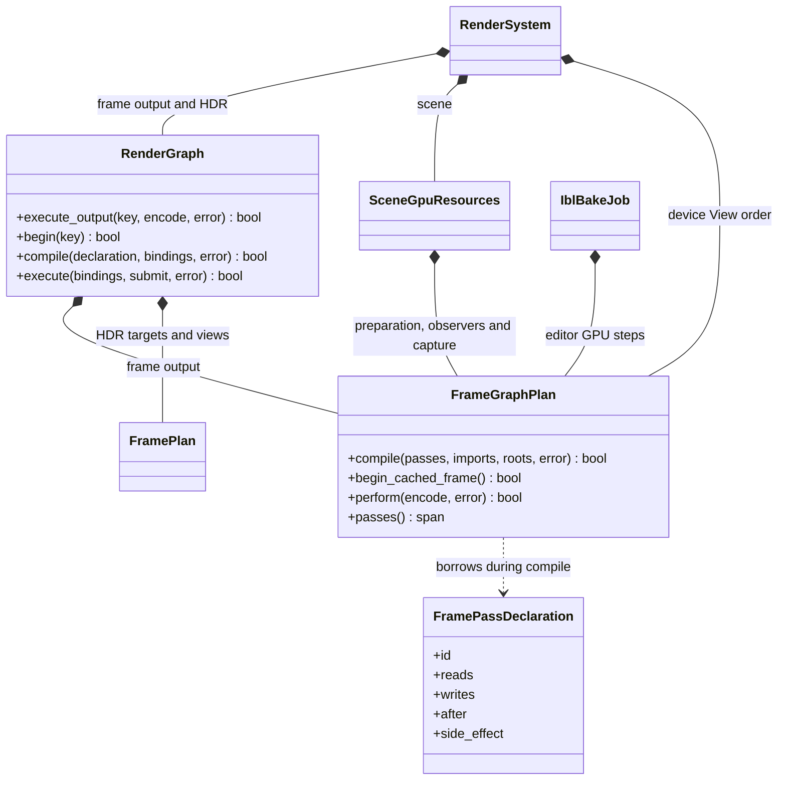

# 跨平台渲染图

运行时使用同一个依赖编译器调度帧输出、场景和各效果。每个作用域声明自己读取、生成的资源版本以及必须执行的副作用。编译器给出活跃通道的执行顺序，拥有 GPU 资源的 Pass 在回调中编码，设备级计划将工作排入 bgfx View。材质绑定与通道内绘制批次由提交层管理。[渲染系统](render-system.md) · [提交与合批](render-submission.md) · [渲染扩展](render-extension.md)

## 类与所有权

`RenderSystem` 独占设备 View 计划、帧输出和 HDR 调度器。`SceneGpuResources` 持有场景准备、主相机和漫反射捕获计划，效果 Pass 持有各自的计划、GPU 句柄和跨帧缓存。编辑器的 IBL 作业直接使用运行时的计划类型，烘焙状态及结果发布留在编辑器插件。[渲染系统](../../../include/engine/runtime/render/render_system.hpp) · [场景 GPU 资源](../../../src/engine/runtime/render/scene_gpu_resources.hpp) · [IBL 作业](../../../src/engine/plugins/editor/scene_bake/ibl_bake_job.cpp)

## 逻辑声明与执行

- 一个 `FramePassDeclaration` 给出作用域内的通道 ID、读写的资源版本、只约束先后的 `after` 前驱以及副作用标记。一个版本由外部导入或由唯一通道写入。每个计划容纳最多 256 个通道、512 个版本，声明中的 span 只在编译期间借用。
- `compile` 从输出根和副作用反向沿读取边保留生产者。先后约束只排列已经活跃的工作。裁掉中间通道时，经过它的顺序约束仍传递给活跃端点。多个通道同时就绪时，编译器按声明顺序选择。未知前驱、重复生产者、缺失的活跃输入和活跃环会返回 `FramePlanError`，其中环路径有效至下次编译或计划销毁。
- `perform` 按计划逐项调用编码回调。某项返回失败时，执行到此结束，计划记为已消费，错误标明该通道。拥有者确认结构相同后，可用 `begin_cached_frame` 重新启用已消费的计划。结构变化由拥有者触发重新编译。[公开接口](../../../include/engine/runtime/render/frame_graph_plan.hpp) · [依赖编译器](../../../src/engine/runtime/render/frame_graph_plan.cpp) · [依赖与域计划测试](../../../tests/runtime/render/render_foundation_test.cpp)

## 已接入的工作

| 作用域 | 进入计划的实际工作 |
| --- | --- |
| 帧输出 | 影片 YUV 各平面上传、清屏、场景或影片绘制、漫反射捕获、UI、虚拟纹理与阴影调试窗口、呈现和截图。截图按封帧前的请求编号消费。 |
| 场景准备和主相机 | 镜面观察、RVT、光照和阴影准备、可见几何、Meshlet、材质表面与深度、AO、MSAA 深度、天空、不透明、反射、冻结、透明、文字、扩展、调试以及线性颜色回读。 |
| AO、SSR 和大气 | ASSAO 的 11 个计算阶段各自声明版本。SSR 逐级声明深度，缓存命中时导入已有 mip，再追踪与合成。大气区分共享介质 LUT、观察者天空 LUT 和背景绘制。 |
| 蒙皮与 Meshlet | 骨骼矩阵上传、变形输出准备和 GPU 蒙皮。直接变形顶点流上传。Meshlet 索引拷贝、三类数据上传、清零、剔除、压紧和可选回读按缓冲版本调度。 |
| 光照与虚拟阴影 | 每个观察者单独生成阴影与分簇光照。各级联、点灯面和虚拟页可导入缓存或重画。VSM 反馈清零、需求计算、回读、深度范围和页表发布保留各自依赖。 |
| 捕获和编辑器烘焙 | 漫反射捕获独立声明灯光、视图清除、可见集、天空、几何、拷贝和回读。IBL 在所属编辑器插件内复用相同编译器，每步只编码当前帧可用的计算、立方体面复制或回读。 |
| RVT | 初始化图集，每个候选物理槽独立绘制，成功后发布映射并逐 mip 上传页表。预留槽位时旧映射仍可用，编码覆盖后或整帧失败时作废受影响的映射。 |

## 物理 View 与窗口输出

设备初始化时，`compile_device_views` 将全部 256 个保留 View 作为输出根编译。设备可用 View 数少于 256 时，初始化失败。独立 View 按编号打破平局。每帧清屏阶段通过 `bgfx::setViewOrder` 提交已编译的顺序，当帧逻辑计划决定各 View 是否产生绘制、计算或拷贝。GPU 更新命令及结果回读还遵循 bgfx 自身的帧生命周期。[设备 View 计划](../../../src/engine/runtime/render/render_view_order.cpp) · [渲染入口](../../../src/engine/runtime/render/render_system.cpp)

场景的 HDR 输出以及影片合成都写入 `FrameOutput` 的 BGRA8 目标。普通场景和空场景可依次合成 UI、RVT 和 VSM 调试图层。影片帧上传两个或三个 YUV 平面，清屏后绘制影片。两条路线都在 View 202 采样最终图像并呈现，有截图请求时再按请求读取同一份图像。帧类型、可选工作和影片色度平面布局组成 `OutputGraphKey`，用于复用输出计划。[帧输出声明](../../../src/engine/runtime/render/passes/output_graph.hpp) · [窗口目标](../../../src/engine/runtime/render/passes/frame_output.cpp)

## HDR 与 Bloom 的物理绑定

HDR 使用专用的 `FramePlan` 将逻辑版本落实为本帧纹理槽与固定 View。每个声明支持一个输出根、最多 8 段、16 个版本，每段至多采样两个输入并完整写入一个颜色目标。开启 Bloom 时执行亮区提取、模糊和最终映射，对应 View 135、136、137。关闭时只执行 137，第二采样槽绑定黑色纹理。[HDR 声明](../../../src/engine/runtime/render/passes/hdr_graph.hpp)

缓存键包含输出尺寸、样点数和设备 View 上限，同时匹配通道声明。编译期不可变声明按身份匹配，动态声明按值比较。编译记录每个活跃槽的首次与最后使用点，验证 View 区间以及纹理身份。不同活跃槽须绑定不同的有效纹理。命中缓存而纹理句柄改变时重新校验。执行前绑定必须与本次编译一致。Pass 继续管理实际纹理和 Framebuffer。[图实现](../../../src/engine/runtime/render/render_graph.cpp) · [HDR 绑定与执行测试](../../../tests/runtime/render/render_submission_test.cpp)

## 扩展与验证边界

增加可选阶段时，首先在所属作用域声明输入、输出及副作用，并把改变依赖结构的条件纳入该作用域的缓存键。新增或改变物理 View 时，还要更新设备级依赖。逻辑计划可独立验证裁剪、顺序与错误，实窗验证覆盖完整输出、可选效果及跨帧回读。[主相机声明](../../../src/engine/runtime/render/passes/scene_graph.hpp) · [渲染验证与平台数据](../../testing.md#bistro-全效果渲染图)

全帧通用的子资源访问与瞬态显存分配、异步计算队列、普通帧直接写交换链，以及可跨帧查询的完整图诊断快照属于后续设计。当前物理纹理由各 Pass 分配，窗口沿上述离屏合成路径呈现。新增后端功能的收益需分别核对实际 GPU 命令与对应设备的整帧测量。[bgfx View 语义](https://bkaradzic.github.io/bgfx/bgfx.html#views) · [Filament 的声明与执行](https://github.com/google/filament/blob/414602be0e255ac0045d684d7dd5299d760d0de5/filament/src/fg/FrameGraph.cpp)
