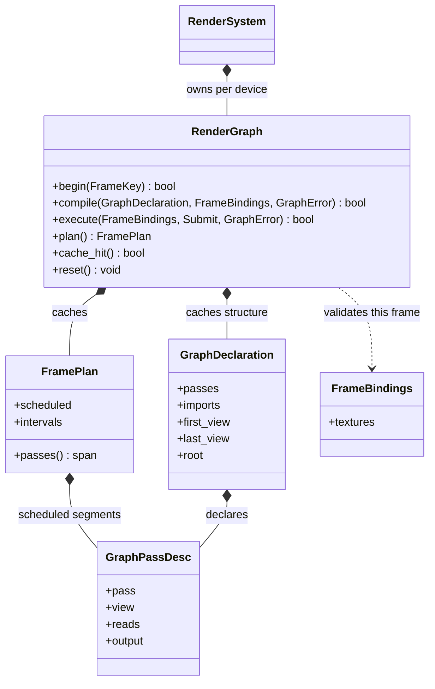
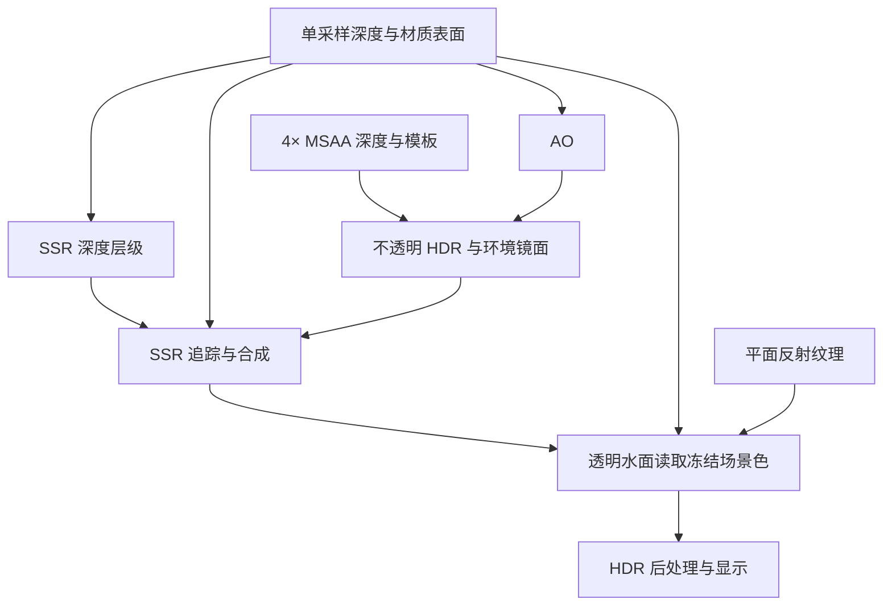

# 跨平台渲染图

## 决策与边界

运行时 `RenderSystem` 已通过渲染图提交 HDR/Bloom 后处理。图从最终显示颜色反推活跃通道，校验资源依赖和固定 View 顺序，由现有 Pass 将计划编码到 bgfx。当前接管范围与后续整帧设计分列如下。

**先用同样的 GPU 工作量测调度成本，再单独试普通帧直出。** 第一项交付是能追溯到实际 bgfx View 的帧计划。第一项性能候选是省去普通帧 View 202 的全屏呈现绘制。图负责通道间的资源；`MaterialBinding` 和绘制批次负责通道内的绑定组合。两项优化各自做 A/B，才能把帧耗变化归到正确的位置。

Render Lab 的 Android 样本来自 `8ed8602c`，使用 Vulkan 模拟器、1280×720、4× MSAA、效果全开。每个窗口约 6 秒，固定镜头 95 帧、移动镜头 82 帧，实际显示分别为 15.76 和 13.54 FPS，显示间隔 P95 为 67.78 和 84.06 ms。庭院材质纹理绑定减少 12.9% 后，另一个连续 19 帧的采样窗内，描述符集仍为 360 个/帧，其中不透明 PBR 228 个、SSR 材质表面 105 个。**Android 真机全效果 30 FPS 是第一档目标，33.33 ms 是预算，60 FPS 是后续目标。** 模拟器的 CPU 采样与 Metal 的 GPU 阶段时间分别保留，跨设备数据不作加减。

架构边界在每帧已准备的场景输入与 bgfx Views 之间。运行时图使用内部值类型，编辑器通过现有性能/诊断入口读取只读快照。场景持久属性仍由相机、环境和灯组件提供。GUID、catalog、资源插件、Shader 离线构建与 ECS 的所有权沿用原有契约。[现有渲染类图](render-system.md) · [提交与合批](render-submission.md) · [渲染扩展](render-extension.md)

## 已实现的类与所有权

图随渲染设备创建和释放。当前切片支持一个输出根、每段至多两个采样输入和一次完整颜色写入。声明容量为 8 段、16 个资源版本，编译与稳定帧执行均使用定容量存储。Bloom 开启时执行 View 135、136、137，关闭时只执行 137，第二采样槽绑定既有黑色纹理。最终颜色写入 `FrameOutput` 的 BGRA8 目标，UI、呈现和捕获沿用原顺序。

两份 HDR 声明在编译期生成，稳定帧以不可变声明的身份复用计划。动态声明按值比较。设备初始化时设置三个 HDR View 的名称、清除方式、恒等变换和排序模式，每次提交分别绑定本帧附件、尺寸与采样纹理。普通 Tracy 采样共用 `Render.hdrResolveSubmit` 标记，打开 `ENGINE_ENABLE_TRACY_FUNCTIONS` 后可进一步查看图声明、编译、绑定复核和执行阶段。

编译检查读取是否有来源、环、View 保留区间及活跃资源的物理别名。设备内以尺寸、采样数、View 上限及声明结构复用最近一次成功计划，物理绑定改变时重新检查有效性和别名。开始第一条编码前再次核对绑定，每个编译结果仅执行一次。正式构建使用图路线。测试构建可通过启动环境变量 `ENGINE_TEST_LEGACY_HDR=1` 选择旧调度。同进程 A/B 启动时清除此环境变量，使用 SDL 同名 Hint 在采样窗口之间切换；每个场景帧在开始绘制时读取一次选择。[编译器](../../../src/engine/runtime/render/render_graph.cpp) · [HDR 声明](../../../src/engine/runtime/render/passes/hdr_graph.hpp)

## 整帧扩展的目标契约

下表及后文描述拟议的整帧接口，包含子资源范围、多个输出、外部副作用及异步队列等后续能力。既有 Pass 保有着色程序、持久目标和执行方法，通用编译部分处理逻辑记录，执行部分在 runtime/render 内把记录落实为 bgfx 操作。

| 阶段 | 最小调用契约 | 所有权与失败状态 |
| --- | --- | --- |
| 开帧 | `begin(const FrameKey&) -> bool` | 在准备成功后开始声明，生成非零图代次。清场景、正常绘制、影片各有自己的输出根。候选声明属本帧。 |
| 描述资源 | `create(const ResourceDesc&, ResourceId&) -> bool`、`import(const ResourceDesc&, ExternalSlot, ResourceVersion&) -> bool` | 临时资源起初未定义；导入把外部槽映射到已有版本。调用方持有物理对象，实际句柄和内容有效性由本帧绑定表给出。 |
| 登记通道 | `add_pass(const PassDesc&, PassId&) -> bool`、`read(PassId, ResourceVersion, const UseDesc&) -> bool`、`write(PassId, ResourceId, const UseDesc&, ResourceVersion&) -> bool` | PassDesc 含通道键、观察者、执行阶段及命令入口。消耗 View 的命令段标注 Raster、Compute 或 Copy。一个可调度的 PassId 对应一次可独立编码的命令段。AO 的两次交换读写的 dispatch 各自登记；SSR 的各级深度、追踪和合成分别登记。旧回调无法拆开时，整体沿原序执行，登记其实际使用的固定 View 集合。CPU 借用有效到最后一次编码，GPU 资源覆盖对应物理命令的最后一次使用；内部时点未知则覆盖整个命令段。读旧写新、覆盖、加载、解析均有明确用途。保留内容的写入通过 `UseDesc.prior` 显式指定输入版本及其范围。写入失败返回无效版本。 |
| 确认结果 | `export_version(ResourceVersion, ExternalSlot) -> bool`、`require(PassId, EffectToken) -> bool`、`order(PassId before, PassId after) -> bool` | 显示/供外部消费的版本和有副作用的作业是活跃根。外部拥有者负责跨帧保存。相同作业身份只能完成一次。外部槽属于调用方；导出时写入该槽的既有物理资源，必要的复制显式入图。 |
| 编译与执行 | `compile(const GraphCaps&, const FrameBindings&, GraphError&) -> bool`、`execute(const FrameBindings&, GraphError&) -> bool` | 编译借用本帧绑定，核对设备能力、输入覆盖、物理别名和输出保留区间，再分配 View。执行使用同一帧的绑定快照，首条命令前复核；快照失效时按下文规则开始新代次。每个图代次最多执行一次，失败后以新代次重试。计划只存槽、范围、稳定键与顺序。每个观察者的矩阵、原点和绘制数据，从准备到其最后一次编码都有效。主相机与漫反射捕获会以不同原点重写 `frame_data`，故应分别保存所需数据，或在受约束的顺序内重新收集后立即消费；栈上矩阵须在作用域内消费或复制到观察者槽。物理附件按本段声明解析。[捕获数据](../../../src/engine/runtime/render/scene_capture.cpp) |
| 退出 | `reset() noexcept -> void` | 丢弃候选与计划，按 bgfx 生命周期退役图拥有的对象。由设备关闭、重建或拥有者析构调用，支持重复清理。 |

`PassId / ResourceId / ResourceVersion` 是带代次的值句柄。资源版本另含逻辑资源身份与写序号。图拥有 `FramePlan` 与当帧声明数组；计划通过整数槽解析本帧绑定。执行回调不捕获跨帧的 ECS 指针、栈引用或旧 GPU 句柄。保存在计划缓存里的入口用静态函数加本帧槽解析，供跨帧读取的诊断快照按值复制。

**声明和执行的有效期。** `begin` 打开新代次，只有声明阶段接受资源、段、根和顺序登记。在声明阶段出错使本次候选无效，并置空失败输出。编译成功即封住该代声明。编译后新到达的截图由原队列保留，进入下一合格帧。已封口后对该代调用登记接口返回失败，不修改计划。编译或首条命令前的绑定复核失败，该代不能退回到旧计划执行；需要重做时以新 `begin` 重新登记。进入编码即消耗本代唯一的执行资格。

**跨帧缓存。** M1a 只保留最近一次成功的不可变结构计划，并用一份候选暂存本次编译。缓存保存自己的规范化值记录和槽布局。逐帧代次只用于检查句柄有效性和重新映射，不参与结构相等比较。绑定场景对象时核对 scope、world epoch、物理代次；作用域退役时失效的是相应绑定。清理设备时由 `reset` 丢弃计划，旧代句柄不能复活。[作用域释放](../../../src/engine/runtime/render/render_observation.cpp)

`FrameKey` 描述设备代次、输出尺寸/格式/采样数、帧类型和视图配置。复用计划还要核对**完整声明的结构相等**，包括实际选用的通道、版本依赖、附件描述、输出根、外部保留槽、槽间物理别名关系与设备能力。`FrameBindings` 提供设备与资源代次、物理身份、访问范围和初始有效区域。编译按物理身份及重叠范围归组，缓存只保存这些关系及影响首读的有效性条件。两个不同的导出值若须同时保留，重叠的外部槽必须能改用独立存储，否则报告两个导出名和冲突范围。两槽从独立对象变为同一目标时，须在提交前重编或明确拒绝该绑定。哈希仅用来加速比较。变动的矩阵、材质值、页号由绑定表传入；如实际视图数、读写范围或通道形状变了，更新相应声明并重编。图代次仍逐帧变化，命中缓存的计划重新映射到本帧槽位。

## 编译和资源契约

### 资源版本与后端用途

纹理描述包含格式、色彩空间、尺寸、样点数、mip、层/面、usage；缓冲描述包含尺寸、布局及用途。访问分别描述采样、颜色/深度/模板附件、存储读写、顶点/索引/间接命令、复制、resolve、呈现、回读。纹理按 aspect、mip、layer 跟踪，缓冲按字节区间跟踪。单写者产生一个新版本；同一物理范围的写后读、读后写、写后写都要排序。不相交范围可消除数据依赖。

物理目标分配和 View 分组后，仍须按后端的实际作用域核验绑定合法性。WebGPU 在整个 render pass、每个 compute dispatch 内以完整 GPUBuffer 判断用途。即使两个字节区间不重叠，同一 render pass 把缓冲同时用作可写 storage 和 vertex 仍然非法。跨绘制时可尝试分开原生通道；同一次 draw 需要冲突用途时改用独立缓冲或在提交前报错。D3D12 的缓冲状态也按整个资源核对。[WebGPU 资源用途](https://www.w3.org/TR/webgpu/#resource-usages)

### 局部写入与内容继承

首次读取或附件 Load 须有已定义的生产者或有效导入。局部清除、阴影页矩形、裁切、混色和模板测试都可能保留旧内容，登记“读旧版本、写新版本”。未触及的范围继承显式父版本的内容和定义状态，首次局部写只定义覆盖区。

首版在同一物理目标做破坏性局部写时只接受可证明安全的单链。例如从全黑 V0 分别写左红、右蓝，若消费者同时要两份结果，分配空纹理仍缺各自未写的半边。须显式保留父内容到独立目标，或在首条命令前报告冲突版本、范围与读者。若把右蓝接在左红之后并只导出末版，则两次写入均应保留。

附件的固定功能混色、深度或模板读改写可沿用同一物理附件；着色器同时采样旧颜色并写回该范围则需要独立目标。范围难以证明时按整份资源保守追踪。无法证明覆盖范围内已有有效内容时，选择完整初始化或拒绝读取。跨帧反馈以先前已发布版本导入，防止把时间上的依赖误建成本帧环。

### 裁剪与顺序

反向标记影响输出的通道及必须发生的副作用。历史更新、请求中的截图/烘焙回读、页表发布、插件有序绘制都可成为根。对存活节点拓扑排序，相同优先度沿用原调度次序。具有画家顺序、共面胜者、模板消耗或可见外部副作用的操作通过 `order(before, after) -> bool` 登记显式顺序边。遇到环，报告一条含通道和资源版本的闭合依赖链。

纯顺序约束不会保活中间节点。对有序序列 A→B→C，如 B 被裁剪而 A、C 存活，投影到活跃节点后仍保留 A→C。必须执行的前置作业登记为根或由真实数据依赖保活。活跃性沿内容依赖回溯；物理上的反依赖和写入顺序在活跃通道之间补齐，避免为已被完整覆盖的旧写入保留绘制。

### 物理资源的生命期

记录第一次写、最后一次读、需要保留的 aspect、附件 load/store 与 resolve。导入的 swapchain、图集、历史、GPU readback 继续归原拥有者。首版按原目标执行；开启复用后，同一个合规 bgfx 纹理可服务按 GPU 顺序互斥的两个瞬态版本，要求物理描述/访问能力匹配、后者全范围初始化。

Framebuffer 按有序附件表建键，包括颜色槽位置、深度/模板、物理身份及代次、mip/层和各自的编码/resolve 标志。首版借用既有 Framebuffer，由原 Pass 销毁。图如另建 Framebuffer，则图负责销毁它；即使 `destroyTextures=false`，bgfx 也会为附件持有引用。作用域卸载、resize 或目标换代时，退役引用旧附件的图缓存，依设备时序销毁 Framebuffer，再释放拥有者的纹理引用。当前未封口批次仍用的附件要保持有效，旧拥有者不得解绑已交给新拥有者的 View。用两个不同尺寸的 4× 场景往返，核对目标颜色和退役后稳定的实际对象数。

CPU 到帧末、连续若干帧或收到提交序号均不能单独证明 GPU 已完成。跨帧优先沿用已有对象销毁和有序提交语义，缺少可靠完成契约时隔离在途对象。

### bgfx 命令阶段与 View

逻辑通道可展开为多个物理 View，Copy、Compute、Raster 有实际前后依赖时分别安排。单个 View 内遵守 bgfx 的分类和排序规则。先校验活跃依赖能否映射到 bgfx 的阶段。锁定版 bgfx 的纹理与动态缓冲更新属于 View 前命令，blit 属于指定 View，`ReadTexture`/`ReadBuffer` 在 View 后命令阶段取数。同一 View 的 blit 在其绘制/计算前处理；需要先画后复制就拆到后续 View。CPU 就绪帧或 Web 回调另外确认完成。每个在途回读独占其写入的 staging 范围和 CPU 输出区直至安全退役。同帧回读两种标记色，两个回执须分别返回各自颜色。若本帧既需先采样旧页表，又要原地预上传新表，必须提供另一物理版本或有序 GPU 复制。没有等价路径时在提交前报告冲突。

硬编码 View 的旧入口只能使用其原槽或在编译时报冲突。可换槽的段必须拿编译结果中的 View 实际配置和提交。核对能力与保留区间后，由整批拥有者一次生成 `setViewOrder`。同一物理 View 的段必须能连续执行。若 A→B→C 被映射为 7、8、7，两次排序无法把单个 View 7 拆开，须换槽、拆分或报错。每个实际批次的单个 View ID 只有一份最终配置。合并光栅段还要求帧缓冲、视口、裁剪、矩阵、排序和清除语义兼容；不同配置须拆槽或报错。复用槽时显式设置或关闭 scissor，MRT 清除颜色各自占用兼容的调色板项。将小裁剪的镜面槽改为全屏时，验收四角与清除颜色。[镜面 View 配置](../../../src/engine/runtime/render/passes/planar_reflection_pass.cpp)

零 draw 的清屏或空投影者阴影页也要实际编码清除，必要时使用 `bgfx::touch` 激活 View；核对清除深度和相邻页保留。图选择已验证的提交序列，原生屏障与布局转换由后端执行。[阴影页清除](../../../src/engine/runtime/render/passes/shadow_pass.cpp)

### 计划发布与失败处理

检查完成后才发布候选计划；条件改变时，旧计划只可用于与原签名匹配的帧。句柄陈旧、未定义读取、能力缺失、反馈冲突、View 耗尽或目标分配失败，报告 Pass 名、资源版本、用途、平台和具体原因。

沿用 `PassTargets` 在场景作用域内按预算分十步准备的契约。整帧能否呈现沿用 `prepare_frame` 的宿主语义。窗口可呈现而候选场景或作用域目标尚未就绪时，照常绘制可用的已发布场景，或清屏并画 UI，成功呈现返回 `submitted`；本帧未收集的作用域截图继续等待。实际表面暂不可用才走相应的 `deferred`，宿主据此暂停音频。必需资源或契约故障返回 `failed`。[宿主呈现与音频](../../../src/engine/runtime/app/runtime_host.cpp)

执行中途出错时，已编码 GPU 工作无法撤销；沿用现有帧收尾，标记部分写入的持久内容失效，取消受影响的发布/回读，下一帧显式重建。持久内容由原缓存拥有者负责确认或作废。RVT/VSM 用候选映射生成本帧页表，登记可能覆盖的物理页。编码前失败直接丢弃候选；已有覆盖命令时，即使宿主仍提交这帧，也须作废涉及的旧映射并把相应页标脏。`RenderSystem` 在统一收尾中通知拥有者，整帧成功才提交新映射。截图、烘焙等业务按请求身份去重。GPU 完成仅交付该步数据，原拥有者负责后续发布和业务终态。现有 RVT 准备会推进真实映射，迁移该域之前要先具备候选与取消语义。[页缓存](../../../src/engine/runtime/render/rvt/virtual_texture_cache.cpp) · [页表上传](../../../src/engine/runtime/render/rvt/rvt_pass.cpp)

**编译及失败验收。** 同规格外部纹理从独立对象改为同一 mip 时应重编或明确报错，两个独立 mip 可分别导出。构造旧页表采样与预上传的冲突，裁掉旧读取后应能编译。在页覆盖已编码时令扩展返回失败，下一帧被覆盖的旧页必须重新生成。给截图设未来的提交序号，验证当前帧照常显示、请求继续等待；排队期间卸载目标，越过序号门槛后须得到 `scope_retired`。

## Render Lab 的第一张图

上图只展开主相机的深度、反射和颜色依赖。单采样结构深度与 4× 深度/模板分别有身份。前者供 AO、SSR 和反馈读取；后者服务逐样点覆盖与共面次序。只有格式、样点、实际参与几何、裁切及覆盖规则一致时，才选已有的表面/深度合写路径。SSR 实际读取表面、深度层级、场景色与环境镜面等输入；透明物体采样冻结后的颜色，合成写入另一兼容目标，防止边读边改同一图像。[场景绘制](../../../src/engine/runtime/render/render_scene.cpp) · [HDR 与透明合成](../../../src/engine/runtime/render/passes/hdr_post_process_pass.cpp)

| 帧中工作 | 图中的真实依赖与顺序 |
| --- | --- |
| 蒙皮、动态几何与 Meshlet | 变形写顶点，索引压紧和剔除写索引、计数与间接命令。主相机深度、表面和颜色可共享已验证的主视图列表；反射、光源和探针各用自己的观察者。 |
| 常规阴影、VSM 与 RVT | 图集局部清除保留其他页。RVT 页表上传登记在 bgfx 的 View 执行前阶段，页绘制进入有序 View。VSM 消费已完成的旧反馈，本帧接收面生成下一份反馈。静止页的有效性归所属缓存判断。 |
| 大气、灯簇与平面反射 | LUT、光源与簇缓冲依赖对应视图。每个镜面有独立相机、斜裁剪和反射颜色目标，写完才能给水面采样。两个镜面和独立捕获若与主镜头共享物理阴影图集，须先完成旧内容的读取，再允许另一个观察者覆写。 |
| AO、SSR、HDR、Bloom | Hi-Z 的 mip、AO 的分层目标及模糊的交替纹理独立声明。复用输入须保持分辨率、色彩空间、精度、滤波与采样时刻；4× MSAA 的源和 resolve 结果是两个版本。水面合成涉及逐样点颜色初值时沿用全屏绘制，普通 blit 只初始化已 resolve 的颜色。深度 revision 为零表示内容不能可靠识别。两帧均为零时，AO 与 Hi-Z 都要重算。非零 revision 且物理输出有效时才可复用；最终 AO 还核对全部 AO uniform，而 Hi-Z 仅覆盖全套深度 mip。SSR 追踪、合成仍读取当帧场景色与环境镜面。 |
| 插件、文字、UI 与显示 | 透明、3D 文字、插件与调试绘制按原通道的混合、模板和先后顺序执行。扩展继续使用 `RenderExtension::draw(const RenderContext&)`，同步借用当前镜头和 View，通过原有附件有序绘制。保留注册顺序和回调失败结果；内部访问未知时限制跨边界重排与复用。LDR UI、调试层、显示与最终屏幕截图分别声明。 |
| 辅助输出与无场景路径 | 场景线性 HDR 捕获、探针/烘焙与最终显示截图分别导出。场景线性 HDR 取映射前 RGBA16F，屏幕截图取含 UI 的 BGRA8。原生回读等待 bgfx 返回的就绪帧，Web 等异步回调；两者都持有 staging 至读取完成或安全退役。影片和纯清屏登记各自输出/副作用根，保留现有暂停、无相机、编辑器预览与设备恢复行为。 |

**缓存何时可读。** 拆分通道后，拥有者在整份结果已编码、提交顺序确定时，一起确认输出的物理代次和内容键。若新 AO 只改了 uniform，但编码在最终 apply 前终止，重试仍要生成 AO。相机固定、蒙皮遮挡物持续运动且 revision 为零时，两帧均重新生成深度层级；静止几何只改变照明时，允许命中 Hi-Z，仍须提交 SSR 追踪和合成。[深度内容识别](../../../src/engine/runtime/render/passes/surface_pass.cpp) · [AO](../../../src/engine/runtime/render/passes/ambient_occlusion_pass.cpp) · [SSR](../../../src/engine/runtime/render/passes/screen_space_reflection_pass.cpp)

**以 Bloom 为例。** View 135 从冻结的 HDR 场景色提取亮部，136 读取亮部并写纵向模糊，137 同时读取场景色与模糊纹理，完成横向滤波和色调映射。亮部纹理在 136 仍是输入，同一时刻 136 的输出必须有独立存储。关闭 Bloom 后，137 使用现有黑色占位纹理，135 和 136 随之退出活跃图。这个例子可以同时验出错误裁剪和错误复用。

**当前显示基线与直出实验。** 提案基线 `f4b7de39` 每个正常帧都准备 BGRA8 离屏显示目标，最终映射与 UI 写入它，再由 View 202 全屏采样呈现。M1a 保留这条链和原有显示层次。候选 M1b 才在格式、传递函数、样点数、alpha、混合与实际显示顺序等价时允许普通帧直出。

**哪些截图属于本帧。** 选择截图时，设备代次失效须以 `device_changed` 结束；尚未越过提交序号门槛时继续等待。对于指定作用域的请求，若目标已卸载则以 `scope_retired` 结束；目标仍存在、当前帧尚未绘制或收集它时继续等待。只有本帧实际可处理的请求建立回读根。对符合的请求，在编译前选择可回读的 BGRA8 显示目标，场景与 UI 都写入该目标，随后分别呈现和复制回读。下一帧在无需保留显示内容、其余条件满足时可恢复直出。

**谁选择显示目标。** 在同一帧内，清屏、场景最终映射、影片、UI、RVT/VSM 调试层和呈现均使用同一份显示目标选择。`RenderSystem` 汇总唯一的输出绑定，旧的 `present` 不能在图执行后再覆盖附件。对接前记录实际集成提交和显示目标选择条件，复用该版本已有的直出能力。若集成基线已经直出，M1a 的旧/新调度都采用现行显示路径。M1b 用相同调度做离屏/直出的 A/B，已存在的收益只记一次。

**截图的失败与完成。** 已选的辅助回读若不可用，按现有 `readback_unavailable` 结束该请求，显示继续提交；显示链自身的必需资源失效才上报整帧失败。回读完成把像素交给 PNG 写入任务，请求进入 `writing`。临时文件成功发布到目标路径才返回 `complete`；编码或写盘失败为 `write_failed`，发布失败为 `publish_failed`。取消仍由原作业处理，强制关闭使未完成请求得到 `device_unavailable`。可阻塞写入队列验证显示继续、请求仍在 `writing`，释放队列后才出现最终文件。独立的线性 HDR 截图仍取色调映射前的场景图。[截图请求选择与完成](../../../src/engine/runtime/render/render_observation.cpp) · [当前显示与回读](../../../src/engine/runtime/render/passes/frame_output.cpp)

**过渡期间的 View 约束。** UI 占用 200，显示与显示截图使用 202、203，独立捕获有 239、242、243 等 View，编辑器 IBL 作业占用 240、241。按当帧实际占用及保留的唯一 ID 核对 `maxViews` 和现有 256 槽范围。GPU 顺序以 `setViewOrder` 为准。图外提交者继续占用原槽；`RenderSystem` 汇总各方后，每个实际提交批次只设置一份最终顺序。

编辑器可能先编码 IBL 240/241，再暂停预览；同一宿主 tick 也可能在预览失败后尝试清屏。由原作业保留未封口的命令和占槽信息，归属于设备代次及下一次实际 `bgfx::frame()` 边界。暂停或编译失败不能清空它们；重试时先查该批是否已提交。确认物理提交后推进烘焙步，回读完成后再交付像素，设备销毁走原取消路径。以暂停两 tick 后恢复、同 tick 失败重试分别验收一次编码一次推进。[编辑器主循环](../../../src/editor_main.cpp) · [IBL 烘焙步进](../../../src/engine/plugins/editor/scene_bake/ibl_bake_job.cpp) · [现有槽位声明](../../../src/engine/runtime/render/render_constants.hpp)

## 平台与执行

同一份逻辑图运行在六个平台的指定后端。能力来自设备及实际格式/usage 探测，结果纳入计划键。共同执行契约是有序 bgfx Views。原生多队列、队列所有权转移、硬件 subpass 融合、显式 heap alias 和跨帧 Vulkan 描述符缓存留给具备相应契约的后端。首版不需要新增上游补丁。[bgfx 执行与排序](https://bkaradzic.github.io/bgfx/internals.html) · [现有渲染目标准备](../../../src/engine/runtime/render/render_scene_resources.cpp)

| 平台 | 方案落点 | 首项平台验收 |
| --- | --- | --- |
| Android · Vulkan | 按组合检查颜色/深度格式、MSAA、可采样/存储用途和附件数。优先看可去掉的整屏复制、resolve 和附件写回。 | 指定一台真实手机，记录型号、GPU/驱动、分辨率和温度状态。采集原生 render pass、CPU/GPU 时间线；可读外存计数器时记录真实字节。[Khronos 移动端子通道实例](https://docs.vulkan.org/samples/latest/samples/performance/subpasses/README.html) |
| iOS · Metal | 用附件最后一次读取推导 store/resolve 候选；与 macOS 共用能力判定，单独验证移动 GPU 和设备恢复。 | 真机检查 MSAA 颜色、深度、模板与透明水覆盖，再用 Metal capture 确认实际附件动作。[Apple GPU 与分块渲染](https://developer.apple.com/documentation/metal/tailor-your-apps-for-apple-gpus-and-tile-based-deferred-rendering) |
| macOS · Metal | 使用现有 Metal resolve-only 支持；后续仍读多样点源时要保存。 | 同设备、同工作负载核对现有线性 HDR 原图、编码器和附件读写。[现有 Metal 适配](../../../third_party/overlay-ports/bgfx/metal-resolve-only-attachments.patch) |
| Windows · D3D12 | 图声明 SRV、UAV、RT、深度与间接用途，bgfx 后端执行状态转换。图内同句柄复用与原生 placed resource 别名分别计量。 | 查 D3D12 验证信息，重点检查 compute 写后作为间接绘制输入、子资源深度读写和 resize。[D3D12 资源状态](https://learn.microsoft.com/en-us/windows/win32/direct3d12/using-resource-barriers-to-synchronize-resource-states-in-direct3d-12) |
| Linux · Vulkan | 与 Android 共用访问契约，按桌面设备自身的特性、预算和驱动执行。 | 在 Vulkan 验证开启时覆盖图像使用冲突、复制、resolve 和多视图；性能用关闭验证的 Release 包采集。 |
| Web 游戏导出 · WebGPU | 宿主异步取得 adapter/device；应用 worker 保有画布和提交权。按原生 render pass 或 dispatch 核对最终物理用途。失去设备时旧运行代次报告失败并收尾，在途回调只能完成旧代清理。页面在旧运行收尾后用新 Canvas 显式启动，图从新设备首次绑定开始。 | 浏览器验证无 usage 冲突，覆盖暂缓启动、resize、回读中设备丢失、页面显式重启及新代首帧，核对旧回调不会发布到新代。[Web 宿主类图](web-host.md) · [WebGPU 规范](https://www.w3.org/TR/webgpu/) |

能力不足时先尝试**逐像素等价**的保守路径，如完整 Store + Resolve、独立临时纹理、沿用原绘制次序。若原效果本身要求设备缺失的能力，返回原因并保留用户请求的画质设置。桌面编辑器使用现有原生后端；WebGPU 面向导出运行包。

## 从现有管线迁移

| 阶段 | 有限改动 | 通过条件 |
| --- | --- | --- |
| M0 · 调度对照 | 盘点全部 256 槽、活跃 View 的唯一提交者和实际次序。先完整声明 HDR/显示切片的输入、输出与执行阶段；其他域沿用原序，图把它们视作不可跨越的边界。 | 旧调度仍是唯一提交者。已接管边界能定位缺边、未初始化 Load、循环与 View 超额。未声明域的通道和目标不得被裁剪、重排或复用。 |
| M1a · 同工作量替换调度 | 接管 HDR、Bloom 和最终映射，沿用所选基线的显示路线、附件和 View 顺序；本提案所审提交为 BGRA8 离屏。固化 UI、捕获与编辑器外部 View 的所有者。 | Bloom 开/关的实际提交与基线一致。逐像素比较含 UI 的 LDR，另核对线性 HDR，逐通道确认每帧只提交一次。固定与移动的命中开销均通过下文 CPU 验收，再扩大接管范围。 |
| M1b · 普通帧直接呈现 | 在同一条已验证的图上单独切换显示目标，保留可强制选择的基线用于 A/B。 | 普通帧省去 View 202 全屏 draw，截图帧保留它和回读。画面包含已知半透明 UI 和可见调试角标；按无请求→合格请求→再次无需离屏核对三种状态。用平台呈现抓帧或系统屏幕采样读取真正的直出帧，单独核对引擎回读。 |
| M2 · 主相机及冻结颜色 | 接入结构深度、材质表面、AO、SSR、4× 深度模板与透明。保留 Hi-Z 和 AO 缓存的各自失效规则。再独立试验一个具备兼容描述与非交叠区间的瞬态目标。 | 共面/裁切、4× 样点、SSR、水面和相机往返的 RGBA/HDR 对照通过。记录目标峰值或实际读写变化及整帧影响；无合格区间就保留原物理布局。 |
| M3 · 多视图与持久状态 | 接入蒙皮、Meshlet、阴影、灯簇、双平面、大气、RVT/VSM、探针和外部有序节点。每迁一个域补齐其数据边，直到所有活跃工作可解释，才移除手工 View 重排，保留一个正式执行入口。 | 空场景、影片、编辑器、作用域切换、页更新失败、设备重建与在途回读通过；逐平台验证条件见上表。 |
| Android 真机 30 / 60 FPS | M0 静态对照可在现有开发机开始。用资源插件构建同一 Bistro 全开 Release 包，在判断 Android 热点或宣布真机达标前取得同机热稳基线。显式选择手机及应用 Surface，固定分辨率、4× MSAA、资源摘要、相机轨迹和设备显示模式。记录该帧实际生效的效果与有效缓存输入，避免用效果未就绪的帧计算全开成绩。每次只切换一项。 | 先验 30，再用同一方法验 60。固定与移动分别记录至少一个 60 秒热稳窗口，含独立呈现 FPS、帧间隔 P50/P95、采样覆盖率、超预算比例和最长连续超预算段。 |

**调度的 CPU 验收。** M1a 在同一 Release 包内、第一项图工作之前选择路线。旧路线跳过图声明、别名归组、结构查找与编译，也关闭 M0 的旁路构图。新路线计入从声明到提交的完整成本。用性能标记复核分流位置，保持两路公共测量开销、实际 GPU 工作及显示路径一致。固定与移动都关闭详细抓帧。分别记录声明及别名归组、命中查找与结构比较、未命中编译、绑定复核和提交的 CPU P50/P95，同时记命中率和每帧分配次数。相机矩阵变化但声明结构相同时应命中；截图切换或别名变化时单列首次编译尖峰。用同机相同条件的旧链波动判断回归；差异不清时追加一组配对数据。若常态提交关键路径或整帧出现可复现的退化，先减小重建范围再进 M2。

**普通帧直出能省什么。** 在 1280×720，BGRA8 的一份图像为 3.52 MiB。与离屏基线相比，普通帧少一次中间颜色写和一次全屏采样，名义读写为 7.03 MiB/帧；交换链仍需写入，截图也仍可能持有离屏分配。确认工作量用物理 View 和实际命令，确认外存流量用设备计数器，确认整帧收益用真实呈现间隔。只有工作量下降时，只报告这一项。

**画面验收。** 正确性在同一进程对同资源、同相机和同动画/水面相位的两次执行做全帧逐像素比较。固定街景、庭院、全景及同轨迹的移动关键帧要求 RGBA 最大通道差为 0；线性 HDR 在同一平台核对尺寸与每通道有限值，再比较最大绝对差为零。移动轨迹需对齐相机、动画、水面相位和关键帧；已有静态机位的结果不计作移动验收。验证模式一次只执行一种调度，跨帧状态需从等价状态启动。性能计时在独立 Release 运行采集，采用真实显示时间戳，CPU/GPU 关键路径分别列出。直出与离屏都用同一个独立观察点比较，保持分辨率、色彩变换、半透明 UI、调试角标与相位一致。先让旧链对旧链确认观察点可重复；若观测方式本身改变输出，或无法读到直出帧，保留像素等价为待验。系统截图、GPU 抓帧与无抓取的性能计时分别进行。各平台各自对照。[已有渲染提交回归](../../../tests/runtime/render/render_submission_test.cpp)

**诊断输出。** 每个记录带帧/设备代次、场景和逻辑视图名。可按通道追到读写版本、物理句柄代次、View ID、第一次/最后一次使用、裁剪/保留原因、物理 View 的分组、附件复用或拒绝复用的原因。注明数据来源。图报告计划中的 copy/resolve、附件动作与理论字节；引擎和 bgfx 记录实际提交的 draw/dispatch/blit 及可用的 View 时间；原生 Metal/Vulkan 等抓帧核对实际编码的 load/store/resolve 与通道合并；硬件计数器另列外存字节。用设备代次、bgfx GPU 时间的源帧号与当帧 View 表归属延迟到达的样本，多项逻辑工作共享一个 View 时只报合计。CPU 声明/编译/提交、瞬态峰值另列。未采的值保留空缺及原因。诊断通过现有性能系统，详细抓取由编辑/MCP 按需开启。

**真机通过条件。** 使用能以整数刷新周期表达本档目标的显示模式，提前记录实际刷新周期、每帧目标周期数和时间戳测量精度。固定与移动两个窗口均须达到该档显示节拍，P95 不超过其目标周期预算及已记录的计时精度。标称 30/60 FPS 分别为 1000/30、1000/60 ms，报告时四舍五入为 33.33/16.67 ms，判定使用未取整值和实测周期。在预先确定的半开时间窗内，同一应用 Surface 的新呈现次数除以完整窗长即实际 FPS。保留窗首前和窗尾后的相邻呈现以识别边界停顿，并用连续帧标识或相邻采集批次的重叠核实中途连续性。确认的停顿计入窗口和超预算时长。若缺的是采集记录，重采该窗。例如 60 秒开头停顿 6 秒，随后 54 秒恰好 30 FPS，整窗为 27 FPS。这一结果只覆盖所列设备、模式和热稳观察窗。

**后续热点由真机选择。** 若真机显示 GPU 在等待提交，就对两个热点 PBR 程序统计每帧和跨帧实际唯一的纹理、采样器、缓冲与布局组合，并计量描述符创建所在的 CPU 时间。在引擎侧先减少等价组合，原生分配策略另行举证。若瓶颈是片元着色或附件存取，就优先实测被重复处理的可见几何、材质求值或目标读写。每项变更分别报告像素、实际工作量和整帧结果。

## 参考取舍

下表按可落到本引擎的决策列出参考。固定提交链接对应已核对的公开文件；产品文档用于理解公开契约。商业及授权资料仅作本地评审，设计以本项目契约和公开资料独立表述。

| 参考 | 采用的长处与在本方案中的落点 |
| --- | --- |
| Filament | 将声明和执行拆开，用资源版本、首末使用点和附件保留推导物理执行。取其小接口，落到 `RenderGraph`。 [FrameGraph 实现](https://github.com/google/filament/blob/414602be0e255ac0045d684d7dd5299d760d0de5/filament/src/fg/FrameGraph.cpp) |
| O3DE Atom | 附件用途、访问阶段、resolve 和瞬态分配分别建模。采用明确的 `UseDesc`；原生多队列需要后端实际暴露同步能力。[Atom 图编译器](https://github.com/o3de/o3de/blob/f9cf6109955246c88df90e475b50826d425a36e1/Gems/Atom/RHI/Code/Source/RHI/FrameGraphCompiler.cpp) |
| Ant / bgfx | 在 bgfx 上方表达效果依赖，以 View 作为执行落点。M1 从后处理导入，通过既有目标拥有者过渡。[Ant FrameGraph](https://github.com/ejoy/ant/blob/f32fbd4811e90c2433bf159aa40fb8f8aceb8b58/pkg/ant.render/framegraph.lua) · [bgfx Views](https://bkaradzic.github.io/bgfx/bgfx.html#views) |
| Unreal RDG、Unity URP、Frostbite | 采用 RDG 的参数声明、外部输出及验证思路，采用 URP Viewer 的读写/未合并原因，采用 Frostbite 各效果独立登记、整帧统一规划的分工。[Unreal RDG](https://dev.epicgames.com/documentation/unreal-engine/render-dependency-graph-in-unreal-engine) · [URP Viewer](https://docs.unity.com/en-us/engine/6000.0/manual/render-pipelines/universal-render-pipeline/customizing-urp/render-graph/viewer-reference) · [Frostbite 公开演讲](https://www.gdcvault.com/play/1024612/FrameGraph-Extensible-Rendering-Architecture-in) |
| The Forge、Wicked Engine、AnKi | 可见性与间接几何输出可以供后续通道共享。沿用独立观察者和覆盖规则，显式连接 compute 写与 indirect/index 读。[The Forge 三角形过滤](https://github.com/ConfettiFX/The-Forge/blob/cd5046893faba2dc7869243873bf01f02a6f0df9/Examples_3/Visibility_Buffer/src/Shaders/FSL/TriangleFiltering.comp.fsl) · [Wicked 3D 渲染路径](https://github.com/turanszkij/WickedEngine/blob/62d913606e8ee2aa2958e83f7bbb8c07d81ae8c9/WickedEngine/wiRenderPath3D.cpp) · [AnKi GPU 驱动渲染](https://anki3d.org/gpu-driven-rendering-in-anki-a-high-level-overview/) |
| Flax、Spartan | 分别借鉴物理目标匹配、深度变体按实心或裁切选择真实输入。M2 以完整描述分配纹理，以所选变体登记依赖。[Flax 目标池](https://github.com/FlaxEngine/FlaxEngine/blob/ded00bc8689ed427ae84f82065d23a9224a2bac5/Source/Engine/Graphics/RenderTargetPool.cpp) · [Spartan 深度变体](https://github.com/PanosK92/SpartanEngine/blob/d1ccb5efcec2f06c4715200b01df5afc9d6f980b/data/shaders/meshlet_mesh_depth.hlsl) |
| NoGraphicsAPI | 学习用明确完成事件检验在途资源退役。用于设计回读/resize/设备丢失测试，bgfx 继续拥有后端堆与同步。[退役验证](https://github.com/sebbbi/NoGraphicsAPI/blob/ffd9f2ab6b7442dcfbe0cb0051d84d0edb078d89/tests/timeline_retirement_test.cpp) |
| Flame、动画与几何上游 | Flame 的批量 2D 提交提示保留 UI 和透明画家顺序。动画/蒙皮与 GeometryFX 等几何实现贡献的是输入/输出边界；制作工具和动作算法继续留在原领域。[Flame SpriteBatch](https://github.com/flame-engine/flame/blob/bf63e37d6979318f4d7d56171bddef5f6cd2b6fa/packages/flame/lib/src/sprite_batch.dart) · [GeometryFX](https://gpuopen.com/archived/geometryfx/) |
| AMD、Khronos、Apple 与图形编程周报原文 | 已有 AO 使用自己的精度、采样核和缓存，图只声明数据。Khronos 的 descriptor 与 tile 样例分别校验 CPU 提交和 GPU 外存两条假设；Apple 文档约束附件动作。周报用于找到作者的图编译资料。[Khronos 描述符管理](https://docs.vulkan.org/samples/latest/samples/performance/descriptor_management/README.html) · [AMD CACAO](https://gpuopen.com/fidelityfx-cacao/) · [Render Graphs 原文](https://apoorvaj.io/render-graphs-1/) |
