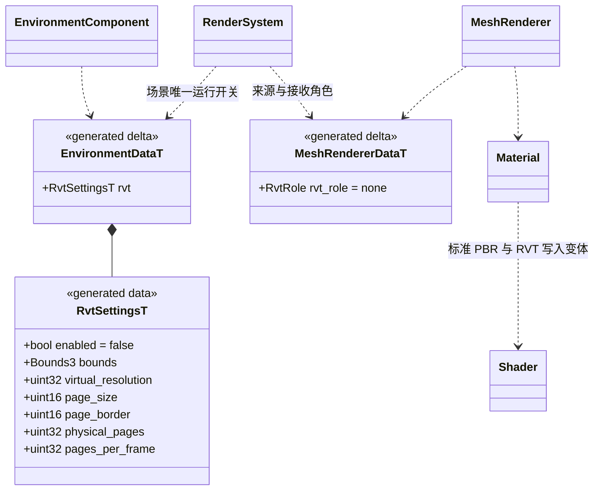
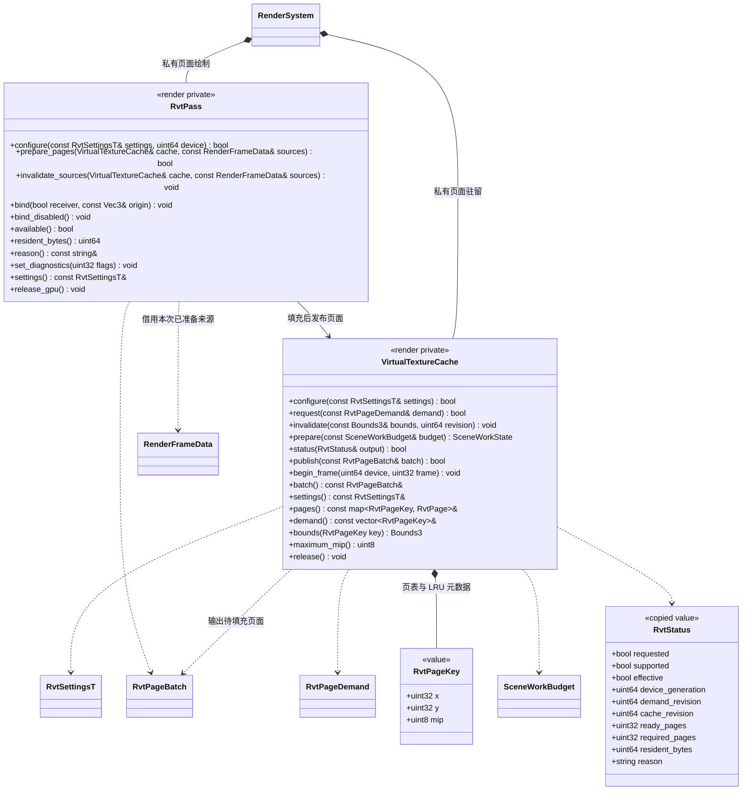
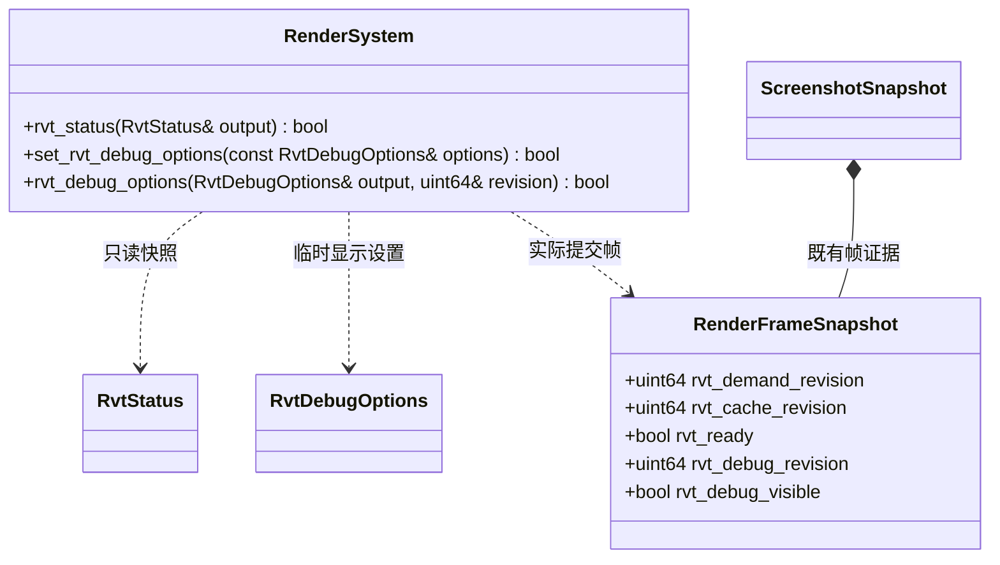
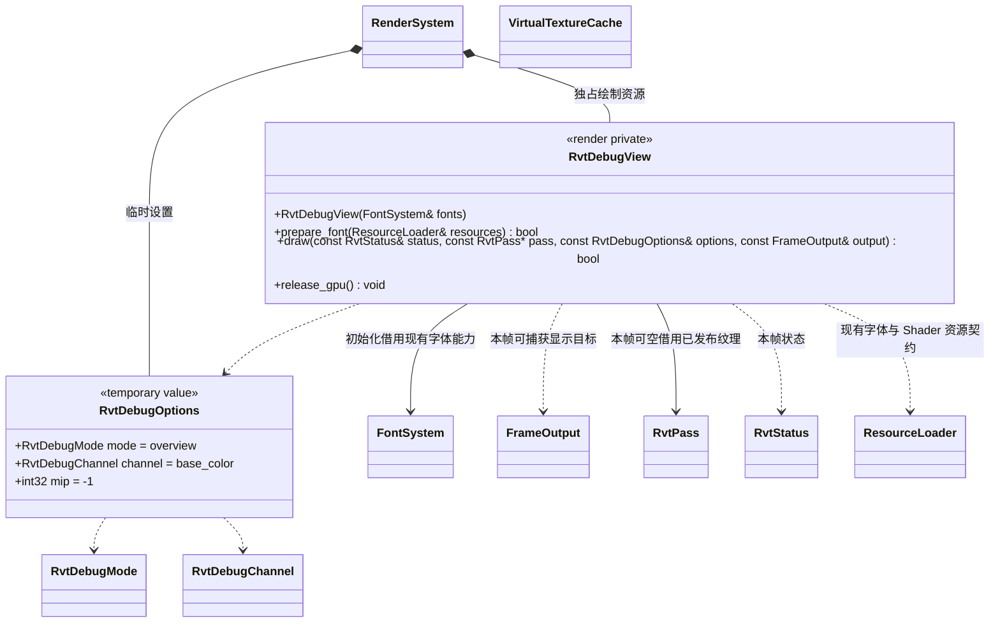

# RVT：材质页面、开关与可替换边界

RVT 在已有 runtime/render 内实现。
本图定义新增职责，不把现有透明阶段 RenderExtension::draw 当作可用的 RVT 前置通道。

## 场景与材质

EnvironmentComponent 的既有 get/set_settings 保存唯一场景开关；没有组件、组件禁用或
rvt.enabled=false 时关闭。按现有环境组件选择规则，不因某个 terrain 出现而隐式启用。
MeshRenderer 的角色枚举 none/writer/reader/writer_reader 只声明用途，不绕过全局开关。
地形生成节点复制 TerrainDataT 中显式配置的角色；普通道路/岩石直接使用同一 MeshRenderer 契约。

页面存储线性 BaseColor、世界法线、Roughness、Metallic、AO，不缓存直接光、动态阴影或显示映射。
编码与通道布局由 Shader 契约固定，材质参数继续按名称与类型访问。
纹理导入的 sRGB/linear、normal 解码、mipmap 和各向异性沿用现有资源配置，
不能用错误色彩空间或参数补偿修饰截图。

本版为世界 XZ 的地表正交投射。来源按明确层优先级/高度规则合成，禁止不稳定 draw 顺序；
有读取角色的写入 pass 必须直接评估源材质，不能读回自己正在写的页。
洞壁、悬垂底面和重叠地下层使用直接三向投射 PBR；接收条件检查高度/法线，
不能把地表颜色投射穿过洞顶。多层体积材质缓存不在本次承诺内。

## 页面与绘制

两类均不是 System，不认识地形密度或建筑损伤。Cache 负责驻留/页表，Pass 负责内容；
后台/主线程和 GPU 所有权遵守原渲染器。page demand 含视图身份、覆盖和 mip；
失效范围及版本通过 invalidate 单独提交。batch 含页键、目标槽、页面版本、需求版本和设备代次，
border 来自缓存配置；这些是拥有型值，不保留 RenderFrameData 借用。

RVT 页绘制在主场景不透明着色之前，由现有 pass 调度分配 view/资源；阴影、Forward PBR、
已有材质和后处理继续复用。不要在透明扩展里晚写页面，也不为 RVT 引入第二条 deferred 渲染管线。
可替换页面分配/淘汰策略必须保持页键、编码、有效版本及绑定契约，不能把 GPU 句柄泄漏给业务。

- 使用普通纹理 atlas、页表和 shader 虚拟寻址，不要求硬件稀疏纹理。各平台按真实能力验证，
  Metal/DX12/Vulkan/WebGPU 不因 API 存在就宣称通过。
- 初始需求和静止测试视图使用确定的可见范围/层级计算；可后续优化反馈，但不能依赖首帧先采到
  未准备页面才能产生需求。预算限制每帧页面和字节，粗级优先避免黑块。
- 一个页面的边界 texel、所有必要通道和 mip 准备完后才替换页表；双缓冲/代次防止 atlas
  槽被旧帧继续采样。未就绪页采同版本有效父页，否则直接评估源 PBR，不读取脏旧槽。
- 地形、道路、来源材质或实例变换变更时失效旧/新包围范围；LOD 变化若材质不变不全图失效。
  颜色/法线页不包含照明，因此普通光源变化无需重烘页。
- 页面请求、source revision、device generation 参与校验，设备重建使 GPU cache 失效，
  使用普通 PBR 并按帧恢复，不能返回旧句柄。
- page border 与 mip/各向异性足迹匹配，法线重新规范化；这部分必须覆盖斜视纹理摩尔纹和页缝验收。

## 关闭、数据与诊断

关闭时立即停止新页请求，下一有效帧全部接收者走直接 PBR；旧页表/atlas 在 fence 安全后释放。
保留源材质、层数据和编辑记录，不删除用户资产。页缓存是可重建运行数据，
不写入地形源或游戏存档；重新开启重建请求，不恢复一份过期 atlas。
若以后增加离线页面烘焙，须另行明确资源生成开关，本次不假定已有烘焙器。

设备不支持时 requested=true、supported=false、effective=false 并给出 reason；
直接 PBR 是可见的已定义降级，不把 RVT 报告为启用成功。
损坏的必要材质/纹理仍按资源错误处理，不能以降级掩盖坏资源。

新增原生查询由 RenderSystem::rvt_status(RvtStatus& output) const 返回独立值；
不在 Engine 增加统计函数。临时 RVT 诊断通过既有 RenderFeature 登记
rvt_viewer/rvt_pages/rvt_residency/rvt_invalidated，编辑器 MCP 直接开关，不保存到组件。
rvt_viewer 是下文的实时贴图面板，另外三项是场景表面的页边界、驻留和失效诊断，
不能用地面色块或页边界线代替实时贴图面板。

为截图观察，RenderFrameSnapshot 新增本帧实际采样的 rvt_demand_revision、rvt_cache_revision
和 rvt_ready；ScreenshotSnapshot 沿用其内含的帧证据。
rvt_ready 表示该帧可见需求在要求 mip 下无过期/缺页，不等于整个世界所有页面常驻。
关闭时按 not_required 处理，不能当作 RVT 质量测试通过。
每次渲染入口先清除当前帧 effective，只有本次主视图成功准备并使用页面时才能重新置位。
无可绘制镜头和电影/清屏帧不继承旧视图的 effective 或 rvt_ready；缓存可以保留供恢复复用，
但 resident_bytes 和旧页数不能证明本帧实际使用。电影帧的 VSM 就绪与诊断可见证据也必须为 false。
固定镜头后等待目标需求就绪，再请求现有 capture_frame 并核对帧里的相同版本；
视域变化后重新等待，不能拿上一镜头的 ready 归档当前图。

## MCP 实时贴图查看器

开启 rvt_viewer 后，编辑器预览或测试运行的同一视口显示
持续更新的调试面板。默认 overview 同时展示以下三项；小窗口按纵向排列，布局相对视口，
不依赖项目 UI 文档、固定窗口大小或手工移动镜头。

| 面板 | 实时内容 |
| --- | --- |
| Virtual Texture | 按世界 XZ 与选定 mip 重建的虚拟贴图概览，标示当前视域/需求范围；未知、未驻留和失效页有不同标记 |
| Physical Atlas | 当前物理图集的真实内容，显示槽位与页边界，可观察页面填充、替换和回收 |
| Page Table | 虚拟页到物理槽的映射及 mip、ready/pending/dirty 状态，带文字图例 |

同时显示 RvtStatus 中的 requested/supported/effective、ready/required pages、resident bytes
和需求/缓存版本。显示文案使用英文；颜色以图例说明含义，不只依靠颜色区分状态。
通道可选 base_color、normal、roughness、metallic、ao；法线和打包通道在查看 Shader 中解码，
BaseColor 仅在最终显示时作正确的线性到显示空间转换，不把调试显示映射写回实际 atlas。

RvtDebugMode 为 overview/virtual_texture/physical_atlas/page_table，RvtDebugChannel 为上表通道；
mip=-1 表示按当前视域自动选择，其余必须为有效层级。RvtDebugOptions 不含 enabled，
唯一开关仍是 RenderFeature::rvt_viewer，避免两处状态。配置原子校验，失败保留原值；
无效枚举和层级不能静默改成另一种视图。只读 getter 为 const，失败输出安全空值。

RvtDebugView 是渲染私有展示类，不是 System 或第二套虚拟纹理缓存。RenderSystem 持有它，
所借用 FontSystem 覆盖查看器生命周期；GPU 清理支持部分初始化和重复调用。
查看器使用引擎内置的诊断字体，来源和许可见[字体说明](../../../third_party/notices/diagnostic-font.md)。
查看器仅在 draw 调用内借用 RvtPass 的当前页表与 atlas，不另造一份纹理句柄模型；
不得把 GPU 句柄传给 MCP、脚本或 UI 业务，不把借用留到下一帧。
没有可用 cache 时 GPU 借用为空，仍用 status 绘制原因；FrameOutput 提供本帧视口和显示目标，
不要求借用 Scene，避免待机状态必须创建假场景。字体或调试 Shader 未就绪时报告实际不可用，
不将命令受理当作面板已画出。

- 每个可提交帧在 RVT 页面发布后取得同一代次的只读视图，直接由 GPU 采样并绘制；
  镜头移动、笔刷修改、页面更新/淘汰在下一实际显示帧反映，不依赖 MCP 反复拉取图片。
- 概览只投影已有页面/有效父页，空缺使用明确占位；查看器不会为补全预览请求全世界页面，
  不更改生产缓存的需求、pin、驻留优先级或 LRU 访问记录。正常页预算继续生效。
- 不逐帧 readback atlas、不每帧编码图片、不通过 CPU 复制整张虚拟贴图。
  仅显式 capture_frame 使用现有异步回读；调试绘制本身有固定屏幕分辨率和开销上限。
- 面板在显示映射及项目 UI 后绘制，处于 FrameOutput 截图/呈现之前；走可捕获的颜色目标，
  不能借用不进入截图的底层统计文字层。页面生成仍在不透明阶段前，两种 pass 职责分开。
- 调试设置或开关改变递增临时 debug revision；RenderFrameSnapshot.rvt_debug_revision
  和 rvt_debug_visible 记录该帧实际呈现的设置与面板，不用“请求已受理”证明界面已显示。
  MCP 可等待相同 debug revision 的可见帧后截图，也可等待关闭后的不可见帧取得干净画面。
- 没有场景、RVT 关闭或设备不支持时显示 No Scene/Disabled/Unsupported 原因，不显示旧场景 atlas，
  不自动启用环境组件的 RVT。设备暂不可绘制时保留请求，恢复后更新，不伪造实时帧。
- 关闭查看器后下一有效帧移除面板，只释放查看器自有资源；不关闭 RVT、不释放生产页。
  反过来关闭 RVT 时生产缓存照常安全释放，查看器显示 Disabled，不能为调试继续保活旧页。
  调试请求可跨预览/玩法切换保留，场景和设备变化时撤销旧 GPU 借用；重启不恢复这些临时设置。

MCP 通过现有 set_render_feature 开关；可选通道/模式设置见
[渲染命令](../../editor/class-diagrams/render-commands.md#rvt-实时调试)。
编辑器和测试运行端点共用原生契约；正式运行包不因此增加 MCP 端点。
