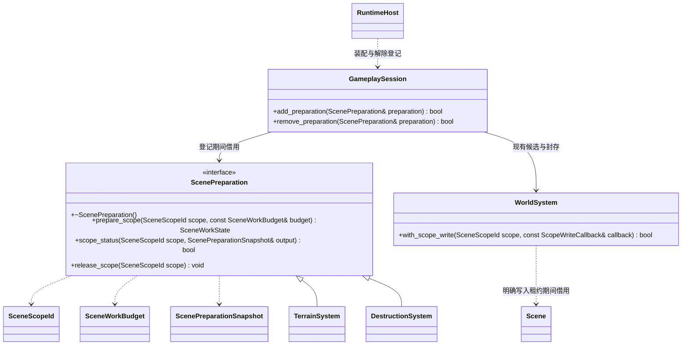

# 插件参与既有场景准备

这是[现有场景加载](scene-loading.md)的必要扩展，
不替换 GameplaySession、不新增加载器，也不把地形特判写入核心。
地形组件需要在场景封存前展开初始瞬态节点，不能等场景已进入后才开始生成碰撞。

RuntimeSetup 的装配输出包含借用的 ScenePreparation 指针列表。宿主创建具体插件时加入列表，
RuntimeHost 在 GameplaySession 构造后逐项登记；空指针、重复项或登记失败使初始化完整回滚。
提供者由世界子系统拥有，GameplaySession 先关闭，再释放世界；核心不识别具体插件。

ScopeWriteCallback 是 bool(Scene&) 的调用期函数借用，图中缩写不新增包装类。
WorldSystem 只在已有、未封存的指定 scope 上开启一次协调线程写阶段，禁止重入和跨回调保存借用；
失败恢复写阶段但不会把回调的任意副作用当作自动撤销，提供方必须先准备候选再追加。
不判断调用者是编辑器还是业务。普通旧候选写句柄在受理 prepare_scene_load 后失去写权限，
只有显式 scope 写租约可在扩展阶段修改；封存后所有写入一律拒绝。

## 生命周期与顺序

- RuntimeHost 在创建 GameplaySession、装配世界插件后登记借用；开始场景加载前完成登记。
  实现由世界子系统拥有；先停止会话并释放所有 scopes，再解除登记，最后关闭插件。
  有在途 scope 时拒绝增删登记，不持有悬空函数地址。
- prepare_scene_load 先冻结调用方的候选编辑，进入现有 preparing；
  GameplaySession 按 SceneWorkBudget 调用登记提供方。提供方后台只做私有计算，
  协调线程通过 with_scope_write 把自己拥有的完整结果加入同一候选。
- 提供方只扩展所属组件的生成物，不能删除其他提供方节点或发布范围。完成后返回 ready；
  未选择插件但场景声明了其必需组件时明确失败，不能略过并报告场景 ready。
- 所有提供方 ready 后封存最终节点与依赖，继续既有 World/Render/Physics/Animation/UI 准备。
  提供方不另行加载整个项目，不自建 GPU/物理世界。
- 所有原生准备就绪后沿用既有 ready → activating → 首帧 → active。
  地形准备计入同一 stages，初始显示或碰撞缺失不能满足进入场景条件。
- prepare/status/release 均属于明确 scope，多个候选可并存；只读 status 不推进任务。
  release 取消私有工作并清理未发布生成物；已经转移给活动组件的状态不能被误删。
- 场景替换、取消、owner 失效仍由原 SceneLoadId/SceneScopeId 表达，不增加另一套场景请求 ID。

这是面向已有领域生成物的最小三方法契约，不是插件 Manager，也不要求所有插件继承它。
RenderExtension 已有的 GPU 准备继续位于渲染阶段；地形初始展开不能冒充透明绘制扩展。
