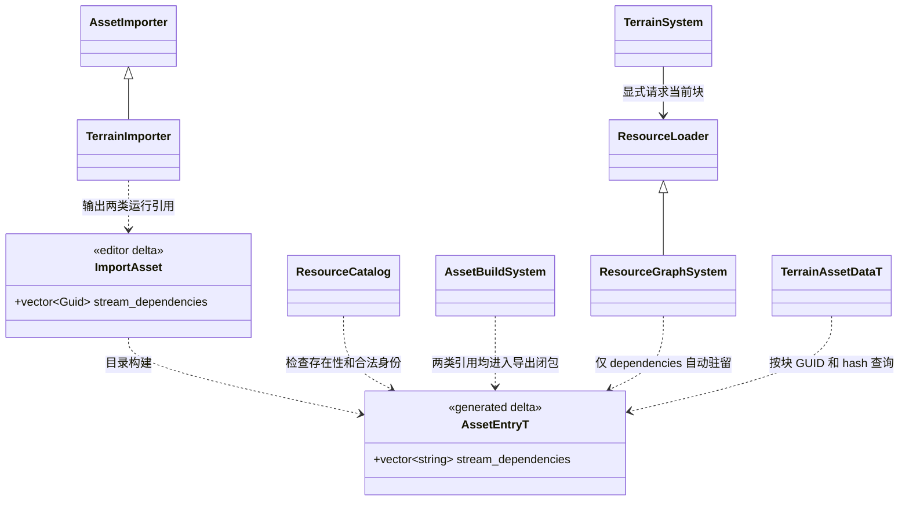

# 区域资源：导出引用与驻留依赖

这是现有目录/导入/资源图的最小语义扩展，
使整个世界随包交付，但启动只加载索引与明确需要的块。

这里只定义新增字段。AssetEntryT 的 dependencies 仍表示必须一起加载和保活的依赖；
stream_dependencies 表示运行包必须包含、但由消费者显式加载的资源。
ImportAsset 原有 build_dependencies 是制作输入/增量依赖，不能拿它冒充打包可达性。

- 导入器识别真实引用，输出普通依赖和流送引用；基础管线不按地形类型写特例。
- 导出器递归包含两类引用和各自闭包，拒绝缺失/冲突引用，包含全部需要的区域 GUID；
  遍历有去重，运行依赖循环仍按现有规则拒绝。离线删除或按入口裁剪不得漏掉流送项。
- ResourceCatalog 验证两类 GUID 都可定位；保持元数据快照，不读块载荷。
  ResourceGraphSystem 自动加载和引用计数只跟随 dependencies；
  stream_dependencies 不产生长期载荷引用，不能因为父索引存活就让整张地图驻留。
- TerrainSystem 用注入 ResourceLoader 的 begin_load/get/release 获取块，每个请求独立持有引用。
  运行时不直接拼 gen 文件路径，不绕过资源图另建全局块加载器。
- 清单发布时 world GUID、各块 GUID/hash 和材质必须一致；跨目录版本的旧请求不能拼到新世界。
  对缺块或 hash 不匹配报告失败，不退回另一包或现场猜测生成。
- 压缩/合包允许按区域随机读取，沿用 FileLocation 的 mount/path/offset/length；
  不能为了读取一个块先把整个世界包解压进内存。
- 目录格式版本直接更新，所有 codec、资源图、构建/同步工具、测试及项目缓存一起更新。
  不读旧目录，不保留“没有 stream_dependencies 就全部自动加载”的兼容分支。

运行期状态保存不写回 catalog，用户修改属于持久存档；导出仍是只读基础资源。
该字段是通用的延迟引用语义，不将 TerrainRegionKey 或项目区域策略加入核心目录。
