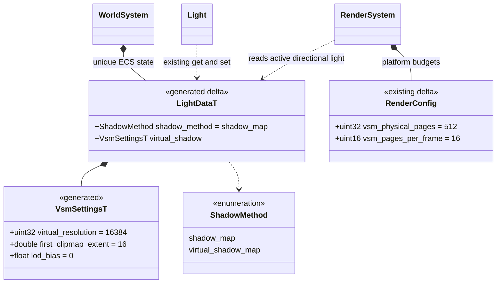
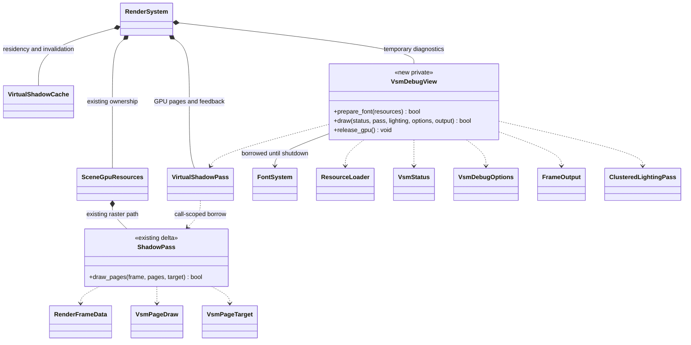
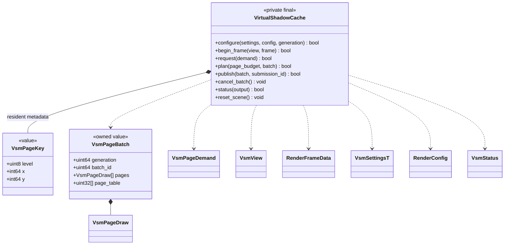
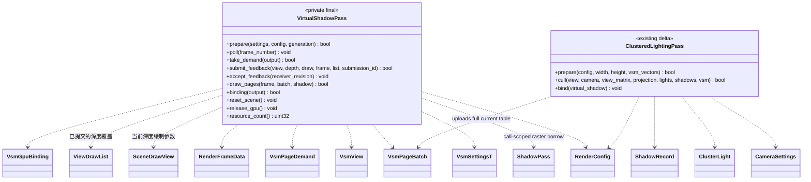
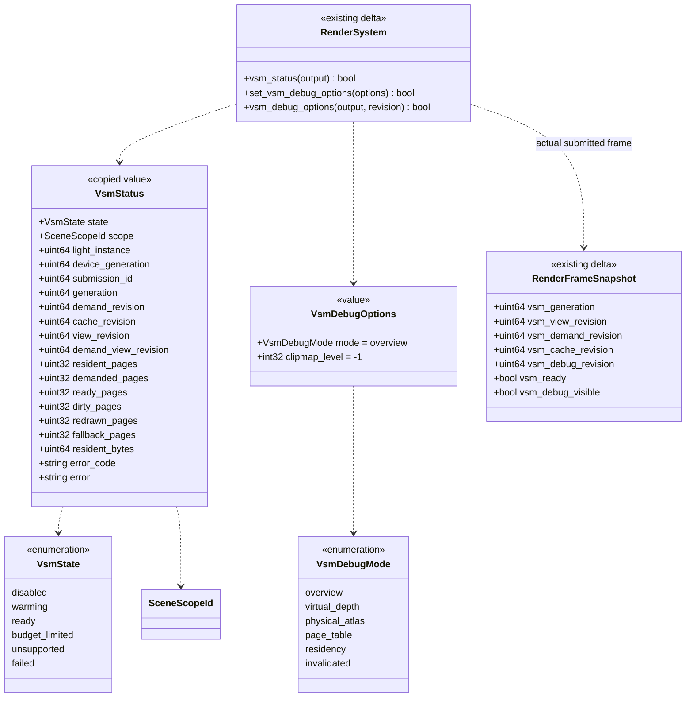

# VSM：方向光虚拟阴影贴图

**状态：当前实现契约。** 主视图方向光可选择 VSM；常规 CSM、局部灯阴影图集及 PCF 继续使用。
验证平台和限制统一见[测试文档](../../testing.md#方向光虚拟阴影)。

[类图索引](../../class-diagrams/index.md) · [当前阴影管线](forward-lighting-reflections.md) ·
[帧提交与资源](render-submission.md) · [RVT](runtime-virtual-texture.md) ·
[脚本增量](../../plugins/runtime/class-diagrams/virtual-shadow-script-api.md) ·
[MCP 接入](../../editor/class-diagrams/render-commands.md#vsm-接口)

## 范围

- 沿用分簇前向渲染、标准 PBR、可采样 D32F 深度与 PCF。为主观察者的一盏方向光提供分页阴影；
  编辑器预览与玩法使用同一主观察者入口。点光、聚光、透明接收者、平面反射和烘焙捕获继续使用现有阴影。
- 光源的生产模式保存在 Light 组件。唯一启用投影的方向光仍由现有规则选择；
  新模式默认关闭，不在 Environment、Scene 或 RenderSystem 再放一份场景开关。
- 动态角色、地形编辑、建筑破坏和资源热重载必须参与页面失效。来源是已经发布的普通渲染数据，
  VSM 不链接地形、破坏或脚本插件，不识别项目类型。
- 新增三个私有行为类：VirtualShadowCache、VirtualShadowPass、VsmDebugView。
  不新增 System、插件、场景加载器、通用 Manager 或另一套渲染后端。
- 第一版保留 CSM 底图，提供缺页、脏页及未覆盖接收者的完整阴影。这会保留 CSM 绘制成本；
  目标是分页质量与正确缓存，不提前承诺帧率提升。SMRT、VSM 局部灯、GPU Meshlet 阴影剔除与静动双缓存不在首版范围。

## 生产配置：一个组件状态来源

Light 与 LightDataT 的既有基础方法、值句柄和 ECS 所有权见[基础组件](component.md)。
新增持久字段由 `include/schemas/runtime/scene.fbs` 唯一生成，不增加手写的第二份光源模型。

| 操作 | 目标行为 |
| --- | --- |
| `cast_shadows=true`，`shadow_method=virtual_shadow_map` | 方向光开启 VSM；CSM 继续提供完整底图 |
| `shadow_method=shadow_map` | 关闭 VSM，恢复纯常规阴影；停止反馈和页生成，回收专用缓存 |
| `cast_shadows=false` 或禁用/移除该 Light | 关闭该光源全部实时投影，清除其 VSM 页和状态 |
| 点光/聚光设为 `virtual_shadow_map` | 配置明确失败，原组件值保持不变；不接受无效开关 |
| 缺少方向灯 | 不自动创建灯，不自动开启 VSM |
| 修改分辨率、灯方向或投影深度编码 | 失效旧页并拒绝旧投影反馈；设置变更重新建立代次，按预算填充 |

`Light::get_settings(Data&)`、`Light::set_settings(const LightSettings&)` 保持既有签名；
编辑器、原生业务和脚本均修改同一组件。已有 `shadow_distance` 决定覆盖距离，
`shadow_resolution/cascades/split_lambda/cascade_blend` 继续控制 CSM 底图，
不会被解释为虚拟页数。生产模式属于当前支持的两种算法，不保留旧接口或旧格式转换。

VsmSettingsT 的参数约束：

- `virtual_resolution` 为 4096、8192、16384 或 32768，表示每级虚拟地址空间的边长。
- `first_clipmap_extent` 为最近一级的半边长，单位米，有限且大于 0。后续级别覆盖范围逐级翻倍，
  级数由阴影距离推导；内部上限为 16，覆盖不足明确报错，不静默裁短阴影距离。
- `lod_bias` 为有限值，范围 [-2, 4]，控制接收像素需求的分辨率选择。
- 页内尺寸固定 128×128、边界固定 4 像素，覆盖现有 PCF 足迹；首版不增加可调页格式。
- `vsm_physical_pages` 与 `vsm_pages_per_frame` 是平台资源预算，接入已有汇总运行设置。
  默认 512 页、每帧最多生成 16 页；具体上限由纹理、缓冲、内存及 bgfx view 数量共同校验。
  预算大于 0 不代表功能已启用，运行时不读取项目 TOML。

VSM 使用普通纹理和缓冲实现软件分页。源网格、材质不需要生成专用 VSM 离线资源，
也不要求先生成 Meshlet 数据；阴影缓存不写进资产、场景文件或游戏存档。
Scene/Prefab 当前格式为 6；编解码、TS 生成数据与项目调用方统一升级，源资源重新导入生成缓存；
不在运行时添加历史版本读取分支。

## 所有权与现有通道复用

`*--` 为独占拥有，`-->` 为生命周期覆盖期间的借用，`..>` 为参数或调用依赖。
已有类在这里仅标明接入关系；其原有完整契约仍由所属类图维护。

- VirtualShadowCache 只拥有 CPU 页面、驻留和来源修订记录，不拥有 GPU、Node 或 Component。
- VirtualShadowPass 拥有物理深度图集、深度测试目标、页面 framebuffer、GPU 需求位图及有界回读槽。
  CPU 回读存储由该对象持有到请求完成，不能随 SceneGpuResources 一起提前销毁。
- ShadowPass 继续由 SceneGpuResources 的 PassTargets 独占；新增页绘制入口复用已有投射物筛选、
  蒙皮顶点、alpha 裁切、材质绑定、实例化及深度 Shader。VirtualShadowPass 仅在调用期间借用它。
- VsmDebugView 借用已有 FontSystem，用内置诊断字体和标准字体资源加载链；它不拥有或驱动页缓存。
  三个新类均位于 `engine::render_detail`，实现放在 `src/engine/runtime/render/vsm/`。
- WorldSystem、场景加载与 GeometryUpdate 维持现有归属。物理/渲染共同发布的新几何成为下一帧 VSM 的输入；
  未发布候选不能使活动场景的缓存失效。

ShadowPass 的唯一新增提交接口：

`bool draw_pages(const RenderFrameData& frame, std::span<const VsmPageDraw> pages, const VsmPageTarget& target)`

VsmPageTarget 是本次调用借用的目标 framebuffer、布局及深度格式值，页内投影、边界和 view ID
由 VsmPageDraw 给出。它们是内部值数据，不是公共 GPU 接口。该方法不分配页、不改变页表、不判断项目，
只提交已经计划的阴影绘制，失败返回 false。页面使用灯光投影筛选投射物，不能复用主相机的可见物列表。

VsmDebugView 的完整契约：

- `explicit VsmDebugView(FontSystem& fonts)`：借用须覆盖对象生命周期。
- `bool prepare_font(ResourceLoader& resources)`：复用内置字体和 Shader 的既有异步准备，不另建字体系统。
- `bool draw(const VsmStatus& status, const VirtualShadowPass* pass, const ClusteredLightingPass* lighting, const VsmDebugOptions& options, const FrameOutput& output)`：
  GPU 对象只在调用期借用；没有有效图集时仅显示状态，不显示旧场景纹理。
- `void release_gpu() noexcept` 与析构兜底：幂等释放自身显示资源，不释放缓存所属资源。

## CPU 页面契约

方法中的完整参数类型如下；可能失败的方法均使用 `[[nodiscard]]`：

| 方法 | 责任与结果 |
| --- | --- |
| `bool configure(const schema::VsmSettingsT&, const RenderConfig&, uint64_t generation)` | 校验布局与容量，建立当前代次；配置失败不留下半套映射 |
| `bool begin_frame(const VsmView&, const RenderFrameData&)` | 复制必要身份、世界包围范围与修订，计算失效；不保存帧指针或 ECS 列 |
| `bool request(const VsmPageDemand&)` | 接收同一代次、同一光源的需求；失效身份拒绝且不修改当前需求 |
| `bool plan(uint32_t page_budget, VsmPageBatch& output)` | 从有限预算选取缺页/脏页，预留槽及页版本；失败清空输出 |
| `bool publish(const VsmPageBatch&, uint64_t submission_id)` | 核验批次、代次及页版本，在页绘制和当前光照缓冲上传都成功受理后发布映射 |
| `void cancel_batch() noexcept` | 释放未提交预留；旧脏页保持无效，不重新当成可用缓存 |
| `bool status(VsmStatus& output) const` | 只读复制 CPU 缓存事实，不 dispatch、不回读、不等待 |
| `void reset_scene() noexcept` | 清空需求、来源记录和映射；不触碰其他渲染模块 |

VsmView 是当前主观察者的拥有型参数值，包含 SceneScopeId、设备/缓存代次、方向灯组件实例、
观察者身份、视图修订、双精度世界原点、稳定灯基、clipmap 原点和深度范围。
VsmPageDemand 保存产生需求时的同一身份、视图修订和提交号，以及去重后的页键/优先级；
不保存镜头、世界或帧结构的指针。普通镜头移动产生的新需求可以与已有稳定世界页共存，
切镜头、瞬移、换光或换场景则拒绝不匹配的旧反馈。
调用方丢弃已过期反馈，继续请求当前视图；这不是当前场景的运行失败。

页键用灯基中的双精度位置计算为整数世界网格坐标，GPU 只使用局部页坐标。
不得把每帧相机相对原点当作持久键，否则相机移动会错误地全缓存失效。
同级深度投影范围保持稳定；确需扩展时该级所有旧深度页失效，不能用新矩阵解释旧深度。

VsmPageBatch 还包含每页的目标槽、页版本、完整带边界投影，以及本帧完整页表和 clipmap 元数据；
不持有 RenderFrameData 中的借用。即使没有新页绘制，也必须提交含撤销映射的当前页表，
不能只上传新页而遗留脏页、已淘汰页或旧场景条目。页面分配状态为 missing/dirty/planned/resident，
只有 resident 且版本匹配的页能被着色器使用。淘汰时先撤销映射，再在 GPU 有序执行下复用槽。
计划表可引用本批将写入的页，但只有整批提交成功才成为可采样的帧状态；
绘制或光照上传失败使该帧提交失败并撤销未发布批次，不把旧表继续冒充当前表。
每个主观察者每帧只形成一个批次；反射和烘焙不能复用或覆盖它。

## GPU 页面与需求反馈

| 方法 | 完整契约 |
| --- | --- |
| `bool prepare(const schema::VsmSettingsT&, const RenderConfig&, uint64_t generation)` | 校验 compute、原子位图、缓冲回读、纹理格式和容量，建立专用资源；失败清理候选 |
| `void poll(uint32_t frame_number)` | 在协调线程检查已发起回读的完成帧，不等待 GPU |
| `bool take_demand(VsmPageDemand& output)` | 取走一个完整需求值；未完成或没有结果返回 false 并清空输出；过期代次直接丢弃 |
| `bool submit_feedback(const VsmView&, bgfx::TextureHandle depth, const SceneDrawView&, const RenderFrameData&, const ViewDrawList&, uint64_t submission_id)` | 借用当前深度及已提交的覆盖输入。完全匹配的已接收或在途需求可复用，其余情况提交需求标记和位图回读。槽满时保留最近需求并返回 true，实际错误返回 false |
| `void accept_feedback(uint64_t receiver_revision) noexcept` | 调用方在 `VirtualShadowCache::request` 接收完整需求后确认该深度输入可复用 |
| `bool draw_pages(const RenderFrameData&, const VsmPageBatch&, ShadowPass&)` | 借用已有阴影绘制，按预算填完整页与边界，不独立采样骨骼或重建网格 |
| `bool binding(VsmGpuBinding& output) const` | 返回调用期可用的物理图集及寻址布局；失败清空句柄 |
| `void reset_scene() noexcept` | 停止旧代次提交，使结果失效；保留仍在被 GPU 写入的 CPU 回读存储 |
| `void release_gpu() noexcept` | 幂等销毁 GPU 对象；不提前释放尚在途的 CPU 地址 |
| `uint32_t resource_count() const noexcept` | 纳入既有资源统计 |

`VirtualShadowPass` 拥有深度输入签名与接收面修订。签名逐字段包含视图和深度目标、绘制范围、几何与资源身份、实际实例变换路径、材质参数与采样设置。加入、删除或移动参与深度的普通物体同样更新接收面修订，即使它不投射阴影。自定义 Shader、变形顶点与帧贴图继续逐帧提交。回读值携带提交时的接收面修订，只有已被缓存接受的同修订需求允许后续帧跳过反馈。相同修订已在途时只保留一次读取。关闭场景或重建设备时随现有资源一起失效。

物理图集为单张可采样的 D32F 深度附件，诊断视图和光照直接读取深度。反馈计算每个线程检查相邻的 2×2 深度像素，分别计算页地址，对写入同一个位图字的需求先合并掩码。屏幕边缘只读取有效像素，回读位图保持全分辨率覆盖。

ClusteredLightingPass 只在原方法中增加必要参数，不新增平行上传入口：

- `bool prepare(const RenderConfig&, uint16_t width, uint16_t height, uint32_t vsm_vectors)`：
  vsm_vectors 是按已校验设置计算的页表与元数据分区容量（16 字节单位），0 表示该视图不用 VSM；
  乘积、偏移和设备上限在分配前检查。
- `bool cull(bgfx::ViewId, const CameraSettings&, const float* view_matrix, const float* projection, std::span<const ClusterLight>, std::span<const ShadowRecord>, const VsmPageBatch* vsm)`：
  末项为本次调用借用；nullptr 明确清除本视图的 VSM 记录。一次上传组合灯、常规阴影与完整当前页表，
  保持每个相机各自的缓冲；不得在同一 bgfx 帧中反复更新已被其他视图引用的 handle。
  所有调用方使用当前签名。
- `void bind(bool virtual_shadow) const`：绑定同一灯缓冲；只允许主视图不透明接收者采样虚拟页。
  透明、反射及烘焙显式传 false，不覆盖它们的场景深度纹理槽。

物理图集沿用现有 RGBA 打包深度，使用经过设备验证的 D32F 深度测试目标；
PCF 比较后滤波、接收平面修正与页边界规则共用当前阴影实现。
不直接对打包深度做线性插值，不让 PCF 读取相邻无关物理页。

### 当前绑定槽与执行顺序的接入约束

现有不透明材质占用 0..4，灯数据缓冲为 5、Lightmap 为 6、分簇索引为 7，
RVT 为 8/9、AO 为 11、IBL 为 12..14、常规阴影为 15。
因此首版不再额外占两张 VSM 纹理槽：

- 物理 VSM 深度图使用不透明通道空闲的槽 10。
- 页表、clipmap 元数据加入既有灯光/阴影 GPU 缓冲的独立分区，由 ClusteredLightingPass 统一布局和上传；
  保留原灯列表及局部阴影记录，不创建另一套分簇光照。
  页表整数编码明确，不能用浮点数近似存放大整数。
- VsmGpuBinding 只描述本次可用的图集与寻址数据；缓冲仍归 ClusteredLightingPass。
  现有内部准备参数传入当前完整页表，并核验容量和分区偏移。
- 透明通道的槽 10 已用于场景深度，因此首版透明接收者继续采 CSM。
  反射、烘焙与不遵守 VSM 采样契约的自定义 Shader 同样使用已有阴影。
  不能通过覆盖槽位让 RVT、折射、Lightmap 或 IBL 失效。
- 主 Shader 的绑定布局、内置程序和导入工具指纹同步升级并重编；
  不能只改原生绑定而继续加载旧 Shader 缓存。

每帧的实际 GPU 依赖为：

1. 协调线程 poll 前期需求；收集当前已发布网格和光源，失效受影响页，形成当前有限批次。
2. 蒙皮先完成，常规 CSM/局部阴影正常提交；页面绘制使用同一份有效顶点。
3. 主深度/表面通道输出接收者深度；GPU 标记需求，回读只影响后续帧的计划。
4. 绘制本帧计划的虚拟阴影页，包含全部边界；成功安排后将当前完整页表与光照缓冲提交一次。
5. 主不透明着色先查询 VSM。虚拟页可以采样时执行该页的过滤。VSM 不可用、缺页或投影越界时才执行同帧 CSM 过滤。随后沿用透明和后处理。
6. 调试视图在最终显示之后、截图之前绘制，反映该提交帧实际使用的 GPU 数据。

`render_constants.hpp` 统一分配 view ID，并由现有提交处给出显式 view 执行顺序。
CPU 调用先后不等于 bgfx 执行顺序；不能让当前编号较大的页绘制在主着色之后才执行。
新顺序需覆盖现有 RVT、反射、主视图、烘焙、UI 与截图，并验证最大 view 数量。
GPU 写页、更新页表、读取页表必须在同一受控顺序内，失败不得发布半成品。
CPU 的 published 表示有序 GPU 命令已受理，截图完成才证明相应帧已实际执行；不为此同步等待 GPU。
缓存对象不把全引擎渲染提交错误吞掉；GPU 错误沿用 RenderSubmitStatus 的既有失败处理。
RVT 与 VSM 同时开启时的调试面板由当前渲染输出统一安排矩形，不重叠、不互相覆盖绑定。

## 失效范围与画面正确性

| 变化 | 失效方式 |
| --- | --- |
| 镜头平移 | 根据稳定页键请求新可见页，已有有效页复用 |
| 切镜头、瞬移、投影或窗口变化 | 更新观察者修订，拒绝不匹配反馈；未覆盖区域使用 CSM |
| 光方向、clipmap 深度编码、源分辨率改变 | 相关光缓存整体或相关级失效，并增加对应代次/版本 |
| 物体移动、增加、删除、启用或 cast_shadows 改变 | 按旧范围与新范围的并集投影失效；删除也必须保留旧范围用于移除残影 |
| 蒙皮、顶点变形、地形挖填、建筑碎块或 LOD 改变 | 使用现有几何/变形修订及保守包围范围，失效覆盖页 |
| alpha 贴图、裁切阈值、UV 或相关 Shader 改变 | 使用材质绑定和资源发布修订，失效覆盖页 |
| 不影响投影的纯颜色参数改变 | 不要求失效阴影页 |
| 设备重建、世界卸载、方向灯删除再创建 | 失效 GPU 句柄、页表和在途反馈；组件实例身份防止旧结果复活 |

普通变换、几何、材质和来源资源必须逐项比较有效修订/身份，
不能只靠 `scene.content_revision`，也不能只比较变换矩阵。
框架无法跟踪的 Shader 顶点位移不得复用陈旧缓存；首版仅允许遵守既有阴影顶点契约的投射物，
由 CPU/GPU 蒙皮与显式变形入口提供可靠位置和范围，不宣称支持任意自定义位移。

页失效即停止采样旧内容，不能继续显示移动前或破坏前的阴影。
CSM 底图仍按当前帧更新；与 VSM 的切换只在兼容投影和接收深度下执行，
边界过渡必须覆盖阶梯、斜面和页缝用例。质量不足时不能用加大 bias 隐藏错误。

## 状态、开关与实际帧证据

原生只增加三个渲染服务方法：

- `bool RenderSystem::vsm_status(VsmStatus& output) const`
- `bool RenderSystem::set_vsm_debug_options(const VsmDebugOptions& options)`
- `bool RenderSystem::vsm_debug_options(VsmDebugOptions& output, uint64_t& revision) const`

只读方法不改变页缓存、不发起 GPU 工作；输出均为独立值。
VirtualShadowCache::status 只填 CPU 需求与驻留事实；RenderSystem 在同一协调线程补齐设备、
提交、能力与 GPU 分配信息。VsmGpuBinding 保存专用 GPU 分配字节数和图集布局值，
灯缓冲页表分区按已校验容量单独计入，关闭后不返回上次分配的统计。
诊断可见性使用现有 `set_debug_feature(RenderFeature::vsm_viewer, bool)`，
不增加第二个可见性 setter，更不通过这个接口改 Light.shadow_method。
Options 校验失败保留旧设置；成功修改递增 debug revision。

VsmStatus 身份必须与设备、场景、方向灯实例及最后提交相符：

- demanded/ready/fallback 统计最近完成需求样本，ready 仅计匹配版本的需求页；
  resident_pages 另外表示保留的全部有效物理页，redrawn_pages 为最近一次提交的页数。
- `view_revision` 表示当前观察者位置/投影/尺寸；`demand_view_revision` 为反馈采样时的修订。
  移动期间允许复用页，但不能把旧视角的完整需求标成当前视角已经 ready。
- `ready` 要求当前视图的反馈已完成且所有需求页有效；`warming` 表示反馈/填页在途；
  `budget_limited` 表示当前需求超出物理容量。更新预算导致的分帧填充保持 warming；缺失部分均由 CSM 覆盖。
- `unsupported` 为能力不满足，`failed` 为资源、程序、编码或提交错误。明确请求的 VSM
  在不支持平台上使准备返回失败并给出原因，不能静默报告成功。
  预算内的已定义 CSM 底图使用与设备不支持是不同情况。
- `resident_bytes` 统计专用 GPU 图集、页表分区、反馈及暂存资源的实际分配，
  不把虚拟地址空间像素数当作物理占用。

RenderSystem::prepare_scope 复用现有准备链，校验 VSM 能力、配置与预算，并准备 CSM 所需资源。
候选场景的准备不能提前重置活动观察者的页缓存。正式切换到新主观察者后，
VirtualShadowPass::prepare 才按新代次准备专用图集和反馈资源；分配失败明确报告，不能标成 ready。
普通状态查询仍描述当前活动范围。场景可在完整常规阴影资源就绪后进入，
虚拟精细页在活动帧按预算填充，不要求等待整幅虚拟阴影；
场景 ready 不等于 VSM ready。严格的 VSM 截图需固定镜头，等待状态 ready，
核对本次 scope、generation、view/demand/cache revision 和 RenderFrameSnapshot 的实际帧证据。

## 调试显示与关闭生命周期

开启 vsm_viewer 默认显示同一实时视口中的三个面板：Virtual Depth、Physical Atlas、Page Table。
可选 clipmap_level=-1 优先显示需求页最多的一级；活动 VSM 的具体级为 0..当前级数-1。
未启用时允许预设 0..15，切换到级数更少的场景时显示会限制在该场景的有效级内。
residency 与 invalidated 模式同时提供场景表面色块，文字图例区分缓存命中、刚更新、缺页与脏页；
实际 atlas 和页表仍可见，不能用线框代替缓存图像。显示文案使用英文。

所有调试操作通过编辑器 MCP 完成；视图状态不写 Scene/Prefab、项目配置或撤销记录。
关闭生产 VSM 后，面板若保持开启只显示 Disabled，不保留旧场景的贴图。

- 场景替换和模式关闭立即增加代次，停止新请求，解除当前绑定并回到普通阴影。
  页表和图集通过 bgfx 正常有序销毁回收；源网格、材质、RVT 与 Meshlet 数据保持各自生命周期。
- 当前场景无可绘制镜头或内容时同样释放 VSM，状态为 disabled，不把上一次观察者的 ready
  带到清屏帧。恢复可绘制视图后重新建立代次与需求。
- 未完成 GPU 回读的 CPU 内存必须留到该请求完成，回读槽数量固定且有上限，不能因切场景无限增长。
  空闲呈现继续 poll；窗口临时挂起期间仅保留必要存储，不等待设备。
- 引擎关闭顺序为停止新提交、release_gpu、bgfx::shutdown 完成、销毁 Pass 及 CPU 回读存储。
- 重新开启不恢复过期页；重新建立代次和需求。缓存不是存档数据，不提供“删除项目文件”式关闭流程。

## 验证入口与边界

公开范例使用标准几何与 PBR，私有真实资源只在本机验证，不进入 Git。
原生回归复用 `engine.render_foundation`、`engine.render_submission` 和场景/配置用例；
编辑器入口与截图归档见[公开 VSM 场景](../../../projects/showcase/docs/virtual-shadows.md)。
截图需带 scope 与实际帧证据，CPU 页状态不能替代真实 GPU 图。

首版保留完整 CSM 成本，不宣称性能提高。局部灯 VSM、SMRT、静动双缓存和 Meshlet 阴影剔除未实现。
跨平台运行、设备恢复以及每一种蒙皮/地形/破坏组合的验证范围，以[测试记录](../../testing.md#方向光虚拟阴影)为准。

## 来源与现有实现入口

分页、按屏幕需求生成、方向光 clipmap 和失效原则参考
[Epic 官方 Virtual Shadow Maps 文档](https://dev.epicgames.com/documentation/en-us/unreal-engine/virtual-shadow-maps-in-unreal-engine)。
本方案自行定义与现有引擎相符的 CPU/GPU 边界，不搬运 Unreal Engine 源码。

深度栅格、材质裁切、CSM 与 PCF 复用仓库已适配的
[bgfx 阴影示例](https://bkaradzic.github.io/bgfx/examples.html#shadowmaps)及其固定来源；
具体版权与变更见[现有渲染来源](../rendering-sources.md)。
现有源码入口：`passes/shadow_pass.*`、`passes/shadow_frame.*`、
`render_scene.cpp`、`scene_draw.cpp`、`render_constants.hpp`。
RVT 的 VirtualTextureCache 依赖世界 XZ 与材质页语义，保留原职责；
本次只复用既有资源、任务、字体、观察与截图能力，不先把两个缓存改成通用 Manager。
