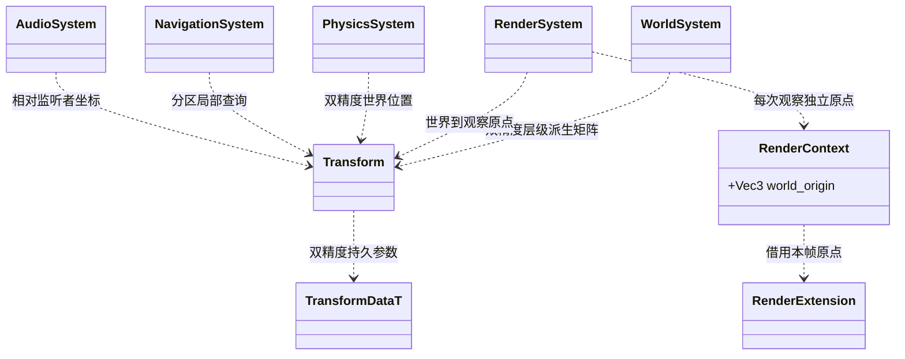

# 大世界坐标与精度

Transform 参数、层级派生矩阵及物理世界位置使用 double；GPU、局部形状与导航单区计算仍使用 float。
先在 double 中减去观察/局部原点再转换，不增加 OriginManager，不搬动持久节点。

Transform 的唯一方法定义在[组件图](component.md)；签名为
world_matrix(double* output)，删除 float 输出签名和兼容重载。world_origin 位于
RenderContext，Vec3 使用既有 schema 的 double；其他字段不在本页重定义。

- WorldSystem 层级派生矩阵保持 double，父子乘法不能先丢精度。
  资源顶点继续局部 float；镜头、光源、阴影、剔除和实例化在 double 中减去本次观察原点，
  再构造 GPU float 矩阵。不能先把绝对平移转 float 再相减。
- 每个主视图、反射/捕获和阴影视图携带明确 origin。RenderExtension、粒子、线框、
  3D 文字都使用本次上下文；RVT 页键仍用稳定世界坐标，不因镜头改变整体失效。
- Jolt 使用其双精度位置配置；位置/RVec3/射线/接触/角色写回全链路不经 Vec3(float) 截断。
  shape 顶点和速度仍可为局部 float。只改构建开关但保留旧转换不算完成。
- 导航几何和查询按已加载的局部分区计算，世界位置到局部坐标先减 double 分区原点，
  返回结果再恢复世界坐标。既有 NavigationSystem 需覆盖实际使用的查询、瓦片更新与代理；
  未加载分区不能承诺可通行，不把一次单区寻路宣称为全世界跨区寻路。
- 音频使用监听者相对位置；效果的持久位置用世界/分区坐标，不能因视图原点改变而漂移。
  整个核心仍不识别 TerrainRegionKey，分区属于调用方明确提供的坐标范围。
- 无需修改节点持久位置以“搬动世界”，不把每帧视图原点写入场景或存档。
  8×8 公里四角、地下和分区边界需验证拾取、碰撞、阴影、效果及截图位置一致。

这里的保证针对已覆盖的有限世界范围与活动窗口，不宣称无限坐标、多物理世界或全球导航均已实现。
